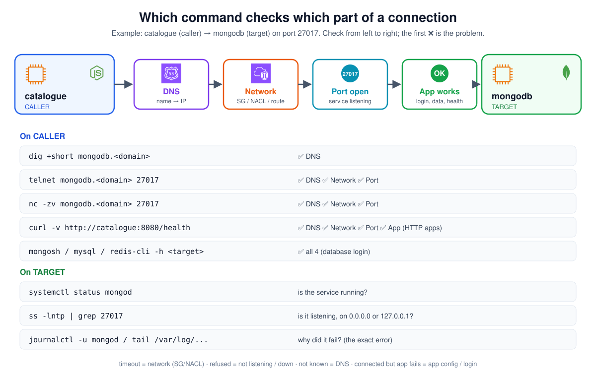

# Connection Check Commands: systemctl, ss, telnet, nc, curl, dig, journalctl

Which command to run, **on which server**, **when**, **what it checks**, and **what each output means**.
Examples are real outputs from my RoboShop servers (catalogue → mongodb).

[← Back to main README](../README.md) · [RoboShop debugging guide](../roboshop-debugging-guide/README.md) · [Traffic flow: incoming & outgoing](../roboshop-traffic-flow-incoming-outgoing/README.md)



## Table of Contents

1. [The big picture](#1-the-big-picture)
2. [systemctl status: is the service running?](#2-systemctl-status-is-the-service-running)
3. [ss -lntp: is it listening, and where?](#3-ss--lntp-is-it-listening-and-where)
4. [curl localhost: does the app answer on its own server?](#4-curl-localhost-does-the-app-answer-on-its-own-server)
5. [dig / nslookup: does the name resolve?](#5-dig--nslookup-does-the-name-resolve)
6. [telnet: can the caller reach the port?](#6-telnet-can-the-caller-reach-the-port)
7. [nc -zv: telnet's quick cousin](#7-nc--zv-telnets-quick-cousin)
8. [curl -v: full HTTP test with every step shown](#8-curl--v-full-http-test-with-every-step-shown)
9. [Client login: mongosh, mysql, redis-cli](#9-client-login-mongosh-mysql-redis-cli)
10. [journalctl: why did it fail?](#10-journalctl-why-did-it-fail)
11. [ping: why it often "fails" in AWS](#11-ping-why-it-often-fails-in-aws)
12. [Checking order and error table](#12-checking-order-and-error-table)
13. [Interview Questions](#13-interview-questions)

---

## 1. The big picture

A connection from a **caller** (catalogue) to a **target** (mongodb) passes 4 parts. Each command checks some of them:

| Part | Question | Checked by |
|------|----------|------------|
| 1. **DNS** | does `mongodb.abhignadevops.store` give the right IP? | `dig`, `nslookup` (and every caller-side command) |
| 2. **Network** | do the SG, NACL and routes let the packets through? | `telnet`, `nc`, `curl -v` |
| 3. **Port open** | is the service running and listening on that port, on the right address? | target: `systemctl status`, `ss -lntp` · caller: `telnet`, `nc` |
| 4. **App works** | does the app accept me and do its job? | `curl .../health`, `mongosh`, `mysql`, app logs |

**Two sides:**

| Run on | Commands | Tells me |
|--------|----------|----------|
| **Target** (the server being called) | `systemctl status`, `ss -lntp`, `curl localhost`, `journalctl` | "my side is ready" |
| **Caller** (the server calling out) | `dig`, `telnet`, `nc`, `curl -v`, DB clients | "I can actually get there" |

---

## 2. systemctl status: is the service running?

**Run on:** the **target**. **When:** first thing, whenever an app or DB doesn't respond.

```bash
systemctl status catalogue
```

My real output:
```
● catalogue.service - Catalogue Service
     Loaded: loaded (/etc/systemd/system/catalogue.service; enabled; preset: disabled)
     Active: active (running) since Sun 2026-10-25 20:57:02 UTC; 29min ago
   Main PID: 1181 (MainThread)
...
Oct 25 20:57:04 catalogue catalogue[1181]: {"msg":"catalogue started on port 8080"}
Oct 25 20:57:05 catalogue catalogue[1181]: {"msg":"MongoDB connected"}
```

| Line | What I read from it |
|------|---------------------|
| `Loaded: ... enabled` | the unit file exists, and it **starts on boot** (that's why it came back after stop/start) |
| `Active: active (running)` | ✅ running now. Others: `inactive (dead)` = stopped, `failed` = crashed |
| `since ...; 29min ago` | when it started: a very recent time = it may be crash-restarting |
| `Main PID: 1181` | the process ID; the same PID shows up in `ss -lntp` |
| last log lines | the app's latest messages: here it started and connected to MongoDB |

**Can't tell me:** whether other servers can reach it.

---

## 3. ss -lntp: is it listening, and where?

**Run on:** the **target**. **When:** the service is running but others can't connect.

```bash
ss -lntp
ss -lntp | grep 8080        # only one port
```

| Flag | Meaning |
|------|---------|
| `-l` | **listening** sockets only |
| `-n` | numbers (`8080`), not names |
| `-t` | TCP |
| `-p` | the **process** using the port (needs root) |

My real output on catalogue:
```
State   Recv-Q  Send-Q  Local Address:Port  Peer Address:Port  Process
LISTEN  0       128     0.0.0.0:22          0.0.0.0:*          users:(("sshd",pid=1189,fd=3))
LISTEN  0       511     *:8080              *:*                users:(("MainThread",pid=1181,fd=19))
LISTEN  0       128     [::]:22             [::]:*             users:(("sshd",pid=1189,fd=4))
```

| Line | Meaning |
|------|---------|
| `0.0.0.0:22` sshd | SSH on all IPv4 addresses |
| `*:8080` MainThread pid 1181 | **catalogue app** on 8080, all addresses (IPv4 + IPv6). PID 1181 = same as `systemctl status` |
| `[::]:22` sshd | SSH on all IPv6 addresses |

**The address is the important part:**

| I see | Meaning | Others can connect? |
|-------|---------|---------------------|
| `0.0.0.0:port`, `*:port`, `[::]:port` | all interfaces | ✅ yes (if the SG allows) |
| `127.0.0.1:port` | this server only | ❌ → `connection refused`. Fix `bindIp` / `bind` |
| port missing | not running | ❌ → `systemctl status`, logs |

> `ss` shows **my door is open**. It does **not** show who is **allowed** to come in: that's the security group, in AWS.

`netstat -lntp` gives the same table (needs `dnf install net-tools`). `ss` is already installed.

---

## 4. curl localhost: does the app answer on its own server?

**Run on:** the **target**. **When:** the service is running and listening; is the app itself healthy?

```bash
curl localhost:8080/health
{"app":"OK","mongo":true}
```

| Result | Meaning |
|--------|---------|
| `{"app":"OK","mongo":true}` | ✅ app up **and** its own database connection works |
| `"mongo":false` | app up, but it can't reach MongoDB → check catalogue → mongodb |
| `Connection refused` | app not listening on 8080 → `systemctl status`, logs |

Testing on **localhost** skips DNS, SG and network, so it isolates the app.

---

## 5. dig / nslookup: does the name resolve?

**Run on:** the **caller**. **When:** "host not found", or to check the IP before anything else.

```bash
dig +short mongodb.abhignadevops.store       # 172.31.0.236
nslookup mongodb.abhignadevops.store
```

| Result | Meaning |
|--------|---------|
| the right private IP | ✅ DNS OK |
| a different IP | record points to an **old server** → update Route 53 (`roboshop.sh` UPSERT) |
| nothing / `NXDOMAIN` | record missing, a typo, or wrong name servers at the registrar |

(`dig` comes from `dnf install bind-utils -y`.)

---

## 6. telnet: can the caller reach the port?

**Run on:** the **caller**. **When:** the target looks fine (`systemctl`, `ss`), but the caller can't connect.

```bash
telnet mongodb.abhignadevops.store 27017
```

My real output (success):
```
Trying 172.31.0.236...                       ← DNS worked
Connected to mongodb.abhignadevops.store.    ← ✅ SG allows it + mongod listening
Escape character is '^]'.                    ← how to get out
(cursor waits)                               ← NORMAL, not stuck
```

> **It looks stuck, but it's a success.** Telnet keeps the connection open and waits for me to type. MongoDB doesn't send text, so nothing appears.
> **Exit:** `Ctrl + ]`, then type `quit`, then Enter.

| Output | Meaning | Fix where |
|--------|---------|-----------|
| `Connected to ...` | ✅ DNS + network + port OK | if the app still fails → app config / login |
| hangs at `Trying ...`, then **timed out** | ❌ packets blocked | **target's SG inbound** (or NACL) |
| `Connection refused` | ❌ reached the server, nothing listening | target: `systemctl status`, `ss -lntp` (`127.0.0.1`?) |
| `Name or service not known` | ❌ DNS | Route 53 / spelling |

**Telnet does NOT check:** passwords, Redis protected-mode, database names, whether the app works. (My manual build: `telnet redis 6379` → Connected, but user still showed `"redis":false` because of protected-mode.)

Install: `dnf install telnet -y`.

---

## 7. nc -zv: telnet's quick cousin

**Run on:** the **caller**. Same check as telnet, but it **exits by itself**, which makes it good in scripts.

```bash
nc -zv mongodb.abhignadevops.store 27017
# Ncat: Connected to 172.31.0.236:27017.     ← ✅
```

| Flag | Meaning |
|------|---------|
| `-z` | just check the port, send no data |
| `-v` | verbose: print the result |

Same results as telnet: `Connected` / `timed out` / `refused`. Install: `dnf install nmap-ncat -y`.

---

## 8. curl -v: full HTTP test with every step shown

**Run on:** the **caller** (or anywhere). **When:** testing an **HTTP** service (apps on 8080, nginx on 80) and I want to see **where** it stops.

```bash
curl -v http://catalogue.abhignadevops.store:8080/health
```

```
* Host catalogue.abhignadevops.store:8080 was resolved.   ← 1. DNS ✅
*   Trying 172.31.9.48:8080...                            ← 2. connecting
* Connected to catalogue.abhignadevops.store ...          ← 3. network + port ✅
> GET /health HTTP/1.1                                    ← 4. my request (lines with >)
> Host: catalogue.abhignadevops.store:8080
< HTTP/1.1 200 OK                                         ← 5. the reply (lines with <) ✅
< Content-Type: application/json
{"app":"OK","mongo":true}                                 ← 6. the body: app works ✅
```

| `-v` shows | Line starts with |
|------------|------------------|
| connection steps (DNS, connect, TLS) | `*` |
| what I sent | `>` |
| what the server answered | `<` |

**Where it stops tells me the problem:**

| curl says | Problem |
|-----------|---------|
| `Could not resolve host` | DNS |
| `Connection timed out` | SG / NACL |
| `Connection refused` | app not listening |
| `HTTP/1.1 502 Bad Gateway` (through nginx) | nginx can't reach the backend app |
| `HTTP/1.1 404 Not Found` | wrong path, or wrong server |
| `HTTP/1.1 500` / `503` | the app is reachable, but broken inside → app logs |
| `200 OK` but `"mongo":false` | app OK, its **database** connection isn't |

**curl vs telnet:** curl tests all 4 parts for HTTP apps (up to the app's answer); telnet works for **any** TCP port (databases too) but stops at "port open".

---

## 9. Client login: mongosh, mysql, redis-cli

**Run on:** the **caller**. **When:** telnet says Connected, but the app still can't use the database. This tests **login and data** (part 4).

```bash
mongosh --host mongodb.abhignadevops.store --eval 'db.getSiblingDB("catalogue").products.countDocuments()'
mysql -h mysql.abhignadevops.store -uroot -p<password> -e "SELECT 1;"
redis-cli -h redis.abhignadevops.store ping           # PONG
```

| Result | Meaning |
|--------|---------|
| a number / `1` / `PONG` | ✅ login and data OK |
| `Access denied` | wrong user/password, or user not allowed from this host |
| `Unknown database` | data not loaded yet |
| Redis `DENIED ... protected mode` | Redis needs `protected-mode no` or a password |

---

## 10. journalctl: why did it fail?

**Run on:** the server with the problem. **When:** any step above fails, to find the **exact** reason.

```bash
journalctl -u catalogue -n 50        # last 50 lines
journalctl -u catalogue -f           # follow live (Ctrl+C to stop)
journalctl -u catalogue -p err       # only errors
```

The other commands tell me **where** it fails; the logs tell me **why**. Which log file each server uses: [debugging guide §6](../roboshop-debugging-guide/README.md#6-logs-where-to-find-the-exact-reason).

---

## 11. ping: why it often "fails" in AWS

```bash
ping mongodb.abhignadevops.store
```

`ping` uses **ICMP**, not TCP. My security groups allow only specific TCP ports (27017, 8080…), not ICMP. So **ping times out even when everything works**.

> Don't use ping to test an app connection in AWS. Use `telnet` / `nc` on the real port.

---

## 12. Checking order and error table

Already in my debugging guide, so not repeated here:
- **The order to run these commands** (target first, then caller): [6-step checklist](../roboshop-debugging-guide/README.md#3-the-6-step-checklist-same-order-every-time)
- **Error → meaning → where to look** (timeout, refused, NXDOMAIN, 502…): [error table](../roboshop-debugging-guide/README.md#2-read-the-error-first-what-it-means--where-to-look)

---

## 13. Interview Questions

**1. Which command shows the ports a server is listening on?**
`ss -lntp` on that server. `-l` listening, `-n` numbers, `-t` TCP, `-p` process.

**2. `0.0.0.0:27017` vs `127.0.0.1:27017`?**
`0.0.0.0` = listening on all interfaces, other servers can connect. `127.0.0.1` = only the server itself.

**3. How do you test if server A can reach port 27017 on server B?**
On A: `telnet B 27017` or `nc -zv B 27017`. "Connected" = DNS, network and port are OK.

**4. telnet shows "Connected" and then nothing. Is it broken?**
No, that's success. It waits for input. Exit with `Ctrl+]` then `quit`.

**5. telnet times out vs connection refused?**
Timeout = packets blocked (SG/NACL). Refused = reached the server, but nothing is listening on that port.

**6. Does a telnet success mean the app works?**
No. It only proves the port is reachable. Login, passwords, Redis protected-mode, and data aren't checked.

**7. What does `curl -v` show that plain curl doesn't?**
Every step: DNS, the connection, the request (`>`), the response headers and status (`<`). I see exactly where it stops.

**8. Why does ping fail in AWS when the app works?**
ping uses ICMP; security groups usually allow only specific TCP ports.

**9. What does `systemctl status` tell you?**
Running or not, enabled on boot or not, the PID, start time, and the latest log lines.

**10. In what order do you debug a connection?**
Target: service running → listening on `0.0.0.0` → healthy locally. Caller: DNS → telnet/nc → curl or DB login. Logs for the exact error.
