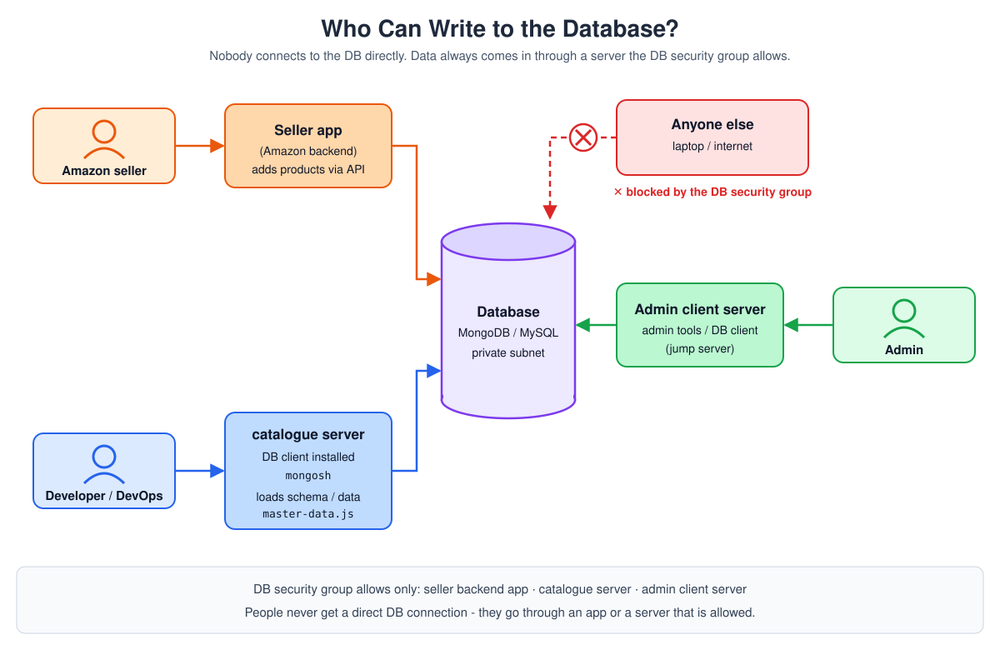

# Day 11 - Backend Deployment: Node.js vs Java vs Python vs Go

> **In short:** A backend in Node.js, Java, Python or Go does the same job: run business logic, talk to a database, answer requests on a port. What changes per language is the **file extension**, the **build tool**, **where dependencies are stored**, and whether the code is **compiled** before it runs.

## Table of Contents

1. [What this is / why it matters](#what-this-is--why-it-matters)
2. [Deployment Steps (Any Language)](#deployment-steps-any-language)
3. [Who Can Write to the Database?](#who-can-write-to-the-database)
4. [Language Comparison at a Glance](#language-comparison-at-a-glance)
5. [Node.js](#nodejs)
6. [Java](#java)
7. [Python](#python)
8. [Go](#go)
9. [Compiled vs Interpreted](#compiled-vs-interpreted)
10. [Common problems and how to solve them](#common-problems-and-how-to-solve-them)
11. [Key takeaways](#key-takeaways)
12. [What I learned](#what-i-learned)
13. [Interview Questions](#interview-questions)

**More in this folder:** [Interview questions](interview-questions/README.md)

---

## What this is / why it matters

- In RoboShop, catalogue/user/cart are **Node.js**, shipping is **Java**, payment is **Python**, dispatch is **Go**.
- Every language has different tools to pull in dependencies and turn code into something that runs.
- I need to know these differences to **deploy**, **troubleshoot**, or just **read** someone else's service.

## Deployment Steps (Any Language)

The same steps work for every language:

1. Install the language runtime
2. Create a folder for the app (`/app`)
3. Create a system user to run it (`roboshop`)
4. Download the app code
5. Extract the code
6. Install dependencies
7. Create a systemd service file
8. Load data if needed (e.g. master data into the DB)
9. Start the service

**Example - systemd file for the Node.js `catalogue` service:**

```ini
[Unit]
Description=Catalogue Service
After=network-online.target

[Service]
User=roboshop
Environment=MONGO_URL="mongodb://mongodb.abhignadevops.store:27017/catalogue"
ExecStart=/bin/node /app/server.js
SyslogIdentifier=catalogue
Restart=on-failure
RestartSec=5

[Install]
WantedBy=multi-user.target
```

- Same pattern as the backend service in [Day 7](../day-07-3tier-nodejs-expense-app/02-backend.md).
- Per language, only `ExecStart` and the `Environment` variables change:

| Language | `ExecStart` example |
|----------|---------------------|
| Node.js | `/bin/node /app/server.js` |
| Java | `/bin/java -jar /app/shipping.jar` |
| Python | `/app/.venv/bin/gunicorn ... payment:app` |
| Go | `/app/dispatch` |

## Who Can Write to the Database?



**Rule:** No person connects to the database directly.

- The DB sits in a **private subnet**.
- Its **security group** allows only a few servers.
- Anyone else (my laptop, the internet) is **blocked**.

**Example - Amazon:**

| Who | Adds data through | Example |
|-----|-------------------|---------|
| **Sellers** | Seller app (Amazon backend) → API → DB | A seller adds a new product |
| **Admins** | Admin client server (admin tools / jump server) → DB | An admin fixes a wrong price |
| **Developers / DevOps** | App server (e.g. `catalogue`) with a DB client → DB | Create tables / load master data |

**How I load the schema in RoboShop:**

1. The schema file comes with the app code: `/app/db/master-data.js`.
2. Install the DB client **on the catalogue server**: `dnf install mongodb-mongosh -y`.
3. Load it from there: `mongosh --host <MONGODB-SERVER-IPADDRESS> </app/db/master-data.js`.
4. It works because the MongoDB SG already allows **27017 from catalogue**.

> **In real companies:** schema changes are usually done by **migration scripts** that run in the CI/CD pipeline or by the app at startup, not typed by hand. Loading it from the app server is the same idea: the change comes from an allowed server, not from someone's laptop.

> **Interview one-liner:** Nobody gets direct DB access. Users and sellers write through the app's API, admins through an admin/jump server, and schema changes are loaded from an allowed app server or a pipeline - the DB security group only allows those.

## Language Comparison at a Glance

| | Node.js | Java | Python | Go |
|---|---|---|---|---|
| File extension | `.js` | `.java` | `.py` | `.go` |
| Build tool | npm | Maven | pip | `go` command |
| Build file | `package.json` + `package-lock.json` | `pom.xml` | `requirements.txt` | `go.mod` + `go.sum` |
| Install / build | `npm install` | `mvn clean package` | `pip install -r requirements.txt` | `go build` |
| Dependencies stored in | `node_modules/` inside each app | `~/.m2/repository` (shared) | System folder (shared) or a `venv` per app | `$GOPATH/pkg/mod` (shared) |
| Compiled? | No - runs source (JIT) | Yes - to bytecode, runs on JVM | No - runs source | Yes - to one native binary |

## Node.js

- `npm install` reads `package.json` and downloads dependencies into **`node_modules/`** inside the app folder.
- `package-lock.json` locks the **exact versions** (including sub-dependencies) → same install today and next month.
- Each app has its **own** `node_modules` → two apps on one server can use different versions of the same library. No conflict.

## Java

Java code must be **compiled** before it runs, so it needs a build tool. The standard one is **Maven**.

**Build file - `pom.xml`:** project name, version, description, dependencies.

**Where dependencies go:**

- Not per app like Node.js.
- One **shared** folder on the machine: `~/.m2/repository`.
- Versions are kept apart by **GAV**:

| Letter | Meaning | Example |
|--------|---------|---------|
| G | Group-id | `com.hdfcbank` |
| A | Artifact-id | `netbanking` |
| V | Version | `1.2.0` |

**Maven lifecycle (`mvn clean package`):**

1. **clean** - delete the old `target/` folder
2. **validate** - check the project is correct
3. **compile** - compile the source (downloads dependencies first)
4. **test** - run the tests
5. **package** - build the artifact → `target/shipping.jar`

**JDK vs JRE:**

| | JRE | JDK |
|---|---|---|
| Full name | Java Runtime Environment | Java Development Kit |
| Used to | **Run** compiled Java | **Build** Java (has the `javac` compiler) + run it |
| Install on | Server that only runs the `.jar` | Build server |

- JDK = JRE + build tools.

**Many Java versions on one server:**

- e.g. `java-21` and `java-25` side by side.
- **`JAVA_HOME`** tells Maven which one to use.
- Set it once in `/etc/profile.d/java.sh`.

## Python

- File: `.py` · Build tool: **pip** · Build file: `requirements.txt`
- `pip install -r requirements.txt` installs into a **shared system folder** by default → every Python app on the server uses the same one.
- Two apps need different versions of one package? → **conflict**.

**Fix - venv (virtual environment):**

```bash
python3.14 -m venv /app/.venv
/app/.venv/bin/pip install -r requirements.txt
```

- A venv = a folder with its **own** Python and its **own** libraries, just for this app.
- Same isolation Node.js gives automatically with `node_modules` - in Python I have to opt in.

**Install a specific Python on RHEL 9:**

```bash
dnf install python3.14 python3.14-pip -y
```

- Newer Pythons come as separate packages (`python3.14`), not `dnf module` streams.
- The system `python3` (3.9) stays untouched, so OS tools keep working.

## Go

- File: `.go` · No separate build tool - the **`go` command** does everything (Go modules).
- Build files:

| File | Holds | Node.js equivalent |
|------|-------|--------------------|
| `go.mod` | Module name, Go version, dependencies with exact versions | `package.json` |
| `go.sum` | Checksum of every dependency | `package-lock.json` (partly) |

- Dependencies are cached **once per machine** in `$GOPATH/pkg/mod` (shared, like Maven).
- `go build` → **one self-contained binary**.
- The server running it needs **nothing else** - no Go, no JRE, no interpreter.
- Deploy = copy one file to the server.

## Compiled vs Interpreted

| Language | How it runs | Needs on the server |
|----------|-------------|---------------------|
| **Go** | Compiled ahead of time → native binary | Nothing |
| **Java** | Compiled → bytecode → runs on the **JVM** | JRE |
| **Node.js** | Source run directly (JIT at run time) | Node.js |
| **Python** | Source run directly (interpreted) | Python |

- Go → fastest start, nothing to install.
- Java → portable across OS, but needs a JRE everywhere.
- Node.js / Python → no build step, but the runtime must be installed.

## Common problems and how to solve them

| Problem | Why it happens | Fix |
|---------|----------------|-----|
| **Dependency version conflict** | Python installs into a shared folder by default | One `venv` per app |
| **Wrong language version used in the build** | Many Java / Python versions installed; the first one on `PATH` wins | Set `JAVA_HOME`, or use the venv's Python (`/app/.venv/bin/...`) |
| **`Unit <name>.service not found`** | Forgot `systemctl daemon-reload` after creating/editing the service file | Run `systemctl daemon-reload` every time - same for every language ([Day 7](../day-07-3tier-nodejs-expense-app/README.md)) |

## Key takeaways

- **Same steps for every language:** runtime → `/app` + system user → code → dependencies → systemd service → start.
- **Dependencies:**
  - Node.js → per app (`node_modules`)
  - Python → shared by default, per app with a `venv`
  - Java → shared `~/.m2/repository`, versions kept apart by GAV
  - Go → shared module cache, versions kept apart by version number
- **Compiled:** only Java (→ bytecode, needs JRE) and Go (→ native binary, needs nothing). Node.js and Python run the source directly.

See also: [Day 7 - Expense App](../day-07-3tier-nodejs-expense-app/README.md) · [Day 8 - Nginx](../day-08-nginx-proxy-api-status-codes/README.md) · [RoboShop setup docs](../roboshop-docs/README.md)

---

## What I learned

- **Same steps for every language:** runtime → `/app` + system user → code → dependencies → systemd service → start.
- **Dependencies:** Node.js per app (`node_modules`), Python per app with a `venv`, Java in `~/.m2`, Go in a module cache.
- **Compiled:** Java (bytecode, needs a JRE) and Go (native binary, needs nothing). Node.js and Python run the source.

---

## Interview Questions

11 questions with short answers → [interview-questions/](interview-questions/README.md)
