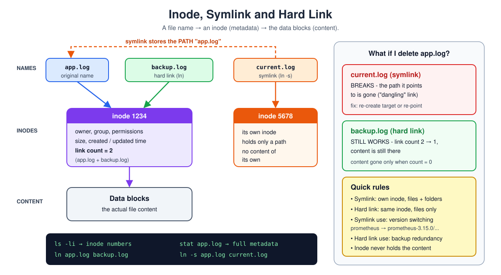
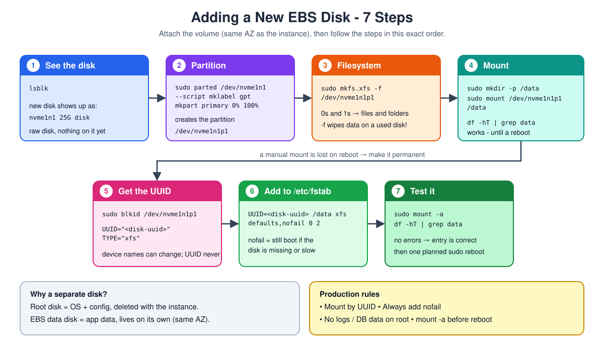
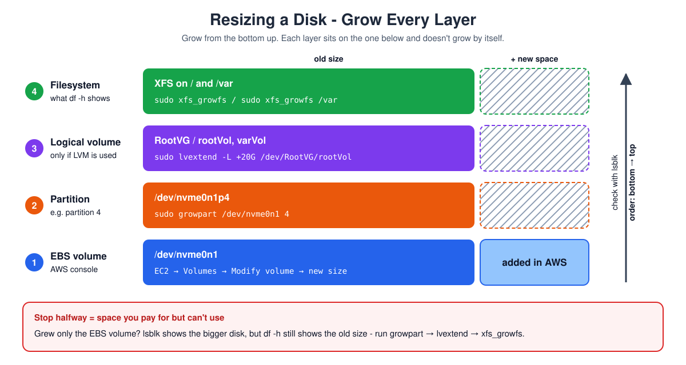

# Day 13 - Disk Management, Inodes & the Linux Directory Layout

> **In short:** Linux keeps a file's **metadata** (inode) separate from its **content**. That explains symlinks vs hard links. App data goes on a **separate EBS disk**, not the root disk - attach it, partition, format, mount, and make it permanent in `/etc/fstab`. Growing a disk later means resizing every layer.

## Table of Contents

1. [What this is / why it matters](#what-this-is--why-it-matters)
2. [How it works](#how-it-works)
   - [Inodes: Metadata, Separate from Content](#inodes-metadata-separate-from-content)
   - [Symlinks (Soft Links) - a Shortcut](#symlinks-soft-links---a-shortcut)
   - [Hard Links - Another Name for the Same File](#hard-links---another-name-for-the-same-file)
   - [Adding a New Disk (EBS Volume)](#adding-a-new-disk-ebs-volume)
   - [Resizing an Existing Disk](#resizing-an-existing-disk)
   - [Checking Disk and Memory Usage](#checking-disk-and-memory-usage)
   - [The Linux Directory Layout](#the-linux-directory-layout)
3. [Common problems and how to solve them](#common-problems-and-how-to-solve-them)
4. [Key takeaways](#key-takeaways)
5. [Interview Questions](#interview-questions)

**Diagrams:** [Inode, Symlink & Hard Link](images/01-inode-symlink-hardlink.svg) · [Add a New Disk](images/02-add-a-new-disk-steps.svg) · [Resize a Disk](images/03-resize-disk-layers.svg)

**More in this folder:** [Interview questions](interview-questions/README.md)

---

## What this is / why it matters

- Every file has two parts: its **content** and its **metadata** (owner, permissions, size, timestamps).
- That split explains how **symlinks** and **hard links** work.
- Knowing how disks are attached, partitioned, mounted and resized explains why **app data shouldn't live on the root disk** - and what to do when that data disk is full.

## How it works

### Inodes: Metadata, Separate from Content



- Think of a person's ID record (name, date of birth, Aadhaar number) vs the person.
- An **inode** is the ID record of a file:
  - Owner and group
  - Permissions
  - Created / last updated time
  - Size
- The file's **content is stored separately** - it's not in the inode.

```bash
ls -li       # shows every file's inode number
stat <file>  # shows full inode metadata for one file
```

### Symlinks (Soft Links) - a Shortcut

A symlink points to another file or folder - like a desktop shortcut.

- Has its **own, different inode number**
- If the target is deleted, the symlink **breaks** - it only pointed to it
- Works on files **and** folders

```bash
ln -s <target> <link-name>
```

**Is the inode of the main file and the symlink the same? No.**

1. Every file has its own inode number.
2. A symlink is also a file - a small file that only stores the path of the main file.
3. So the symlink gets its **own inode number**.
4. Main file inode ≠ symlink inode.

**Example:**

```bash
ln -s app.log current.log
ls -li
```
```text
1234 -rw-r--r-- 1 ec2-user ec2-user 120 Oct 12 10:00 app.log
5678 lrwxrwxrwx 1 ec2-user ec2-user   7 Oct 12 10:01 current.log -> app.log
```

- `app.log` → inode **1234**
- `current.log` → inode **5678** (different)
- `l` at the start = it's a symlink, `->` shows where it points

**If I remove the main file, the symlink breaks.**

1. The symlink only stores the path `app.log` - not the content.
2. Delete `app.log` → the path points to nothing.
3. The symlink is still there, but it's **broken** (a "dangling" link).

```bash
rm app.log
cat current.log
```
```text
cat: current.log: No such file or directory
```

- `ls -l` still shows `current.log -> app.log` (in red on most terminals).
- Fix: create `app.log` again, or point the symlink to another file with `ln -sf <new-target> current.log`.

**Use - version switching during an upgrade:**

```
/home/ec2-user/prometheus  →  /home/ec2-user/prometheus-3.15.0.linux-amd64/prometheus
```

1. Everything uses the stable path `prometheus`
2. To upgrade, re-point `prometheus` to the new version's folder
3. Nothing that uses `prometheus` needs to change

Also used for backward compatibility - e.g. on RHEL 9, `/bin` is a symlink to `/usr/bin`.

### Hard Links - Another Name for the Same File

A hard link doesn't point to the file - it **is** the file, under a second name.

- **Same inode number** as the original
- Only for **files**, not directories
- Deleting one name doesn't delete the content - it's gone only when **every** hard link is deleted

```bash
ln <file> <link-name>
```

**Is the inode of the main file and the hard link the same? Yes.**

1. A hard link is not a new file - it's a second name for the same file.
2. Both names point to the same inode → same inode number.

```bash
ln app.log backup.log
ls -li
```
```text
1234 -rw-r--r-- 2 ec2-user ec2-user 120 Oct 12 10:00 app.log
1234 -rw-r--r-- 2 ec2-user ec2-user 120 Oct 12 10:00 backup.log
```

- Both show inode **1234** (same)
- The `2` = link count → 2 names point to this inode

**If I delete the main file, the hard link stays.**

1. `rm app.log` only removes the name `app.log`.
2. Link count goes 2 → 1.
3. `backup.log` still opens with the full content.
4. The content is deleted only when the link count is 0 (every name removed).

```bash
rm app.log
cat backup.log     # still works
```

**Use - file backups:** even if someone deletes the main file by mistake, the data is not fully deleted - the hard link still has it.

**Not allowed for directories:**

```bash
ln mydir mydir-link
```
```text
ln: mydir: hard link not allowed for directory
```

- Hard links work only on files.
- For a folder shortcut, use a symlink: `ln -s mydir mydir-link`.

| | Symlink | Hard link |
|---|---|---|
| Inode number | Different from the target | Same as the target |
| Breaks if target is deleted? | Yes | No - content stays until every link is gone |
| Works on directories? | Yes | No |
| Typical use | Shortcuts, version switching | File-level backup redundancy |

### Adding a New Disk (EBS Volume)



**Why a separate disk:**

- An EC2 instance comes with one **root disk**.
- Delete the instance → the root disk is deleted with it.
- So: **root disk = OS and config**, **extra EBS disk = app data** → independent lifecycles.
- The EBS volume must be in the **same Availability Zone** as the instance (e.g. `us-east-1d`) - it's physically tied to a location.

**What is a filesystem?** A disk only stores raw 0s and 1s. The filesystem organises them into the files and folders I see.

**Steps after attaching the volume** (it shows up as e.g. `/dev/nvme1n1`). Skipping or reordering a step is the usual reason for "the disk isn't showing up".

**1. Check the OS can see the disk:**

```bash
lsblk
```
```text
nvme1n1   259:1   0   25G  0 disk
```

**2. Partition the disk:**

```bash
sudo parted /dev/nvme1n1 --script mklabel gpt mkpart primary 0% 100%
```

| Part | Meaning |
|---|---|
| `--script` | No confirmation prompt - needed for automation (Ansible, Terraform, cloud-init) |
| `mklabel gpt` | GUID Partition Table - modern standard, supports large disks, more reliable than old MBR |
| `mkpart primary 0% 100%` | One partition using the whole disk |

This creates `/dev/nvme1n1p1` - the `p1` is the **partition**, not the raw disk.

**3. Create a filesystem on the partition:**

```bash
sudo mkfs.xfs -f /dev/nvme1n1p1
```

- XFS is the default on RHEL - good for large files, logs and high I/O.
- It can grow later **without unmounting**.
- `-f` forces formatting: fine on a new empty disk, **wipes data** on a used one.

**4. Create a mount point and mount it:**

```bash
sudo mkdir -p /data
sudo mount /dev/nvme1n1p1 /data
df -hT | grep data     # verify
```

**5. Get the disk's UUID:**

```bash
sudo blkid /dev/nvme1n1p1
```
```text
/dev/nvme1n1p1: UUID="<disk-uuid>" TYPE="xfs"
```

Device names like `/dev/nvme1n1p1` can change after a reboot on AWS - the UUID doesn't.

**6. Make the mount permanent in `/etc/fstab`:**

```bash
sudo vim /etc/fstab
```

Add at the bottom:

```text
UUID=<disk-uuid>   /data   xfs   defaults,nofail   0   2
```

| Field | Meaning |
|---|---|
| `UUID=...` | The disk's permanent ID - safer than a device name |
| `/data` | Where it's mounted |
| `xfs` | Filesystem type |
| `defaults` | Standard mount options |
| `nofail` | Don't block boot if this disk is missing or slow to attach |
| `0` | Skip in old `dump` backups |
| `2` | `fsck` order - checked after the root filesystem (`1`) |

**7. Test fstab without rebooting:**

```bash
sudo mount -a
df -hT | grep data
```

- No errors → the entry is correct.
- Still do one planned `sudo reboot` and check `/data` is mounted - better to find a mistake now than during an unplanned reboot.

**Rules for production disks:**

- Mount by **UUID**, never by device name.
- Always add **`nofail`** for a data disk.
- Never keep logs or DB data on the root disk.
- Always run **`mount -a`** before rebooting.

### Resizing an Existing Disk



Growing a disk is **layered** - each layer needs its own step:

```
EBS volume  →  partition  →  logical volume (LVM)  →  filesystem
 (AWS console)   growpart        lvextend               xfs_growfs
```

If I stop halfway (e.g. only grow the volume in AWS), the extra space is allocated but **unusable**.

**1. Check partitions:**

```bash
lsblk
```

**2. Grow the partition** (after increasing the EBS size in AWS) - here partition 4 on `/dev/nvme0n1`:

```bash
sudo growpart /dev/nvme0n1 4
```

**3. Extend the logical volumes** - a bigger partition doesn't make the LVs bigger by itself:

```bash
sudo lvextend -L +20G /dev/RootVG/rootVol
sudo lvextend -L +30G /dev/RootVG/varVol
```

**4. Grow the filesystems** to use the new space:

```bash
sudo xfs_growfs /
sudo xfs_growfs /var
```

### Checking Disk and Memory Usage

```bash
df -hT     # disk space + filesystem type per mounted disk
free -m    # RAM usage (in MB)
du -sh *   # size of each item in the current folder
```

**Swap** = virtual RAM on disk. If swap usage keeps climbing, physical RAM is already full.

### The Linux Directory Layout

Every top-level folder has one job:

| Directory | What it's for |
|---|---|
| `/bin` | Everyday commands (`ls`, `cp`, ...) |
| `/boot` | Files to boot the server - kernel (`vmlinuz-*`), initial RAM disk (`initramfs`), boot loader (GRUB2) |
| `/dev` | Devices - disks, keyboard, mouse, anything the kernel exposes as a device |
| `/etc` | System-wide config - `/etc/passwd`, `/etc/group`, `/etc/nginx`, `/etc/yum.repos.d`, `/etc/systemd`, `/etc/sudoers`, `/etc/fstab` |
| `/home` | Each user's personal space, e.g. `/home/ec2-user` |
| `/lib` | Shared system libraries |
| `/media` | Where USB drives / CDs auto-mount on a desktop |
| `/mnt` | Usual place to manually mount an extra disk |
| `/opt` | Third-party software not installed by the package manager |
| `/proc` | Virtual folder with live process and system info - `/proc/cpuinfo`, `/proc/meminfo` |
| `/root` | Home folder of the root user |
| `/run` | Runtime state of running programs (PID files, sockets) |
| `/sbin` | System admin commands |
| `/srv` | Meant for data served by services; rarely used today (Nginx on RHEL uses `/usr/share/nginx/html`) |
| `/tmp` | Temporary files |
| `/var` | Data that changes all the time - most importantly logs (`/var/log`) |

## Common problems and how to solve them

| Problem | Why it happens | Fix |
|---|---|---|
| **Symlink points at nothing** (dangling) | Target was deleted or moved | Re-create the target, or re-point the symlink |
| **Can't hard-link a directory** | Not allowed by design | Use a symlink |
| **Mounted disk gone after reboot** | Mounted with `mount` but never added to `/etc/fstab` | Add an fstab entry using the UUID |
| **Server won't boot after editing fstab** | No `nofail`, and the disk wasn't ready at boot | Add `nofail`; always test with `mount -a` first |
| **Grew the EBS volume but no extra space on the server** | Resizing the volume doesn't resize anything on top | `growpart` → `lvextend` (if LVM) → `xfs_growfs` |

## Key takeaways

- **Inode** = a file's metadata (owner, permissions, timestamps, size) - never the content.
- **Symlink** = points at a file (different inode, breaks if the target goes). **Hard link** = the same file under another name (same inode, files only, lives until every link is gone).
- Keep app data on a **separate EBS volume** in the **same AZ** - the root disk dies with the instance.
- **Add a disk:** `lsblk` → `parted` → `mkfs.xfs` → `mount` → `blkid` → `/etc/fstab` (UUID + `nofail`) → `mount -a`.
- **Resize a disk:** EBS volume → `growpart` → `lvextend` → `xfs_growfs`.
- Quick checks: `df -hT` (disk), `free -m` (RAM), `du -sh *` (folder sizes).
- `/etc` = config, `/var` = logs and changing data, `/opt` = third-party installs, `/mnt` = manual mounts.

See also: [Day 3 - Linux Basics](../day-03-linux-basics/README.md) · [Day 5 - Linux Administration](../day-05-users-packages-services-processes/README.md)

---

## Interview Questions

10 questions with short answers → [interview-questions/](interview-questions/README.md)
