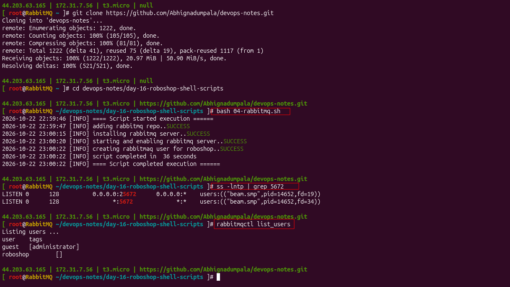
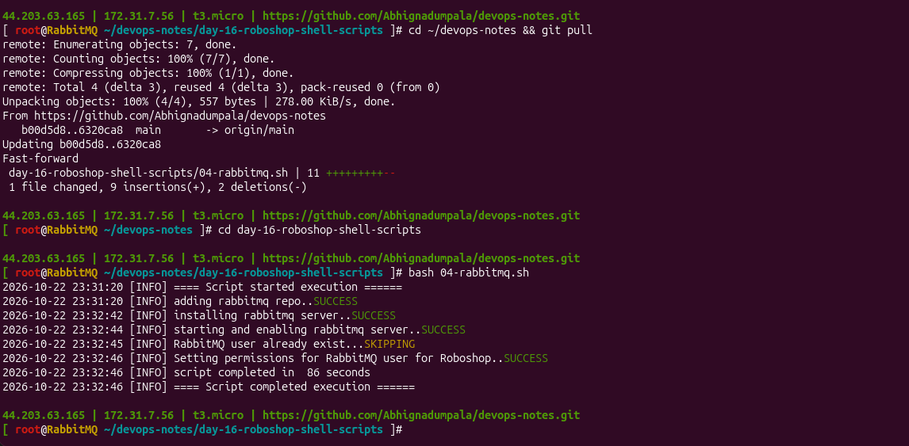

# 04-rabbitmq.sh: RabbitMQ Server

[← Day 16 notes](../README.md) · [Common part of every script](../00-common-part.md)

## What this server does

**RabbitMQ** is a message queue. **Payment** puts each order in the queue; **dispatch** takes it out. If dispatch is down, orders wait safely in the queue.

| Fact | Value |
|------|-------|
| Server | `roboshop-rabbitmq` (RHEL 9, t3.micro) |
| Software | Erlang + RabbitMQ (from `rabbitmq.repo`) |
| Ports | 5672 (apps), 15672 (management UI) |
| Called by | payment, dispatch |
| SG inbound | 5672 from `roboshop-payment`, `roboshop-dispatch` · 15672 from My IP |
| Config file I change | none (listens on all interfaces by default) |
| Files used | `04-rabbitmq.sh`, `rabbitmq.repo` |
| Run time | **36 s** (2nd run 86 s, see below) |

---

## Steps the script does

1. Check I'm root, start the log
2. Add the Erlang + RabbitMQ repos
3. Install `erlang` and `rabbitmq-server`
4. Enable + start RabbitMQ
5. Create the app user `roboshop` **only if it doesn't exist**
6. Give it permissions

---

## The code, block by block

### 1–4. The common part

```bash
user_id=$(id -u)
logs_folder="/var/log/roboshop"
logs_file="${logs_folder}/${0}.log"
...
if [ $user_id -ne 0 ]; then ... exit 1; fi
mkdir -p $logs_folder
timestamp(){ ... }
validate(){ ... }
```

**What it does:** settings, root check, log folder, and the `timestamp` + `validate` helpers. Same in every script; explained line by line in the [server notes index](../00-common-part.md#the-common-part-top-of-every-script).

### 5. Add the RabbitMQ repos

```bash
cp rabbitmq.repo /etc/yum.repos.d/rabbitmq.repo
validate $? "adding rabbitmq repo"
```

**What it does:** adds the Erlang + RabbitMQ download locations for `dnf`.
**Why:** neither is in RHEL's repos. RabbitMQ is written in **Erlang**, so it needs Erlang first.

### 6. Install

```bash
dnf install erlang rabbitmq-server -y &>> $logs_file
validate $? "installing rabbitmq server"
```

**What it does:** installs Erlang and the RabbitMQ server.

### 7. Start RabbitMQ

```bash
systemctl enable rabbitmq-server &>> $logs_file
systemctl start rabbitmq-server &>> $logs_file
validate $? "starting and enabling rabbitmq server"
```

**What it does:** start on boot + start now. It listens on **5672** for apps.

### 8. Create the app user (only if missing)

```bash
rabbitmqctl list_users | grep -qw "roboshop"
if [ $? -ne 0 ]; then
     rabbitmqctl add_user roboshop <password> &>> $logs_file
     validate $? "Creating RabbitMQ user for Roboshop"
else
    echo -e "$(timestamp) [INFO] RabbitMQ user already exist...${Y}SKIPPING${N}" | tee -a $logs_file
fi
```

**What it does:**
1. Lists RabbitMQ users and searches for `roboshop`.
2. Not found → create it. Found → yellow **SKIPPING**.

| Part | Meaning |
|------|---------|
| `grep -q` | print nothing, only set `$?` (0 = found) |
| `grep -w` | whole word: `roboshop`, not `roboshop2` |

**Why:** payment and dispatch log in as `roboshop`. Without the check, a 2nd run fails ("user already exists"): this makes it **idempotent**.

### 9. Give the user permissions

```bash
rabbitmqctl set_permissions -p / roboshop ".*" ".*" ".*" &>> $logs_file
validate $? "Setting permissions for RabbitMQ user for Roboshop"
```

**What it does:** on vhost `/`, gives `roboshop` **configure, write, read** on everything (`.*` = all).
**Why outside the `if`:** setting the same permissions again is safe, so it runs every time.

<details>
<summary><b>Full script in one piece</b> (click to open)</summary>

```bash
#!/bin/bash

user_id=$(id -u)
logs_folder="/var/log/roboshop"
logs_file="${logs_folder}/${0}.log"
R="\e[31m"
G="\e[32m"
Y="\e[33m"
N="\e[0m"

if [ $user_id -ne 0 ]; then
    echo "Please run this script with sudo access.."
    exit 1
fi

mkdir -p $logs_folder

timestamp(){
    date +"%F %T"
}

validate(){
    if [ $1 -ne 0 ]; then
        echo -e "$(timestamp) [ERROR] ${2}..${R}FAILED${N}" | tee -a $logs_file
        exit 1
    else
        echo -e "$(timestamp) [INFO] ${2}..${G}SUCCESS${N}" | tee -a $logs_file
    fi
}
echo "$(timestamp) [INFO] ==== Script started execution ======" | tee -a $logs_file

cp rabbitmq.repo /etc/yum.repos.d/rabbitmq.repo
validate $? "adding rabbitmq repo"

dnf install erlang rabbitmq-server -y &>> $logs_file
validate $? "installing rabbitmq server"


systemctl enable rabbitmq-server &>> $logs_file
systemctl start rabbitmq-server &>> $logs_file
validate $? "starting and enabling rabbitmq server"

rabbitmqctl list_users | grep -qw "roboshop"
if [ $? -ne 0 ]; then
     rabbitmqctl add_user roboshop roboshop123 &>> $logs_file
     validate $? "Creating RabbitMQ user for Roboshop" 
else
    echo -e "$(timestamp) [INFO] RabbitMQ user already exist...${Y}SKIPPING${N}" | tee -a $logs_file
fi

rabbitmqctl set_permissions -p / roboshop ".*" ".*" ".*" &>> $logs_file
validate $? "Setting permissions for RabbitMQ user for Roboshop"


echo "$(timestamp) [INFO] script completed in  $SECONDS seconds" | tee -a $logs_file
echo "$(timestamp) [INFO] ==== Script completed execution ======" | tee -a $logs_file
```

</details>

---

## Run + result



**2nd run:** the user step says **SKIPPING**, everything else SUCCESS.



## Verify

```bash
ss -tlnp | grep 5672            # *:5672
rabbitmqctl list_users          # guest [administrator], roboshop []
```

| You see | Meaning |
|---------|---------|
| `*:5672` | AMQP port for payment and dispatch |
| `guest [administrator]` | Default user, can only log in from the same server |
| `roboshop []` | App user, no admin tag needed |

---

## Problems I hit

| Problem | Cause | Fix |
|---------|-------|-----|
| 2nd run would stop at `add_user` | User already exists → non-zero exit → `validate` stops | Check first with `grep -qw`, else SKIPPING |
| 2nd run took 86 s (82 s in `dnf`) | dnf refreshes the 4 repos' metadata (`metadata_expire=300`) | Normal. Not stuck: `tail -f` the log |

---

## Interview questions

**1. Why a message queue between payment and dispatch?**
Payment doesn't wait for dispatch. If dispatch is down, orders wait in the queue and nothing is lost.

**2. How did you make the user step idempotent?**
`rabbitmqctl list_users | grep -qw roboshop`: create only if not found, else print SKIPPING.

**3. What do `-q` and `-w` do in grep?**
`-q`: no output, only the exit code. `-w`: match the whole word, so `roboshop2` doesn't count.
