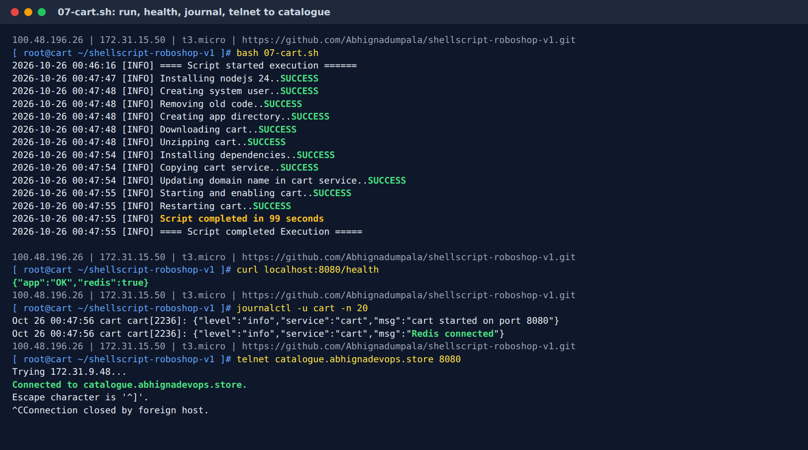

# 07-cart.sh: Cart Server

[← Day 16 notes](README.md) · [Common part of every script](00-common-part.md) · [06-user.sh](06-user.sh.md) (same pattern, explained in more detail)

## What this server does


**Cart** is a Node.js app that keeps each customer's **shopping cart**. It stores the cart in **Redis** and asks **catalogue** for the product name and price.

| Fact | Value |
|------|-------|
| Server | `roboshop-cart` (RHEL 9, t3.micro) |
| Software | Node.js 24 + the cart app |
| Port | 8080 |
| Called by | frontend, shipping, payment |
| Calls | redis (`REDIS_HOST`), catalogue (`CATALOGUE_HOST:CATALOGUE_PORT`) |
| SG inbound | 8080 from `roboshop-frontend`, `roboshop-shipping`, `roboshop-payment` |
| Must allow cart | redis 6379 ✅, catalogue 8080 ✅ |
| Config file I add | `/etc/systemd/system/cart.service` |
| Files used | `07-cart.sh`, `cart.service` |
| Run time | **99 s** |

```
cart ──► redis:6379       stores the cart items
cart ──► catalogue:8080   gets product details and price
```

---

## Steps the script does

1. Save the script's folder (`scripts_dir`), check I'm root
2. Install Node.js 24
3. Create the `roboshop` system user (skip if it exists)
4. Fresh `/app`, download and unzip the code
5. `npm install` the libraries
6. Copy `cart.service`, put in my domain
7. Start, then **restart** cart

It's `06-user.sh` with `user` → `cart`. Only the **service file** is really different.

---

## The code, block by block

### 1. The common part

```bash
user_id=$(id -u)
logs_folder="/var/log/roboshop"
logs_file="${logs_folder}/${0}.log"
domain_name="abhignadevops.store"
scripts_dir=$(dirname "$(realpath "$0")")
...
if [ $user_id -ne 0 ]; then ... exit 1; fi
mkdir -p $logs_folder
timestamp(){ ... }
validate(){ ... }
```

**What it does:** settings, root check, log folder, `timestamp` + `validate`: [00-common-part.md](00-common-part.md).
`scripts_dir` remembers the repo folder (`/root/shellscript-roboshop-v1`) **before** `cd /app`, so `cart.service` is still found in block 6.

> ⚠️ `domain_name` must be **my** domain. With another domain (e.g. copied from someone else's script), `sed` writes `redis.<their-domain>` into the service file. That name isn't in my Route 53, so cart can't find Redis → `redis: false`.

### 2. Install Node.js 24

```bash
dnf module disable nodejs -y &>> $logs_file
dnf module enable nodejs:24 -y &>> $logs_file
dnf install nodejs -y &>> $logs_file
validate $? "Installing nodejs 24"
```

**What it does:** picks Node.js 24 instead of RHEL's default and installs it. The slowest step (91 of 99 s).

### 3. Create the app user (only if missing)

```bash
id roboshop &>> $logs_file
if [ $? -ne 0 ]; then
    useradd --system --home /app --shell /sbin/nologin --comment "roboshop system user" roboshop &>> $logs_file
    validate $? "Creating system user"
else
    echo -e "$(timestamp) [INFO] System user roboshop already exist...${Y}SKIPPING${N}"
fi
```

**What it does:** creates the `roboshop` Linux user only if it's missing (**idempotent**).
When I copied `06-user.sh`, I replaced `user` → `cart` everywhere **except** here: `roboshop` is the Linux user, not the user service.

### 4. Fresh app folder + download + unzip

```bash
rm -rf /app
validate $? "Removing old code"

mkdir -p /app
validate $? "Creating app directory"

curl -L -o /tmp/cart.zip https://raw.githubusercontent.com/daws-92s/roboshop-documentation/refs/heads/main/artifacts/cart-v4.zip &>> $logs_file
validate $? "Downloading cart"

cd /app
unzip /tmp/cart.zip &>> $logs_file
validate $? "Unzipping cart"
```

**What it does:** clean `/app`, download `cart-v4.zip`, unzip it into `/app`. `rm -rf /app` first, so `unzip` never asks "replace?" on a re-run.

### 5. Install the app's libraries

```bash
npm install &>> $logs_file
validate $? "Installing dependencies"
```

**What it does:** downloads the libraries from `package.json` into `node_modules/` (here: the Redis driver + an HTTP client to call catalogue).

### 6. Install the service file with my domain

```bash
cp $scripts_dir/cart.service /etc/systemd/system/cart.service
validate $? "Copying cart service"

sed -i "s/DOMAIN_NAME/$domain_name/g" /etc/systemd/system/cart.service
validate $? "Updating domain name in cart service"
```

**What it does:** copies `cart.service` to systemd's folder, then replaces both `DOMAIN_NAME`s in the **copy**.

```
before:  REDIS_HOST=redis.DOMAIN_NAME          CATALOGUE_HOST=catalogue.DOMAIN_NAME
after:   REDIS_HOST=redis.abhignadevops.store  CATALOGUE_HOST=catalogue.abhignadevops.store
```

**Why copy first:** the repo file keeps `DOMAIN_NAME`, so `git pull` on the server keeps working ([06-user.sh.md block 6](06-user.sh.md#6-install-the-service-file-with-my-domain) has the comparison table).

### 7. Start, then restart

```bash
systemctl daemon-reload &>> $logs_file
systemctl enable cart &>> $logs_file
systemctl start cart &>> $logs_file
validate $? "Starting and enabling cart"

systemctl restart cart
validate $? "Restarting cart"
```

**What it does:** systemd reads the new unit, cart starts on boot, starts now, then restarts so a re-run always loads the latest code and config.

---

## cart.service, line by line

```ini
[Unit]
Description=Cart Service
After=network-online.target

[Service]
User=roboshop
Environment=REDIS_HOST=redis.DOMAIN_NAME
Environment=CATALOGUE_HOST=catalogue.DOMAIN_NAME
Environment=CATALOGUE_PORT=8080
ExecStart=/bin/node /app/server.js
SyslogIdentifier=cart
Restart=on-failure
RestartSec=5

[Install]
WantedBy=multi-user.target
```

| Line | Meaning |
|------|---------|
| `REDIS_HOST=redis.DOMAIN_NAME` | **outgoing**: where Redis is. Only the hostname; the app uses port 6379 itself |
| `CATALOGUE_HOST=catalogue.DOMAIN_NAME` | **outgoing**: where catalogue is |
| `CATALOGUE_PORT=8080` | catalogue's port |
| `User=roboshop` | run as the app user, not root |
| `SyslogIdentifier=cart` | name shown in `journalctl` |
| `Restart=on-failure` + `RestartSec=5` | crashed? restart after 5 s |

**User vs cart service file:**

| | user.service | cart.service |
|-|--------------|--------------|
| Redis | `REDIS_URL="redis://redis.DOMAIN_NAME:6379"` (full URL) | `REDIS_HOST=redis.DOMAIN_NAME` (hostname only) |
| Other | `MONGO_URL=...` | `CATALOGUE_HOST` + `CATALOGUE_PORT` |

Each app reads its **own** variable names, so I copy them exactly from the app's docs.

<details>
<summary><b>Full script in one piece</b> (click to open)</summary>

```bash
#!/bin/bash

user_id=$(id -u)
logs_folder="/var/log/roboshop"
logs_file="${logs_folder}/${0}.log"
domain_name="abhignadevops.store"
scripts_dir=$(dirname "$(realpath "$0")")
R="\e[31m"
G="\e[32m"
Y="\e[33m"
N="\e[0m"

if [ $user_id -ne 0 ]; then
    echo "Please run this script with sudo access.."
    exit 1
fi

mkdir -p $logs_folder

timestamp(){
    date +"%F %T"
}

validate(){
    if [ $1 -ne 0 ]; then
        echo -e "$(timestamp) [ERROR] ${2}..${R}FAILED${N}" | tee -a $logs_file
        exit 1
    else
        echo -e "$(timestamp) [INFO] ${2}..${G}SUCCESS${N}" | tee -a $logs_file
    fi
}
echo "$(timestamp) [INFO] ==== Script started execution ======" | tee -a $logs_file

dnf module disable nodejs -y &>> $logs_file
dnf module enable nodejs:24 -y &>> $logs_file
dnf install nodejs -y &>> $logs_file
validate $? "Installing nodejs 24"

id roboshop &>> $logs_file
if [ $? -ne 0 ]; then
    useradd --system --home /app --shell /sbin/nologin --comment "roboshop system user" roboshop &>> $logs_file
    validate $? "Creating system user"
else
    echo -e "$(timestamp) [INFO] System user roboshop already exist...${Y}SKIPPING${N}"
fi

rm -rf /app
validate $? "Removing old code"

mkdir -p /app
validate $? "Creating app directory"

curl -L -o /tmp/cart.zip https://raw.githubusercontent.com/daws-92s/roboshop-documentation/refs/heads/main/artifacts/cart-v4.zip &>> $logs_file
validate $? "Downloading cart"

cd /app
unzip /tmp/cart.zip &>> $logs_file
validate $? "Unzipping cart"

npm install &>> $logs_file
validate $? "Installing dependencies"

cp $scripts_dir/cart.service /etc/systemd/system/cart.service
validate $? "Copying cart service"

sed -i "s/DOMAIN_NAME/$domain_name/g" /etc/systemd/system/cart.service
validate $? "Updating domain name in cart service"

systemctl daemon-reload &>> $logs_file
systemctl enable cart &>> $logs_file
systemctl start cart &>> $logs_file
validate $? "Starting and enabling cart"

systemctl restart cart
validate $? "Restarting cart"

echo "$(timestamp) [INFO] Script completed in $SECONDS seconds"
echo "$(timestamp) [INFO] ==== Script completed Execution =====" | tee -a $logs_file
```

</details>

---

## How I ran it

```bash
# laptop
git add 07-cart.sh cart.service && git commit -m "Add cart script and service" && git push
bash roboshop.sh cart          # EC2 roboshop-cart + cart.abhignadevops.store → 172.31.15.50

# cart server
ssh ec2-user@<cart-public-ip>
sudo -i
git clone https://github.com/Abhignadumpala/shellscript-roboshop-v1.git
cd shellscript-roboshop-v1
bash 07-cart.sh
```

> Push **before** cloning on the server. `roboshop.sh` doesn't need the scripts, but the clone does. `git status` must say "nothing to commit".

## Run + result



```
2026-10-26 00:46:16 [INFO] ==== Script started execution ======
2026-10-26 00:47:47 [INFO] Installing nodejs 24..SUCCESS
2026-10-26 00:47:48 [INFO] Creating system user..SUCCESS
2026-10-26 00:47:48 [INFO] Removing old code..SUCCESS
2026-10-26 00:47:48 [INFO] Creating app directory..SUCCESS
2026-10-26 00:47:48 [INFO] Downloading cart..SUCCESS
2026-10-26 00:47:48 [INFO] Unzipping cart..SUCCESS
2026-10-26 00:47:54 [INFO] Installing dependencies..SUCCESS
2026-10-26 00:47:54 [INFO] Copying cart service..SUCCESS
2026-10-26 00:47:54 [INFO] Updating domain name in cart service..SUCCESS
2026-10-26 00:47:55 [INFO] Starting and enabling cart..SUCCESS
2026-10-26 00:47:55 [INFO] Restarting cart..SUCCESS
2026-10-26 00:47:55 [INFO] Script completed in 99 seconds
```

```
$ curl localhost:8080/health
{"app":"OK","redis":true}

$ journalctl -u cart -n 20
... cart started on port 8080
... Redis connected

$ telnet catalogue.abhignadevops.store 8080
Trying 172.31.9.48...
Connected to catalogue.abhignadevops.store.
```

| Check | Proves |
|-------|--------|
| `"redis":true` + `Redis connected` | cart → redis works |
| `telnet ... 8080` → `Connected` | cart → catalogue: DNS ✅ SG ✅ catalogue listening ✅ |

Health shows only Redis: cart calls catalogue **only when a request comes in**, so telnet is how I test that hop.

## Verify

```bash
systemctl status cart                          # active (running)
grep HOST /etc/systemd/system/cart.service     # abhignadevops.store, no DOMAIN_NAME left
curl localhost:8080/health                     # {"app":"OK","redis":true}
telnet catalogue.abhignadevops.store 8080      # Connected (exit: Ctrl+] then quit)
```

---

## Problems I hit

| Problem | Cause | Fix |
|---------|-------|-----|
| Wrong domain in `domain_name` | Started from a copy with someone else's domain | `abhignadevops.store`; check with `grep -n domain_name= 07-cart.sh` |
| `sed` before `cp` (repo file edited) | Order copied from an older version | `cp` first, `sed` the copy |
| `scripts_dir` set twice (line 7 and 19) | Added the new line, kept the old one | One `scripts_dir=` per script |
| Catalogue `cp $script_dir/mongo.repo` left after the rename | Renamed `script_dir` → `scripts_dir` in most lines but not all | `grep -n "script_dir\|scripts_dir" *.sh` after a rename |
| Cart server created, but scripts not on GitHub | `git add` / `commit` / `push` not run yet (`git status`: modified + untracked) | Push first, then clone |

---

## Interview questions

**1. Cart health shows only Redis. How do you test cart → catalogue?**
From the cart server: `telnet catalogue.<domain> 8080` (or `curl catalogue.<domain>:8080/health`). Connected = DNS, SG and port are fine.

**2. Why `REDIS_HOST` here but `REDIS_URL` in user?**
Each app reads its own environment variables. The service file must use exactly the names the app expects.

**3. You copied a script and renamed a variable. How do you make sure nothing was missed?**
`grep -n` for the old name. `bash -n` only checks syntax; an unset variable is just empty.

**4. Who is allowed to call cart, and why three SGs?**
frontend (browser requests), shipping (adds the shipping cost to the cart), payment (reads the cart at checkout).
