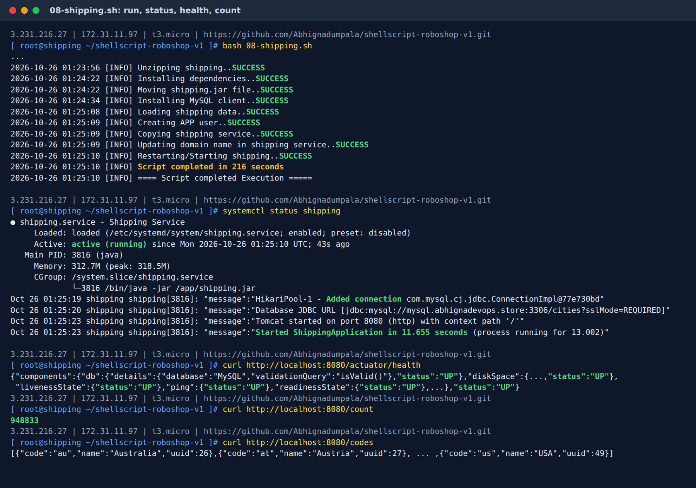

# 08-shipping.sh: Shipping Server

[← Day 16 notes](../README.md) · [Common part of every script](../00-common-part.md)

## What this server does


**Shipping** is a Java (Spring Boot) app. It looks up the city in **MySQL**, works out the distance and the shipping cost, and adds it to the cart.

| Fact | Value |
|------|-------|
| Server | `roboshop-shipping` (RHEL 9) |
| Software | Java 25 + Maven 3.9 |
| Port | 8080 |
| Called by | frontend |
| Calls | mysql (`DB_HOST`), cart (`CART_ENDPOINT`) |
| SG inbound | 8080 from `roboshop-frontend` |
| MySQL SG must allow | 3306 from `roboshop-shipping` |
| Config file I add | `/etc/systemd/system/shipping.service` |
| Files used | `08-shipping.sh`, `shipping.service` |
| Run time | **216 s** (Java + Maven install ~2 min 20 s, build 26 s, data load 34 s) |
| Result | health `UP` (db `UP`), `/count` = **948,833** cities |
| Data | `cities` database in MySQL (~948,833 cities) |

---

## Steps the script does

1. Common part: root check, log file, `timestamp`, `validate`
2. Install **Java 25 + Maven**
3. Make **Java 25** the default and set **`JAVA_HOME`**
4. Create the `roboshop` user (skip if it exists)
5. Clean `/app`, download and unzip the code
6. **Build** the app with Maven → `shipping.jar`
7. Install the **MySQL client**
8. **Load the cities data only if it isn't there yet** (count check)
9. Create the app's MySQL user
10. Copy `shipping.service` and put in my domain
11. Start (restart) shipping

---

## The code, block by block

### 1. The common part

```bash
user_id=$(id -u)
logs_folder="/var/log/roboshop"
logs_file="${logs_folder}/${0}.log"
domain_name="abhignadevops.store"
scripts_dir=$(dirname "$(realpath "$0")")
...
if [ $user_id -ne 0 ]; then ... exit 1; fi
mkdir -p $logs_folder
timestamp(){ ... }
validate(){ ... }
```

**What it does:** settings, root check, log folder, `timestamp` + `validate`. Same as every script: [00-common-part.md](../00-common-part.md).
`scripts_dir` is saved **before** `cd /app`, so `shipping.service` is still found later.

> ⚠️ `domain_name` must be **my** domain (`abhignadevops.store`). With another domain, `mysql.<their-domain>` doesn't resolve and the data load fails.

### 2. Install Java 25 + Maven

```bash
dnf module enable maven:3.9 -y &>> $logs_file
dnf install maven java-25-openjdk-devel -y &>> $logs_file
validate $? "Installing Java and Maven"
```

**What it does:** picks Maven 3.9 and installs Maven + the Java 25 **JDK**.

| Word | Meaning |
|------|---------|
| **Maven** | Java build tool: downloads libraries and packs the app into one `.jar` |
| **JDK** (`-devel`) | Java + build tools (compiler). Needed to **build**. The JRE alone can only **run** Java |

### 3. Make Java 25 the default + set JAVA_HOME

```bash
alternatives --set java "/usr/lib/jvm/java-25-openjdk/bin/java"
validate $? "Setting Java 25 as default Java version"

echo "export JAVA_HOME=$(dirname $(dirname $(readlink -f /usr/bin/java)))" > /etc/profile.d/java.sh
source /etc/profile.d/java.sh
echo $JAVA_HOME
validate $? "Setting JAVA_HOME for maven"
```

**What it does:**
1. `alternatives --set java ...`: `dnf install maven` also brings an older Java (21). This makes the `java` command point to **Java 25**.
2. Finds the real Java 25 folder and saves it as `JAVA_HOME` in `/etc/profile.d/java.sh`.
3. `source` loads it now; files in `/etc/profile.d/` also load at every login.

**How the JAVA_HOME line works:**

```
readlink -f /usr/bin/java   → /usr/lib/jvm/java-25-openjdk-25.0.1.../bin/java   (real file)
dirname                     → /usr/lib/jvm/java-25-openjdk-25.0.1.../bin
dirname again               → /usr/lib/jvm/java-25-openjdk-25.0.1...         = JAVA_HOME
```

**Why:** Maven needs `JAVA_HOME` to know **which Java** to build with.

> ⚠️ `validate $?` checks **only the command right above it**: here that's `echo $JAVA_HOME`, not the `export` or `source`. `echo` always returns `0`, even when the variable is empty, so this step **always says SUCCESS**.
>
> ```bash
> JAVA_HOME=""
> echo $JAVA_HOME; echo $?         # 0  → "success" although it's empty
> [ -n "$JAVA_HOME" ]; echo $?     # 1  → really tests the value
> ```
>
> | Line before `validate` | Empty `JAVA_HOME` gives |
> |------------------------|-------------------------|
> | `echo $JAVA_HOME` (my script now) | ✅ SUCCESS (wrong) |
> | `[ -n "$JAVA_HOME" ]` (`-n` = not empty) | ❌ FAILED (correct) |
>
> **Rule:** make the command right before `validate` the one that checks the thing I care about.

### 4. Create the app user (only if missing)

```bash
id roboshop &>> $logs_file
if [ $? -ne 0 ]; then
    useradd --system --home /app --shell /sbin/nologin --comment "roboshop system user" roboshop &>> $logs_file
    validate $? "Creating system user"
else
    echo -e "$(timestamp) [INFO] System user roboshop already exist...${Y}SKIPPING${N}"
fi
```

**What it does:** `id roboshop` fails (non-zero) if the user doesn't exist → create it. Exists → SKIPPING.
**Why:** the app runs as a normal user, not root. The check makes a 2nd run safe (**idempotent**).

### 5. Fresh app folder + download + unzip

```bash
rm -rf /app
validate $? "Removing old code"

mkdir -p /app
validate $? "Creating app directory"

curl -L -o /tmp/shipping.zip https://raw.githubusercontent.com/daws-92s/roboshop-documentation/refs/heads/main/artifacts/shipping-v4.zip &>> $logs_file
validate $? "Downloading shipping"

cd /app
unzip /tmp/shipping.zip &>> $logs_file
validate $? "Unzipping shipping"
```

**What it does:** deletes the old `/app`, creates it again, downloads the code zip and unzips it into `/app`.
**Why `rm -rf /app`:** on a re-run, `unzip` would ask "replace?" and hang. A fresh folder avoids that.

### 6. Build the app with Maven

```bash
mvn clean package &>> $logs_file
validate $? "Installing dependencies"

mv target/shipping.jar shipping.jar
validate $? "Moving shipping.jar file"
```

**What it does:**

| Part | Meaning |
|------|---------|
| `clean` | delete the old build (`target/`) |
| `package` | download libraries → compile → test → pack into `target/shipping.jar` |
| `mv target/shipping.jar shipping.jar` | put the jar in `/app`, where `shipping.service` expects it |

**Why:** Java must be **compiled** before it runs. Node.js doesn't need this step.
The first build is the slowest step: Maven downloads all the libraries into `~/.m2/repository`.

### 7. Install the MySQL client

```bash
dnf install mysql -y &>> $logs_file
validate $? "Installing MySQL client"
```

**What it does:** installs only the `mysql` **command** (client), not a MySQL server. It's needed to load data into the MySQL **server**.

### 8. Load the cities data only once (the count check)

```bash
count=$(mysql -h "mysql.$domain_name" -u root -p<password> -N -B -e "SELECT COUNT(*) FROM cities.cities;" 2>> $logs_file )
if [ -z "$count" ] || [ "$count" -eq 0 ]; then
    mysql -h "mysql.$domain_name" -uroot -p<password> < /app/db/master-data.sql &>> $logs_file
    validate $? "Loading shipping data"
else
    echo -e "$(timestamp) [INFO] Master data already loaded...${Y}SKIPPING${N}"
fi
```

**What it does:** asks MySQL "how many cities are there?", then loads the data **only** if the answer is empty or `0`.

**Every piece of the first line:**

| Part | Meaning |
|------|---------|
| `mysql -h "mysql.$domain_name"` | connect to the MySQL **server** by its DNS name |
| `-e "SELECT COUNT(*) FROM cities.cities;"` | run this one query: count rows in table `cities` of database `cities` |
| `-N` | no column name in the output, only the number |
| `-B` | batch mode: plain text, no table borders |
| `$( ... )` | **catch** the normal output and store it in `count` (nothing prints on screen) |
| `2>> $logs_file` | send **error messages** to the log file |

**The `if` and the load, piece by piece:**

| Part | Meaning |
|------|---------|
| `[ -z "$count" ]` | `-z` = "is it **empty**?" True when the query failed and printed nothing (no `cities` database yet) |
| `\|\|` | **OR**: if the left test is true, load; if not, try the right test |
| `[ "$count" -eq 0 ]` | `-eq` = numbers equal. True when the table exists but has **0** rows |
| `"$count"` in quotes | an empty variable stays `""`. Without quotes `[ -eq 0 ]` gives *"unary operator expected"* |
| `-z` test **first** | `[ "" -eq 0 ]` would error (`integer expression expected`). If `-z` is true, `\|\|` never runs the right side |
| `mysql ... < /app/db/master-data.sql` | `<` feeds the file into `mysql` as input: it runs every SQL line inside (create the `cities` database, table, ~948k rows) |
| `&>> $logs_file` on the load | output **and** errors go to the log. Without it, `mysql: [Warning] Using a password on the command line interface can be insecure.` prints between my SUCCESS lines |
| `validate $? "Loading shipping data"` | here the exit code **does** matter: the load must succeed |
| `else ... SKIPPING` | count is a number above 0 → data is already there, don't load it twice |

**In one line:** "ask MySQL how many cities there are. Nothing or zero → load them. Anything else → skip."

**Two kinds of numbers. Don't mix them up:**

| | What it is | Values |
|-|------------|--------|
| **Exit code** `$?` | did the command work? | `0` = success, `1` (non-zero) = **failure**. Always. |
| **Output pipe** `1>` / `2>` | where does the text go? | `1` = normal output, `2` = error messages |

```
                  ┌──► pipe 1 (normal output) ──► $( ) ──► count = "948833"
mysql query ──────┤
                  └──► pipe 2 (error message) ──► 2>> $logs_file
```

**What happens on each run:**

| Run | Query result | Exit code | `count` | Log file gets | Action |
|-----|--------------|-----------|---------|---------------|--------|
| **1st** (no data yet) | `ERROR 1049 Unknown database 'cities'` | 1 (failed) | **empty** `""` | the error text | `-z` true → **load data** |
| Database exists, table empty | `0` | 0 | `0` | nothing | `-eq 0` true → **load data** |
| **2nd** (data loaded) | `948833` | 0 | `948833` | nothing | **SKIPPING** |

**Why no `validate $?` after the count line:** on the 1st run the query **fails** (exit code 1), because the database isn't there yet. `validate` would print FAILED and **stop the script**, so the data would never load. Here a failed query just means "not loaded yet", so the script checks the **data count**, not the exit code.

**Same idea as my other checks:**

| Check | Fails / empty means | Then |
|-------|---------------------|------|
| `id roboshop` | user doesn't exist | create it |
| `rabbitmqctl list_users \| grep -qw roboshop` | RabbitMQ user doesn't exist | create it |
| `countDocuments()` (catalogue) | `0` products | load products |
| `SELECT COUNT(*) FROM cities.cities` | empty or `0` | load cities |

**Test it by hand** (on the shipping server, before loading):
```bash
mysql -h mysql.abhignadevops.store -uroot -p<password> -e "SELECT COUNT(*) FROM cities.cities;"
# ERROR 1049 (42000): Unknown database 'cities'
echo $?
# 1   ← the QUERY failed (data not there). Not the script.
```

### 9. Create the app's MySQL user

```bash
mysql -h "mysql.$domain_name" -uroot -p<password> < /app/db/app-user.sql &>> $logs_file
validate $? "Creating APP user"
```

**What it does:** runs the SQL file that creates the MySQL user **`shipping`**, which can use only the `cities` database.
**Why:** the app logs in as `shipping` (see `DB_USER` in the service file), not as `root`: **least privilege**.
It's outside the `if`, so it runs every time; the SQL must be safe to run again.

### 10. Install the service file with my domain

```bash
cp $scripts_dir/shipping.service /etc/systemd/system/shipping.service
validate $? "Copying shipping service"

sed -i "s/DOMAIN_NAME/$domain_name/g" /etc/systemd/system/shipping.service
validate $? "Updating domain name in shipping service"
```

**What it does:** copies `shipping.service` to systemd's folder, then replaces **every** `DOMAIN_NAME` in the copy (`/g` = all matches on a line).

```
before:  CART_ENDPOINT=cart.DOMAIN_NAME:8080       DB_HOST=mysql.DOMAIN_NAME
after:   CART_ENDPOINT=cart.abhignadevops.store:8080   DB_HOST=mysql.abhignadevops.store
```

**Why copy first, then `sed`:** my repo file keeps `DOMAIN_NAME`, so git stays clean and the next run works the same.

**Why here, after the MySQL steps:** the service file only has to be in place **before** `daemon-reload` (block 11). Its place among the other steps doesn't matter.

### 11. Start shipping

```bash
systemctl daemon-reload &>> $logs_file
systemctl enable shipping &>> $logs_file
systemctl restart shipping
validate $? "Restarting/Starting shipping"
```

| Command | Meaning |
|---------|---------|
| `daemon-reload` | systemd reads the new `shipping.service` |
| `enable` | start on every boot |
| `restart` | works whether it's stopped or running, and always loads the latest jar + config |

**Why start last:** the data (block 8) and the app user (block 9) must exist **before** shipping starts, or it fails to connect to MySQL.

---

## shipping.service, line by line

```ini
[Unit]
Description=Shipping Service
After=network-online.target

[Service]
User=roboshop
Environment=CART_ENDPOINT=cart.DOMAIN_NAME:8080
Environment=DB_HOST=mysql.DOMAIN_NAME
Environment=DB_USER=shipping
Environment=DB_PASSWORD=<password>
ExecStart=/bin/java -jar /app/shipping.jar
SyslogIdentifier=shipping
Restart=on-failure
RestartSec=5

[Install]
WantedBy=multi-user.target
```

| Line | Meaning |
|------|---------|
| `User=roboshop` | run as the app user, not root |
| `CART_ENDPOINT=cart.DOMAIN_NAME:8080` | **outgoing**: where cart is (`name:port`), to add the shipping cost |
| `DB_HOST=mysql.DOMAIN_NAME` | **outgoing**: where MySQL is |
| `DB_USER` / `DB_PASSWORD` | the MySQL app user from block 9 |
| `ExecStart=/bin/java -jar /app/shipping.jar` | start the Java app |
| `Restart=on-failure` + `RestartSec=5` | crashed? systemd restarts it after 5 s |

---

<details>
<summary><b>Full script in one piece</b> (click to open)</summary>

```bash
#!/bin/bash

user_id=$(id -u)
logs_folder="/var/log/roboshop"
logs_file="${logs_folder}/${0}.log"
domain_name="abhignadevops.store"
scripts_dir=$(dirname "$(realpath "$0")")
R="\e[31m"
G="\e[32m"
Y="\e[33m"
N="\e[0m"

if [ $user_id -ne 0 ]; then
    echo "Please run this script with sudo access.."
    exit 1
fi

mkdir -p $logs_folder

timestamp(){
    date +"%F %T"
}

validate(){
    if [ $1 -ne 0 ]; then
        echo -e "$(timestamp) [ERROR] ${2}..${R}FAILED${N}" | tee -a $logs_file
        exit 1
    else
        echo -e "$(timestamp) [INFO] ${2}..${G}SUCCESS${N}" | tee -a $logs_file
    fi
}
echo "$(timestamp) [INFO] ==== Script started execution ======" | tee -a $logs_file

dnf module enable maven:3.9 -y &>> $logs_file
dnf install maven java-25-openjdk-devel -y &>> $logs_file
validate $? "Installing Java and Maven"


alternatives --set java "/usr/lib/jvm/java-25-openjdk/bin/java"
validate $? "Setting Java 25 as default Java version"

echo "export JAVA_HOME=$(dirname $(dirname $(readlink -f /usr/bin/java)))" > /etc/profile.d/java.sh
source /etc/profile.d/java.sh
echo $JAVA_HOME
validate $? "Setting JAVA_HOME for maven"

id roboshop &>> $logs_file
if [ $? -ne 0 ]; then
    useradd --system --home /app --shell /sbin/nologin --comment "roboshop system user" roboshop &>> $logs_file
    validate $? "Creating system user"
else
    echo -e "$(timestamp) [INFO] System user roboshop already exist...${Y}SKIPPING${N}"
fi

rm -rf /app
validate $? "Removing old code"

mkdir -p /app
validate $? "Creating app directory"

curl -L -o /tmp/shipping.zip https://raw.githubusercontent.com/daws-92s/roboshop-documentation/refs/heads/main/artifacts/shipping-v4.zip &>> $logs_file
validate $? "Downloading shipping"

cd /app
unzip /tmp/shipping.zip &>> $logs_file
validate $? "Unzipping shipping"

mvn clean package &>> $logs_file
validate $? "Installing dependencies"

mv target/shipping.jar shipping.jar
validate $? "Moving shipping.jar file"

dnf install mysql -y &>> $logs_file
validate $? "Installing MySQL client"

count=$(mysql -h "mysql.$domain_name" -u root -p<password> -N -B -e "SELECT COUNT(*) FROM cities.cities;" 2>> $logs_file )
if [ -z "$count" ] || [ "$count" -eq 0 ]; then
    mysql -h "mysql.$domain_name" -uroot -p<password> < /app/db/master-data.sql &>> $logs_file
    validate $? "Loading shipping data"
else
    echo -e "$(timestamp) [INFO] Master data already loaded...${Y}SKIPPING${N}"
fi

mysql -h "mysql.$domain_name" -uroot -p<password> < /app/db/app-user.sql &>> $logs_file
validate $? "Creating APP user"

cp $scripts_dir/shipping.service /etc/systemd/system/shipping.service
validate $? "Copying shipping service"

sed -i "s/DOMAIN_NAME/$domain_name/g" /etc/systemd/system/shipping.service
validate $? "Updating domain name in shipping service"

systemctl daemon-reload &>> $logs_file
systemctl enable shipping &>> $logs_file
systemctl restart shipping
validate $? "Restarting/Starting shipping"

echo "$(timestamp) [INFO] Script completed in $SECONDS seconds"
echo "$(timestamp) [INFO] ==== Script completed Execution =====" | tee -a $logs_file
```

</details>

---

## How I ran it

```bash
# laptop
git add 08-shipping.sh shipping.service
git commit -m "Add shipping script and service"
git push                                   # d15c83b..f011c58  main -> main
bash roboshop.sh shipping
```

```
Creating instance: shipping
shipping ID: i-06c56a47daca4346b
shipping IP: 172.31.11.97
DNS updated: shipping.abhignadevops.store -> 172.31.11.97
```

```bash
# shipping server
ssh ec2-user@<shipping-public-ip>
sudo -i
git clone https://github.com/Abhignadumpala/shellscript-roboshop-v1.git
cd shellscript-roboshop-v1
bash 08-shipping.sh

# 2nd terminal: watch the slow steps (Maven build, ~948k rows)
tail -f /var/log/roboshop/08-shipping.sh.log
```

## Run + result



```
2026-10-26 01:23:56 [INFO] Unzipping shipping..SUCCESS
2026-10-26 01:24:22 [INFO] Installing dependencies..SUCCESS        ← mvn clean package: 26 s
2026-10-26 01:24:22 [INFO] Moving shipping.jar file..SUCCESS
2026-10-26 01:24:34 [INFO] Installing MySQL client..SUCCESS
2026-10-26 01:25:08 [INFO] Loading shipping data..SUCCESS          ← 948,833 cities: 34 s
2026-10-26 01:25:09 [INFO] Creating APP user..SUCCESS
2026-10-26 01:25:09 [INFO] Copying shipping service..SUCCESS
2026-10-26 01:25:09 [INFO] Updating domain name in shipping service..SUCCESS
2026-10-26 01:25:10 [INFO] Restarting/Starting shipping..SUCCESS
2026-10-26 01:25:10 [INFO] Script completed in 216 seconds
```

**Where the 216 s went:** Java + Maven install ≈ 2 min 20 s (before unzip), Maven build 26 s, data load 34 s, everything else a few seconds.

```
$ curl localhost:8080/actuator/health
{"components":{"db":{"details":{"database":"MySQL",...},"status":"UP"}, ... "status":"UP"}

$ curl localhost:8080/count
948833

$ curl localhost:8080/codes
[{"code":"au","name":"Australia",...}, ... {"code":"us","name":"USA","uuid":49}]     ← 25 countries
```

**Reading `systemctl status shipping` / the journal:**

| Log line | Meaning |
|----------|---------|
| `Main PID: 3816 (java)` · `/bin/java -jar /app/shipping.jar` | the jar from block 6 is running |
| `Memory: 312.7M` | Java uses far more memory than the Node apps (t3.micro has 1 GB) |
| `HikariPool-1 - Added connection ...` | the MySQL connection pool connected: DNS ✅ SG 3306 ✅ `shipping` DB user ✅ |
| `jdbc:mysql://mysql.abhignadevops.store:3306/cities` | `DB_HOST` from the service file, after `sed` |
| `Tomcat started on port 8080` | listening |
| `Started ShippingApplication in 11.655 seconds` | Spring Boot needs ~12 s to start, so `curl` right after the script can say "connection refused" |

| Check | Proves |
|-------|--------|
| health `db: UP` | shipping → mysql works |
| `/count` = `948833` | the count check loaded the data, and the app can read it |
| `/codes` | the country list comes from MySQL too |

## Verify

```bash
systemctl status shipping                     # active (running)
curl localhost:8080/actuator/health           # {"status":"UP", ... db UP}
curl localhost:8080/count                     # number of cities (~948833)
journalctl -u shipping -n 50                  # app log (Java errors: read the first "Caused by:")
```

On mysql:
```bash
mysql -uroot -p<password> -e "SELECT COUNT(*) FROM cities.cities;"
```

---

## Problems I hit

| Problem | Cause | Fix |
|---------|-------|-----|
| JAVA_HOME step always SUCCESS | `validate $?` checks `echo $JAVA_HOME`, and `echo` never fails | `[ -n "$JAVA_HOME" ]` right before `validate` (optional) |
| MySQL warning in the middle of my SUCCESS lines | The 2 load commands had no redirect | `&>> $logs_file` on both |
| Started from a copy with another domain | `domain_name` must be my own Route 53 zone | `abhignadevops.store`, checked with `grep -n domain_name=` |
| `sed` repo file → `cp` (other order) | Works for many runs, but the repo file is changed, so a later `git pull` on the server refuses | `cp` first, `sed` the copy |

---

## Interview questions

**1. Why `mvn clean package`?**
Java must be compiled. `clean` deletes the old build; `package` downloads libraries, compiles, tests and packs everything into one `.jar`.

**2. JDK vs JRE?**
The JRE only runs Java. The JDK = JRE + build tools (compiler). Building with Maven needs the JDK.

**3. Why set `JAVA_HOME`?**
Maven uses it to know which Java to build with. Two Java versions are installed, so it must point to Java 25.

**4. How do you load the cities only once?**
`count=$(mysql ... SELECT COUNT(*) ...)`. If `count` is empty (database missing) or `0`, load the data; otherwise SKIPPING.

**5. Why no `validate $?` after the count query?**
On the 1st run the query fails because the database doesn't exist yet. `validate` would stop the script. The failure is the expected answer "not loaded yet", so the script checks the count instead.

**6. What do `2>>` and `$( )` do in that line?**
`$( )` stores the normal output (the number) in `count`. `2>>` sends error messages to the log, so they don't end up in `count` or on screen.

**7. Why does the app use a `shipping` MySQL user, not root?**
Least privilege: it can only use the `cities` database. If the app is hacked, the attacker doesn't get MySQL root.
