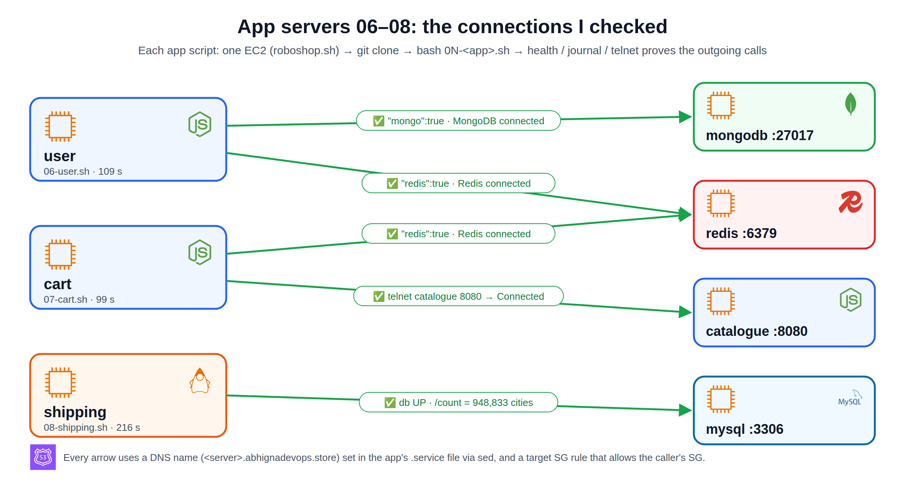
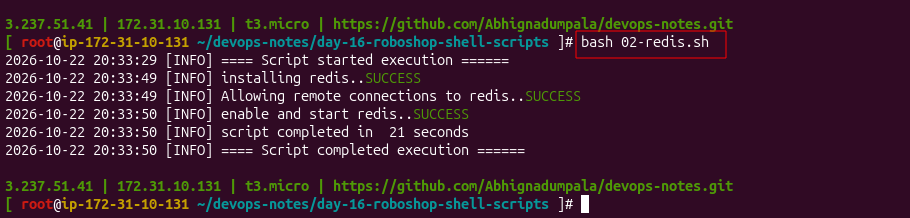
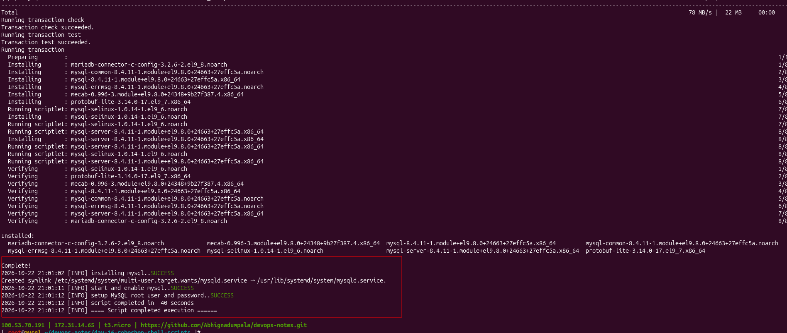
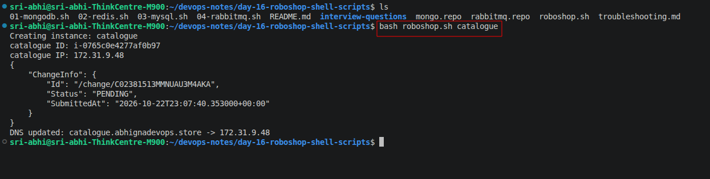
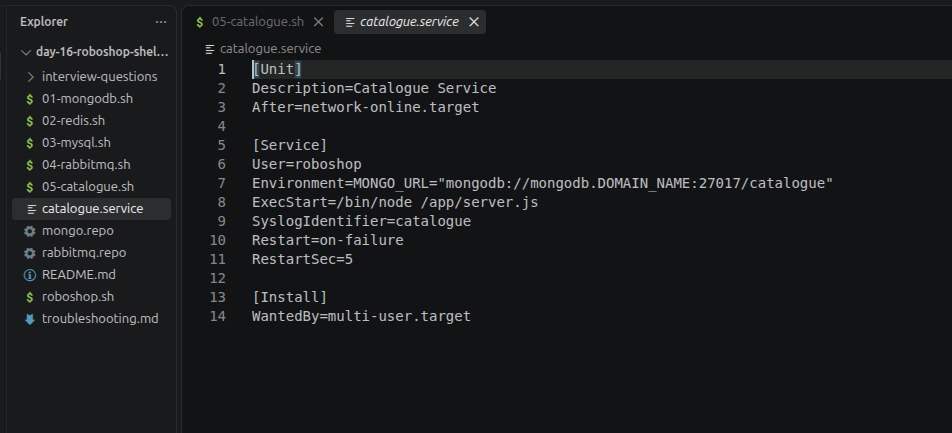
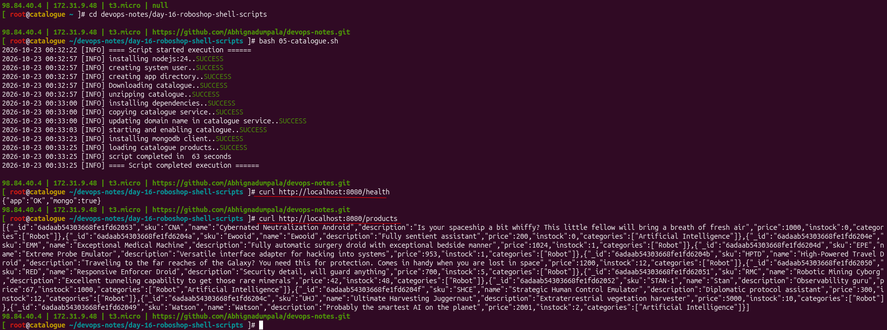

# Day 16 - RoboShop with Shell Scripts

> **In short:** Same RoboShop project, now **automated with shell scripts** instead of typing every command by hand. `roboshop.sh` runs on my **laptop** and creates the EC2 servers + Route 53 records through the AWS CLI. Each component script (`01-mongodb.sh`…) runs **on its own server** and installs that service. GitHub carries the scripts from my laptop to the servers.

> **Project repo:** the scripts and full project docs now live in [shellscript-roboshop-v1](https://github.com/Abhignadumpala/shellscript-roboshop-v1). This folder keeps my day-by-day learning notes.


**Progress**



| # | Script | Server | Status |
|---|--------|--------|--------|
| 01 | `01-mongodb.sh` | roboshop-mongodb | ✅ MongoDB 7.0 |
| 02 | `02-redis.sh` | roboshop-redis | ✅ Redis 7, 21 s |
| 03 | `03-mysql.sh` | roboshop-mysql | ✅ MySQL 8.4.11, 40 s (+ root@localhost bug found and fixed) |
| 04 | `04-rabbitmq.sh` | roboshop-rabbitmq | ✅ 36 s, re-run safe (SKIPPING) |
| 05 | `05-catalogue.sh` | roboshop-catalogue | ✅ 63 s, 11 products |
| 06 | `06-user.sh` | roboshop-user | ✅ 109 s, mongo + redis connected ([notes](06-user/README.md)) |
| 07 | `07-cart.sh` | roboshop-cart | ✅ 99 s, redis connected, catalogue:8080 reachable ([notes](07-cart/README.md)) |
| 08 | `08-shipping.sh` | roboshop-shipping | ✅ 216 s, health UP, 948,833 cities ([notes](08-shipping/README.md)) |
| 09 | `09-payment.sh` | roboshop-payment | ✅ 18 s, Python 3.14 + venv + gunicorn, rabbitmq true ([notes](09-payment/README.md)) |
| 10 | `10-frontend.sh` | roboshop-frontend | ✅ Nginx reverse proxy, all 5 `/api/*/health` 200, **3 orders placed** end to end ([notes](10-frontend/README.md)) |
| 11 | dispatch | roboshop-dispatch | ⏭️ server created, script next |

## Table of Contents

1. [Big picture: what runs where](#big-picture-what-runs-where)
2. [Files in this folder](#files-in-this-folder)
3. [Security groups: one common SG + one SG per component](#security-groups-one-common-sg--one-sg-per-component)
4. [roboshop.sh: create servers + DNS](#roboshopsh-create-servers--dns)
5. [01-mongodb.sh: install MongoDB on the server](#01-mongodbsh-install-mongodb-on-the-server)
6. [How I ran it (step by step)](#how-i-ran-it-step-by-step)
7. [Result](#result)
8. [Better logging: timestamp, log levels, $SECONDS](#better-logging-timestamp-log-levels-seconds)
9. [02-redis.sh](#02-redissh)
10. [03-mysql.sh (and the root@localhost bug)](#03-mysqlsh-and-the-rootlocalhost-bug)
11. [04-rabbitmq.sh + idempotency](#04-rabbitmqsh--idempotency)
12. [05-catalogue.sh: first app service](#05-cataloguesh-first-app-service)
13. [sed quick recap](#sed-quick-recap)
14. [Shell scripts vs real-time tools](#shell-scripts-vs-real-time-tools)
15. [Key takeaways](#key-takeaways)
16. [What I learned](#what-i-learned)
17. [Interview Questions](#interview-questions)

**More in this folder:** Each script has its own folder with the script, its config files and its explanation `README.md` (e.g. [05-catalogue/](05-catalogue/README.md)), common part in [00-common-part.md](00-common-part.md) · [Problems I hit and fixes](troubleshooting.md) · [Interview questions](interview-questions/README.md)

---

## Big picture: what runs where

```
 MY UBUNTU LAPTOP                              AWS
 ┌───────────────────────────┐          ┌──────────────────────────────┐
 │ day-16-roboshop-shell-    │          │ roboshop-mongodb (RHEL 9)    │
 │ scripts/                  │          │                              │
 │  ├ roboshop.sh ──① runs here──────────▶ creates this VM + DNS      │
 │  ├ 01-mongodb.sh          │          │ /root/devops-notes (clone)   │
 │  └ mongo.repo             │          │  └ 01-mongodb.sh ──④ runs here│
 └────────────┬──────────────┘          └──────────────▲───────────────┘
              │ ② git push                             │ ③ ssh + git clone
              ▼                                        │
        ┌──────────────────────────────────────────────┐
        │ GitHub: Abhignadumpala/devops-notes (public) │
        └──────────────────────────────────────────────┘
```

| Step | Where | What | Why |
|------|-------|------|-----|
| ① | Laptop | `bash roboshop.sh mongodb` | Calls the **AWS API**: creates the VM and DNS record. Installs nothing inside the VM |
| ② | Laptop → GitHub | `git push` | The new VM is empty; GitHub delivers the scripts |
| ③ | MongoDB VM | `ssh` → `sudo su -` → `git clone` | Same files now exist **inside** the server |
| ④ | MongoDB VM | `bash 01-mongodb.sh` | `dnf`, `systemctl`, `sed` act on **the machine they run on** |

> `01-mongodb.sh` can't run on the laptop: it would try to install MongoDB on the laptop (and Ubuntu has no `dnf`).

## Files in this folder

| File | Runs on | Does |
|------|---------|------|
| [roboshop.sh](00-roboshop/roboshop.sh) | Laptop (needs AWS CLI) | Creates EC2 instances + updates Route 53 |
| [01-mongodb.sh](01-mongodb/01-mongodb.sh) | MongoDB server (as root) | Installs and configures MongoDB 7.0 |
| [mongo.repo](01-mongodb/mongo.repo) | Copied by `01-mongodb.sh` and `05-catalogue.sh` | Tells `dnf` where to download MongoDB 7.0 (server, and the `mongosh` client) |
| [02-redis.sh](02-redis/02-redis.sh) | Redis server | Installs Redis 7, opens it to other servers |
| [03-mysql.sh](03-mysql/03-mysql.sh) | MySQL server | Installs MySQL 8.4, sets the root password, checks the login |
| [04-rabbitmq.sh](04-rabbitmq/04-rabbitmq.sh) | RabbitMQ server | Installs RabbitMQ, creates the `roboshop` app user (skips if it exists) |
| [rabbitmq.repo](04-rabbitmq/rabbitmq.repo) | Copied by `04-rabbitmq.sh` | Erlang + RabbitMQ repos (not in RHEL) |
| [05-catalogue.sh](05-catalogue/05-catalogue.sh) | Catalogue server | Node.js 24 app: user, code, npm, systemd service, product data |
| [catalogue.service](05-catalogue/catalogue.service) | Copied by `05-catalogue.sh` | systemd unit with a `DOMAIN_NAME` placeholder |
| [06-user.sh](06-user/06-user.sh) | User server | Node.js 24 app, `user.service` (Redis + MongoDB) |
| [user.service](06-user/user.service) | Copied by `06-user.sh` | `REDIS_URL` + `MONGO_URL` with `DOMAIN_NAME` |
| [07-cart.sh](07-cart/07-cart.sh) | Cart server | Node.js 24 app, `cart.service` (Redis + catalogue) |
| [cart.service](07-cart/cart.service) | Copied by `07-cart.sh` | `REDIS_HOST` + `CATALOGUE_HOST` with `DOMAIN_NAME` |
| [08-shipping.sh](08-shipping/08-shipping.sh) | Shipping server | Java 25 + Maven build, cities loaded once, app DB user |
| [shipping.service](08-shipping/shipping.service) | Copied by `08-shipping.sh` | `CART_ENDPOINT` + `DB_HOST` with `DOMAIN_NAME`, DB user |
| [09-payment.sh](09-payment/09-payment.sh) | Payment server | Python 3.14 + venv + `pip install`, gunicorn |
| [payment.service](09-payment/payment.service) | Copied by `09-payment.sh` | `CART_HOST`, `USER_HOST`, `AMQP_HOST` with `DOMAIN_NAME`, gunicorn from the venv |
| [10-frontend.sh](10-frontend/10-frontend.sh) | Frontend server | Nginx 1.26, web pages, `nginx -t` before restart |
| [roboshop.conf](10-frontend/roboshop.conf) | Copied by `10-frontend.sh` | Reverse proxy `/api/*` → apps on 8080, with `DOMAIN_NAME` |

## Security groups: one common SG + one SG per component

Every instance gets **two** SGs:

```
roboshop-mongodb  →  roboshop-mongodb + roboshop-common
roboshop-redis    →  roboshop-redis   + roboshop-common
```

| SG | Inbound rules |
|----|---------------|
| **roboshop-common** | Only **SSH 22 from My IP**. Attached to every instance |
| roboshop-frontend | 80 from anywhere |
| roboshop-mongodb | 27017 from catalogue, user |
| roboshop-redis | 6379 from user, cart |
| roboshop-mysql | 3306 from shipping |
| roboshop-rabbitmq | 5672 from payment, dispatch · 15672 from My IP |
| roboshop-catalogue | 8080 from frontend, cart |
| roboshop-user | 8080 from frontend, payment |
| roboshop-cart | 8080 from frontend, shipping, payment |
| roboshop-shipping / payment | 8080 from frontend |
| roboshop-dispatch | none (only connects out to RabbitMQ) |

> **Why a common SG:** SSH is in **one** place. If my home IP changes, I update **one** rule, not 11 SGs.

## roboshop.sh: create servers + DNS

```bash
bash roboshop.sh mongodb redis mysql      # one server per name
```

**Inputs at the top:**

| Variable | Value |
|----------|-------|
| `ami_id` | `ami-0055977a6e828a4f4` (Redhat-9-DevOps-Practice) |
| `instance_type` | `t3.micro` |
| `hosted_zone_id` | Route 53 zone of my domain |
| `domain_name` | `abhignadevops.store` |
| Key pair | None (password login for `ec2-user`) |

**What it does for each name:**

| Step | Command | Note |
|------|---------|------|
| 1. Create | `aws ec2 run-instances ... --security-groups "roboshop-common" "roboshop-$instance"` | SG **names** work in the default VPC |
| 2. Wait | `aws ec2 wait instance-running` | Public IP may be empty right after launch |
| 3. Get IP | `if [ $instance != "frontend" ]` → private IP, `else` → public IP | |
| 4. DNS | `aws route53 change-resource-record-sets` with `UPSERT` | Creates the record, or overwrites the old IP |

| Server | IP used | Route 53 record |
|--------|---------|-----------------|
| mongodb, redis, cart… | **Private** IP | `mongodb.abhignadevops.store` |
| frontend | **Public** IP | `abhignadevops.store` |

> **UPSERT** = **UP**date if it exists, in**SERT** if it doesn't.

**Quotes in the Route 53 JSON:** variables don't work inside single quotes. Close the quote around each variable:
```bash
'"Name": "'$r53_record_name'",'
```
→ `"Name": "mongodb.abhignadevops.store",`

## 01-mongodb.sh: install MongoDB on the server

**Common part** (same in every component script):

| Code | Meaning |
|------|---------|
| `user_id=$(id -u)` | root = `0` |
| `if [ $user_id -ne 0 ]; then ... exit 1` | Stop unless run as root (`dnf` and `systemctl` need root) |
| `logs_file="${logs_folder}/${0}.log"` | `$0` = script name → `/var/log/roboshop/01-mongodb.sh.log` |
| `mkdir -p $logs_folder` | Create the log folder; no error if it exists |
| `$(date +"%F %T")` | Date and time, e.g. `2026-10-22 00:15:30` |
| `&>> $logs_file` | Output **and** errors appended to the log |
| `R`, `G`, `Y`, `N` | Colors: red, green, yellow, normal |

**validate function** = checks each step:

```bash
validate(){
    if [ $1 -ne 0 ]; then
        echo -e "${2}..${R}FAILED${N}" | tee -a $logs_file
        exit 1
    else
        echo -e "${2}..${G}SUCCESS${N}" | tee -a $logs_file
    fi
}

dnf install mongodb-org -y &>> $logs_file
validate $? "Install MongoDB"
```

| Piece | Meaning |
|-------|---------|
| `$?` → `$1` | Exit code of the last command (`0` = success) |
| `"Install MongoDB"` → `$2` | Message to print |
| `echo -e` | Makes the color codes work |
| `tee -a` | Show on screen **and** append to the log |
| `exit 1` | Stop at the first failure |

**MongoDB steps:**

| Step | Command | Why |
|------|---------|-----|
| 1 | `cp mongo.repo /etc/yum.repos.d/mongo.repo` | Repo for MongoDB 7.0 (8.0 crashes on this AMI). Run from inside the folder |
| 2 | `dnf install mongodb-org -y` | Install |
| 3 | `systemctl enable mongod` + `start` | Start on boot + start now |
| 4 | `sed -i 's/127.0.0.1/0.0.0.0/g' /etc/mongod.conf` | Listen on all addresses so catalogue and user can connect |
| 5 | `systemctl restart mongod` | Config is read only at start |

```
Am I root? ─no─▶ "run with sudo" → exit 1
   │yes
   ▼
log folder → start time
repo → install → enable+start → sed → restart
   each step: validate → ✅ SUCCESS / ❌ FAILED + stop
```

## How I ran it (step by step)

**On the laptop:**
```bash
cd ~/devops-notes/day-16-roboshop-shell-scripts
bash roboshop.sh mongodb
git push
```

**On the MongoDB server:**
```bash
ssh ec2-user@<public-ip>
sudo su -
dnf install git -y
git clone https://github.com/Abhignadumpala/devops-notes.git
cd devops-notes/day-16-roboshop-shell-scripts
bash 01-mongodb.sh
```

> Changed a script later? Push from the laptop, then `git pull` on the server.

## Result

**roboshop.sh mongodb**
```
Creating instance: mongodb
mongodb ID: i-0b336bf4b51e709ea
mongodb IP: 172.31.0.236
DNS updated: mongodb.abhignadevops.store -> 172.31.0.236
```

**01-mongodb.sh**
```
Adding mongo repo..SUCCESS
Install MongoDB..SUCCESS
Enable and start MongoDB..SUCCESS
Updating remote connections to MongoDB..SUCCESS
Restarting MongoDB..SUCCESS
```

| Check | Result |
|-------|--------|
| Instance | `t3.micro`, RHEL 9 practice AMI, SGs `roboshop-mongodb` + `roboshop-common` |
| Route 53 | `mongodb.abhignadevops.store` → `172.31.0.236`, change status `INSYNC` |
| MongoDB | Installed, enabled, listening on `0.0.0.0:27017` |

**Stop vs start:** after a stop/start, the **private IP stays the same** (DNS still works) but the **public IP changes**.

## Better logging: timestamp, log levels, $SECONDS

From `02-redis.sh` on, every script uses an improved common part:

```bash
timestamp(){
    date +"%F %T"
}

validate(){
    if [ $1 -ne 0 ]; then
        echo -e "$(timestamp) [ERROR] ${2}..${R}FAILED${N}" | tee -a $logs_file
        exit 1
    else
        echo -e "$(timestamp) [INFO] ${2}..${G}SUCCESS${N}" | tee -a $logs_file
    fi
}

echo "$(timestamp) [INFO] ==== Script started execution ======" | tee -a $logs_file
...
echo "$(timestamp) [INFO] script completed in $SECONDS seconds" | tee -a $logs_file
```

| Piece | Meaning |
|-------|---------|
| `timestamp()` | A function: every line gets the date and time, like real logs |
| `[INFO]` / `[ERROR]` | **Log level**: easy to search with `grep ERROR` |
| `$SECONDS` | **Built-in** bash variable: seconds since the script started. Must be CAPITALS (`$seconds` is empty) |
| `&>> $logs_file` on `dnf` | Hundreds of dnf lines go to the log, the screen shows only SUCCESS lines |

```
2026-10-22 20:33:29 [INFO] ==== Script started execution ======
2026-10-22 20:33:49 [INFO] installing redis..SUCCESS
2026-10-22 20:33:50 [INFO] script completed in 21 seconds
```

**One validate for a group of commands**

```bash
dnf module disable redis -y &>> $logs_file
dnf module enable redis:7 -y &>> $logs_file
dnf install redis -y &>> $logs_file
validate $? "installing redis"
```

| Style | Pro | Con |
|-------|-----|-----|
| One validate **per command** | Catches every failure | Longer script |
| One validate **per group** (class) | Shorter | `$?` = only the **last** command; an earlier failure (e.g. `enable redis:7`) is missed |

> Script looks frozen? Its output goes to the log. Open a 2nd SSH session: `tail -f /var/log/roboshop/<script>.log`.

## 02-redis.sh

| Step | Command |
|------|---------|
| 1 | `dnf module disable redis -y` → `dnf module enable redis:7 -y` → `dnf install redis -y` |
| 2 | `sed -i -e 's/^bind 127.0.0.1/bind 0.0.0.0/' -e 's/^protected-mode yes/protected-mode no/' /etc/redis/redis.conf` |
| 3 | `systemctl enable redis` + `systemctl start redis` |

| vs MongoDB | MongoDB | Redis |
|------------|---------|-------|
| Repo file | ✅ `mongo.repo` | ❌ already in RHEL repos |
| Version | From the repo | `dnf module` disable → enable `:7` |
| Config | `bind` only | `bind` **and** `protected-mode` (two locks) |
| Restart needed? | Yes (sed after start) | No: **sed before the first start** |



## 03-mysql.sh (and the root@localhost bug)

```bash
dnf module enable mysql:8.4 -y &>> $logs_file
dnf install mysql-server -y &>> $logs_file
validate $? "installing mysql"

systemctl enable mysqld &>> $logs_file
systemctl start mysqld &>> $logs_file
validate $? "start and enable mysql"

mysql_secure_installation --set-root-pass RoboShop@1 &>> $logs_file
validate $? "setup MySQL root user and password"

mysql -uroot -e "ALTER USER 'root'@'localhost' IDENTIFIED BY 'RoboShop@1';" &>> $logs_file
validate $? "setting password for root@localhost"

mysql -uroot -pRoboShop@1 -e "SELECT VERSION();" &>> $logs_file
validate $? "checking root login with password"
```



**The bug:** the script said SUCCESS, but `mysql -uroot -pRoboShop@1` gave `ERROR 1045 Access denied for user 'root'@'localhost'`.

**Proof** (logged in with no password, which only works if the password is empty):
```
mysql -uroot -e "SELECT user, host, plugin, authentication_string='' AS no_password FROM mysql.user;"
| root | %         | caching_sha2_password | 0 |   ← has the password
| root | localhost | caching_sha2_password | 1 |   ← EMPTY password
```

In MySQL a user = **name + where it logs in from**. `root` is really **2 accounts**:

| Account | Who logs in | After `--set-root-pass` |
|---------|-------------|-------------------------|
| `root@'%'` | Other servers (shipping, `mysql -h <host>`) | ✅ RoboShop@1 |
| `root@localhost` | The MySQL server itself | ❌ empty |

```
                MySQL server
   ┌───────────────────────────────┐
   │ mysql -uroot (on this server) │ ← root@localhost   no password ❌
   └───────────────────────────────┘
                 ▲ network :3306
 shipping server ┘                   ← root@'%'         RoboShop@1 ✅
```

| Question | Answer |
|----------|--------|
| Did I miss a step? | No. The trainer's doc has only `mysql_secure_installation --set-root-pass` |
| Why no error for the trainer? | The doc verifies with plain `mysql` (**no password**), which only works **because** root@localhost is empty. Shipping connects with `-h` as `root@'%'`, so the app works |
| Does the app need the fix? | No. It's a **security** fix: anyone on the server had passwordless MySQL root |
| Fix | `ALTER USER 'root'@'localhost' IDENTIFIED BY 'RoboShop@1';` + a **login check** step |

> **Lesson:** a command can return success without doing everything. Validate the **result** (log in), not only the exit code.
> Real time: apps use their own least-privilege user (`shipping` → only the `cities` DB), and passwords come from **Secrets Manager / SSM**, not from code in GitHub.

## 04-rabbitmq.sh + idempotency

| Step | Command |
|------|---------|
| 1 | `cp rabbitmq.repo /etc/yum.repos.d/rabbitmq.repo` |
| 2 | `dnf install erlang rabbitmq-server -y` |
| 3 | `systemctl enable rabbitmq-server` + `start` |
| 4 | `rabbitmqctl add_user roboshop roboshop123` (only if missing) |
| 5 | `rabbitmqctl set_permissions -p / roboshop ".*" ".*" ".*"` = configure, write, read on vhost `/` |


| Check | Meaning |
|-------|---------|
| `*:5672` | AMQP port, used by payment and dispatch |
| `0.0.0.0:25672` | RabbitMQ's clustering port (not used here) |
| `guest [administrator]` | Default user, can only log in from the same server |
| `roboshop []` | App user, no admin tag needed |

**Idempotent** = safe to run again. On a 2nd run `add_user roboshop` fails ("user already exists") → validate → script stops. Fix: **check first**.

```bash
rabbitmqctl list_users | grep -qw "roboshop"
if [ $? -ne 0 ]; then
    rabbitmqctl add_user roboshop roboshop123 &>> $logs_file
    validate $? "Creating RabbitMQ user for Roboshop"
else
    echo -e "$(timestamp) [INFO] RabbitMQ user already exist...${Y}SKIPPING${N}" | tee -a $logs_file
fi
```

| Part | Meaning |
|------|---------|
| `grep -q` | Quiet: print nothing, only set `$?` (0 = found) |
| `grep -w` | Whole word: `roboshop` but not `roboshop2` |
| `set_permissions` outside the `if` | Safe to run every time |

**2nd run (tested):** user step → yellow **SKIPPING**, everything else SUCCESS.


> The 2nd run took 86 s (82 s in `dnf install`): dnf refreshes the 4 RabbitMQ repos' metadata (`metadata_expire=300`) and checks signatures before saying "already installed".

## 05-catalogue.sh: first app service



| # | Step | Command |
|---|------|---------|
| 1 | Node.js 24 | `dnf module disable nodejs` → `enable nodejs:24` → `install nodejs` |
| 2 | App user (if missing) | `id roboshop` → `useradd --system --home /app --shell /sbin/nologin ... roboshop` |
| 3 | App folder | `mkdir -p /app` |
| 4 | Download | `curl -L -o /tmp/catalogue.zip <artifact URL>` |
| 5 | Unzip | `cd /app` → `rm -rf /app/*` → `unzip /tmp/catalogue.zip` |
| 6 | Libraries | `npm install` |
| 7 | Service | `cp $scripts_dir/catalogue.service /etc/systemd/system/` → `sed` the domain |
| 8 | Start | `systemctl daemon-reload` → `enable` → `start catalogue` |
| 9 | Mongo client | `cp $scripts_dir/mongo.repo ...` → `dnf install mongodb-mongosh -y` |
| 10 | Products (only once) | `countDocuments()` → if `0`, `mongosh --host mongodb.$domain_name </app/db/master-data.js`, else SKIPPING |
| 11 | Restart | `systemctl restart catalogue` → picks up every change from this run |

**New tricks in this script**

| Trick | Code | Why |
|-------|------|-----|
| Remember the script folder | `scripts_dir=$(dirname "$(realpath "$0")")` (at the top) | After `cd /app`, `cp catalogue.service` looks in `/app` → "No such file" |
| Clean before unzip | `rm -rf /app/*` | On a re-run unzip asks "replace?"; output goes to the log, so the script **looks frozen** |
| Skip existing user | `id roboshop` + `if` | `useradd` fails on a 2nd run |
| Placeholder in the service file | `mongodb.DOMAIN_NAME` + `sed -i "s/DOMAIN_NAME/$domain_name/"` | Domain lives in **one** variable; DNS name, not IP |
| `sed` the **copy**, not the repo file | `cp` first, then `sed` on `/etc/systemd/system/catalogue.service` | The repo file keeps `DOMAIN_NAME`, git stays clean, works again next run |
| `daemon-reload` | before `start` | systemd reads the new unit file |
| Load products only once | `product_count=$(mongosh ... --eval '...countDocuments()')` + `if [ "$product_count" -eq 0 ]` | A 2nd run would add all products again |
| Restart at the end | `systemctl restart catalogue` + `validate` | `start` does nothing if it's already running; `restart` always loads the new config/code |

**`$PWD` vs `realpath "$0"`**

| | `$PWD` | `$(dirname "$(realpath "$0")")` |
|---|---|---|
| Gives | folder **I am in** when I run it | folder **the script lives in** |
| `cd shell-roboshop-v1; sudo sh 05-catalogue.sh` | ✅ | ✅ |
| `sudo sh shell-roboshop-v1/05-catalogue.sh` from `~` | ❌ `/home/ec2-user` | ✅ |

```
$0                       05-catalogue.sh
realpath "$0"            /home/ec2-user/shell-roboshop-v1/05-catalogue.sh
dirname  ...             /home/ec2-user/shell-roboshop-v1   → scripts_dir
cd /app                  scripts_dir does not change
cp "$scripts_dir/catalogue.service" ...   ✅ full path
```

- Run it at the **top**, before any `cd`: `realpath` joins the **current** folder + name.
- Don't hard-code the path: my laptop and EC2 have different folders.

**catalogue.service**



```
repo file:    mongodb://mongodb.DOMAIN_NAME:27017/catalogue
   │ cp → /etc/systemd/system/   then   sed s/DOMAIN_NAME/abhignadevops.store/
   ▼
on server:    mongodb://mongodb.abhignadevops.store:27017/catalogue
```

**Result:** 63 s, then `/health` → `{"app":"OK","mongo":true}` and `/products` → all **11 products**.



**Idempotent product load:**
```bash
product_count=$(mongosh --host mongodb.$domain_name --quiet \
  --eval 'db.getSiblingDB("catalogue").products.countDocuments()' 2>> $logs_file)
validate $? "connecting to mongodb"

if [ "$product_count" -eq 0 ]; then
    mongosh --host mongodb.$domain_name </app/db/master-data.js &>> $logs_file
    validate $? "loading catalogue products"
else
    echo -e "$(timestamp) [INFO] products are already loaded...${Y}SKIPPING${N}"
fi

systemctl restart catalogue &>> $logs_file
validate $? "restarting catalogue"
```

> **Rule for every app script:** end with `systemctl restart <service>` + `validate $?`. `start` does nothing on a running service, so on a re-run new config or code would be ignored.

## sed quick recap

**sed = Stream EDitor**: edits text line by line without opening the file.

| Option | Meaning |
|--------|---------|
| `sed -e '...' file` | Print the result only; file not changed |
| `sed -i '...' file` | **In-place**: save the change into the file |
| `s/old/new/g` | Substitute; `g` = all matches on the line |
| `sed -i '1a text' file` | Append a line **after** line 1 |
| `sed -i '1i text' file` | Insert a line **before** line 1 |
| `sed -i '1c text' file` | Change line 1 |
| `sed -i '/^mail/c text' file` | Change the line that **starts with** `mail` |
| `sed -i -e 's/a/b/' -e 's/c/d/' file` | Two replacements in one command (Redis) |
| `sed -i "s/DOMAIN_NAME/$domain_name/" file` | **Double quotes** so `$domain_name` is replaced. Needs **3 slashes** `s/old/new/` |

## Shell scripts vs real-time tools

| Task | Today (shell) | Real-time tool |
|------|---------------|----------------|
| Create servers, SGs, DNS | `roboshop.sh` | **Terraform** |
| Install and configure software | `01-mongodb.sh` | **Ansible** |
| Package the app | Install on each server | **Docker** |
| Run many services | 11 EC2 servers | **Kubernetes** |
| Databases | Install MongoDB / MySQL / Redis | **RDS, DocumentDB, ElastiCache** |

> Shell is still used daily for small automation, CI/CD steps, EC2 user data and troubleshooting. Those tools automate these same steps.

## Key takeaways

- **Laptop** creates servers (AWS API); **each server** installs its own software.
- **GitHub** moves scripts from the laptop to the servers.
- **roboshop-common** holds SSH for all servers; component SGs hold only app ports.
- **frontend → public IP + root domain**, everything else → **private IP + `<name>.domain`**.
- **validate + `$?`** = stop at the first failed step with a clear SUCCESS / FAILED message.
- **Logs** go to `/var/log/roboshop/<script>.log`, with timestamps and `[INFO]`/`[ERROR]` levels.
- **Idempotent** scripts check before creating (`id roboshop`, `list_users | grep -qw`, `rm -rf /app/*`, `countDocuments()`), so a re-run SKIPS instead of failing.
- **Always `systemctl restart <service>` + `validate`** at the end of an app script: `start` ignores changes if the service is already running.
- **Validate the result, not only the exit code:** `mysql_secure_installation` said SUCCESS but left `root@localhost` without a password; a login check caught it.
- **`scripts_dir=$(dirname "$(realpath "$0")")`** before any `cd`, so the script finds its own files from any folder.
- **Placeholders + sed** keep the domain in one variable; config files use **DNS names**, not IPs.
- **Check values, not only exit codes:** a failed `run-instances` leaves `$instance_id` empty, and `describe-instances` with an empty ID returns **every** instance. Stop with `[ -z "$instance_id" ]` (or `${instance_id:?}`); `set -euo pipefail` is the safety net ([Day 15](../day-15-shell-loops-error-handling-aws-cli/README.md#exit-code-0-is-not-enough-check-empty-values)).

## What I learned

- **Laptop** creates servers + DNS (`roboshop.sh`); **each server** runs its own install script, pulled from **GitHub**.
- **SGs:** `roboshop-common` for SSH + one SG per component for its app port. SG **names** must exist, or `groupId` is empty.
- **frontend** → public IP + root domain; the rest → private IP + `<name>.domain` (Route 53 UPSERT).
- **validate + logs** (`/var/log/roboshop/`, timestamps, `[INFO]`/`[ERROR]`) on every step.
- **Idempotent** re-runs: check first (`id roboshop`, `list_users`, `countDocuments()`), else SKIPPING.
- End app scripts with **`systemctl restart` + `validate`**; validate the **result**, not only the exit code.
- `scripts_dir=$(dirname "$(realpath "$0")")` + placeholders with `sed` for the domain.

---

## Interview Questions

Practice questions with short answers → [interview-questions/](interview-questions/README.md)

Something broken? → [Debugging guide: which error → what to check](../roboshop-debugging-guide/README.md) · [Problems I hit](troubleshooting.md)
