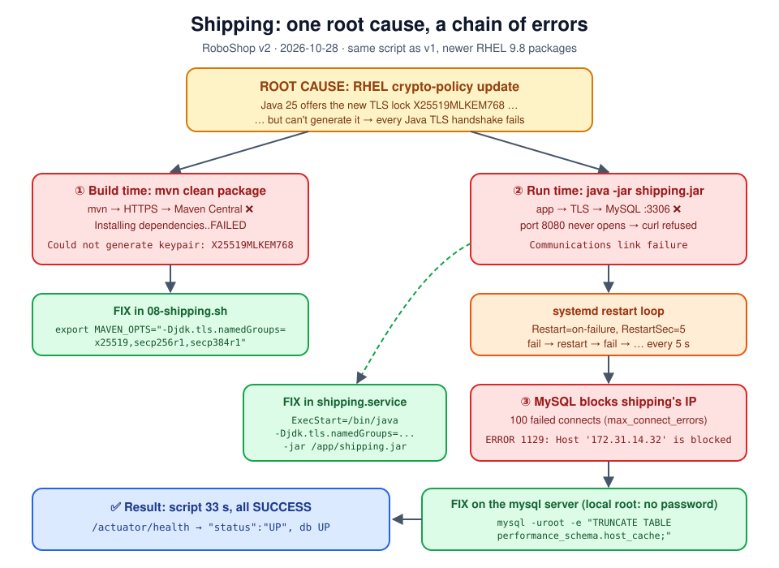
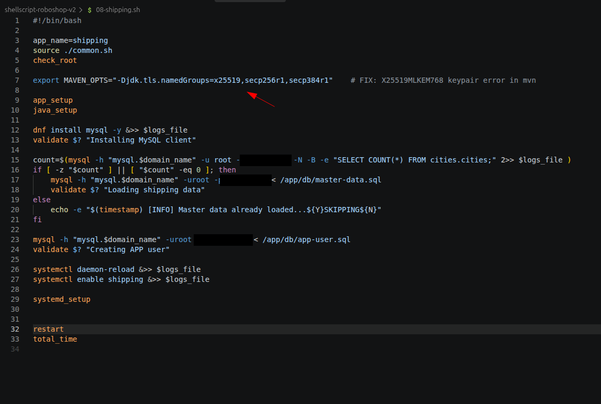
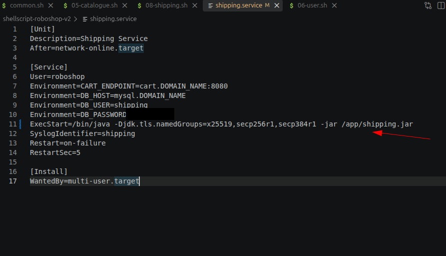
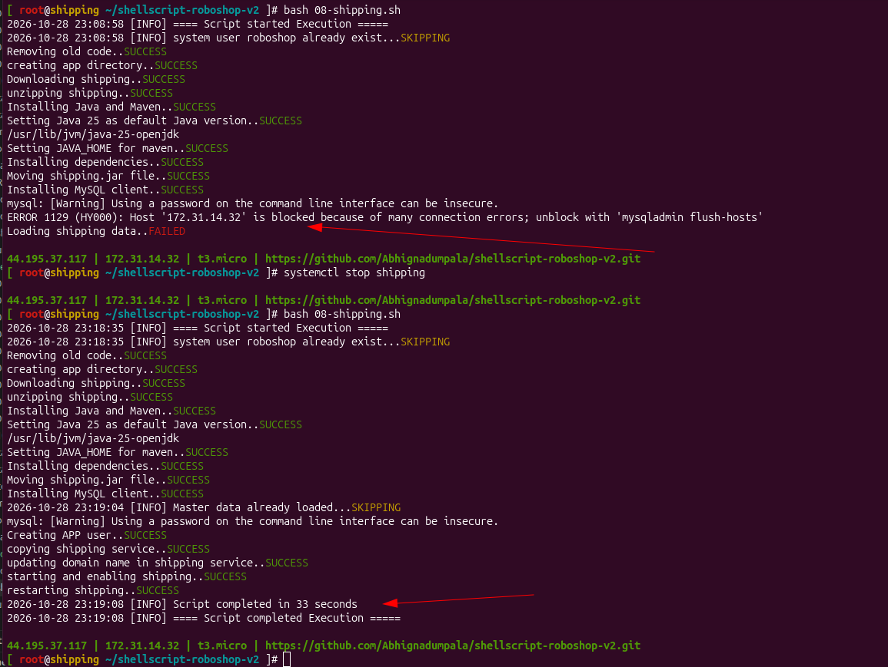
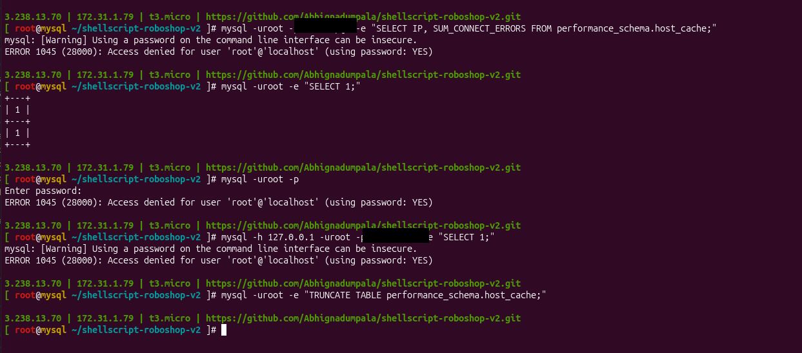
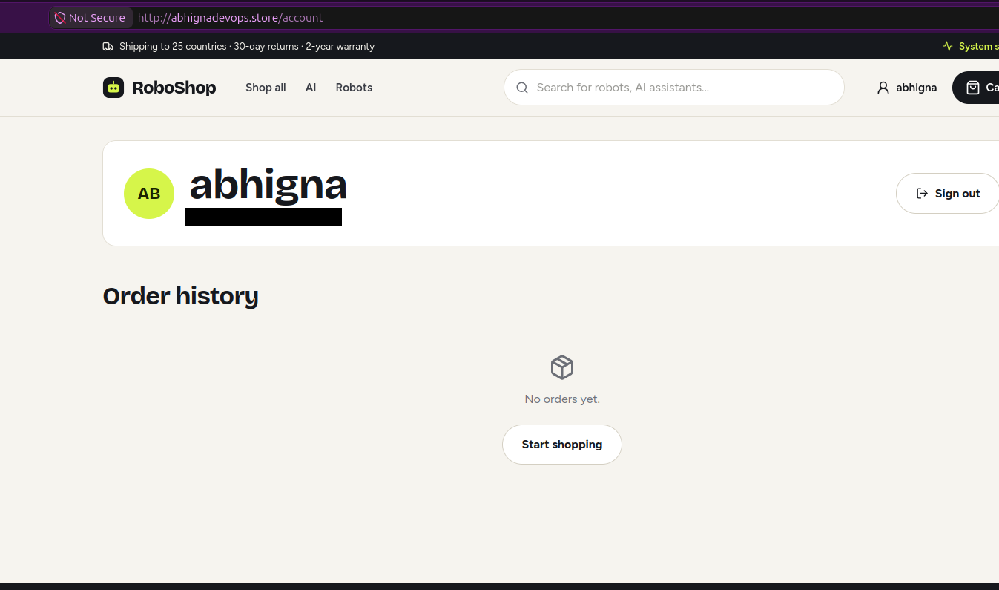

# Day 17 - Troubleshooting

[← Back to Day 17 notes](../README.md)

Real problems I hit while building RoboShop v2 (`03` to `09`), what each error meant, and how I fixed it. The full run with screenshots is in [hands-on/](../hands-on/README.md).



## Table of Contents

1. [`cannot stat 'rabbitmq.repo'`: validate stopped the script](#1-cannot-stat-rabbitmqrepo-validate-stopped-the-script)
2. [How my validate function stopped the script](#2-how-my-validate-function-stopped-the-script)
3. [Safe to run again: the RabbitMQ user check](#3-safe-to-run-again-the-rabbitmq-user-check)
4. [`Unit mysql.service could not be found`](#4-unit-mysqlservice-could-not-be-found)
5. [`images/` folder not showing in `git status`](#5-images-folder-not-showing-in-git-status)
6. [Removing a file I already pushed](#6-removing-a-file-i-already-pushed)
7. [Shipping `mvn` fails: `X25519MLKEM768` keypair not available](#7-shipping-mvn-fails-x25519mlkem768-keypair-not-available)
8. [`cannot stat ... catalogue.service`: same mistake, second time](#8-cannot-stat--catalogueservice-same-mistake-second-time)
9. [Shipping app: 8080 never opens, same TLS error to MySQL](#9-shipping-app-8080-never-opens-same-tls-error-to-mysql)
10. [MySQL `ERROR 1129`: host is blocked](#10-mysql-error-1129-host-is-blocked)
11. [`Access denied for root@localhost` on the mysql server](#11-access-denied-for-rootlocalhost-on-the-mysql-server)
12. [Order confirmed, but order history empty (`/check` 404)](#12-order-confirmed-but-order-history-empty-check-404)
13. [Quick Checklist](#quick-checklist)

---

## 1. `cannot stat 'rabbitmq.repo'`: validate stopped the script

**Definition:** `cannot stat` = `cp` could not find the source file. *stat* is the system call that reads a file's details; if the file isn't there, it fails.

**What I saw** (on the rabbitmq server, inside `shellscript-roboshop-v2`):
```text
[ root@rabbitmq ~/shellscript-roboshop-v2 ]# bash 04-rabbitmq.sh
2026-10-28 20:19:10 [INFO] ==== Script started Execution =====
cp: cannot stat 'rabbitmq.repo': No such file or directory
adding rabbitmq repo..FAILED
```

**How I found the cause:**

| Step | Command | Result |
|---|---|---|
| 1. Read the error | - | `cp` can't find `rabbitmq.repo` |
| 2. Am I in the right folder? | `pwd` | `/root/shellscript-roboshop-v2` ✅ |
| 3. Is the file there? | `ls` | `01-mongodb.sh 02-redis.sh 03-mysql.sh 04-rabbitmq.sh common.sh mongo.repo roboshop.sh` ❌ no `rabbitmq.repo` |

**Cause:** I wrote `04-rabbitmq.sh` but **never added `rabbitmq.repo` to the repo**. The server only gets what's in GitHub.

**Fix: always at the source (laptop), never only on the server:**

```text
laptop                         GitHub                    rabbitmq server
create rabbitmq.repo  ──push──►  3a92459  ──git pull──►  rabbitmq.repo ✅
                                                          bash 04-rabbitmq.sh
```

```bash
# laptop
git add rabbitmq.repo
git commit -m "Add rabbitmq.repo"
git push

# server
git pull                  # 367f9f0..3a92459  create mode 100644 rabbitmq.repo
bash 04-rabbitmq.sh
```

**Result after the fix:**
```text
2026-10-28 20:21:21 [INFO] ==== Script started Execution =====
adding rabbitmq repo..SUCCESS
installing rabbitmq server..SUCCESS
starting and enabling rabbitmq server..SUCCESS
Creating RabbitMQ user for Roboshop..SUCCESS
Setting permissions for RabbitMQ user for Roboshop..SUCCESS
2026-10-28 20:24:22 [INFO] Script completed in 181 seconds
```

| | Time |
|---|---|
| First failure | 20:19:10 |
| Fixed run started | 20:21:21 |
| Time to find + fix | **~2 minutes** |

Why I didn't just create the file on the server: the next server I build would have the same problem, and `git pull` could later refuse because of a local file. **Fix in Git, then pull.**

## 2. How my validate function stopped the script

**Definition:** `$?` = the exit status of the **last** command. `0` = success, anything else = failure.

**My `validate` in `common.sh`:**
```bash
validate(){
    if [ $1 -ne 0 ]; then                                   # $1 = exit status ($?)
        echo -e "${2}..${R}FAILED${N}" | tee -a $logs_file  # $2 = step name
        exit 1                                              # stop the whole script
    else
        echo -e "${2}..${G}SUCCESS${N}" | tee -a $logs_file
    fi
}
```

**In `04-rabbitmq.sh`:**
```bash
cp rabbitmq.repo /etc/yum.repos.d/rabbitmq.repo
validate $? "adding rabbitmq repo"
```

**What happened step by step:**

| # | What ran | Value |
|---|---|---|
| 1 | `cp rabbitmq.repo ...` | fails, prints `cannot stat` |
| 2 | `$?` | `1` (not 0) |
| 3 | `validate 1 "adding rabbitmq repo"` | `1 -ne 0` is true |
| 4 | prints | `adding rabbitmq repo..FAILED` (also written to `/var/log/roboshop/04-rabbitmq.sh.log`) |
| 5 | `exit 1` | **script stops**: `dnf install`, `systemctl`, `rabbitmqctl` never run |

**Without validate** the script would carry on:

| Step | With validate ✅ | Without validate ❌ |
|---|---|---|
| copy repo | FAILED → stop | error, keeps going |
| `dnf install rabbitmq-server` | not run | fails: `No match for argument` (no repo) |
| `systemctl start rabbitmq-server` | not run | fails: unit not found |
| `rabbitmqctl add_user` | not run | fails: command not found |
| What I see | **1 clear error at the real cause** | 4 errors; the real one is buried at the top |

**Rule:** stop at the **first** failure. The first error is the real cause; everything after it is just a side effect.

## 3. Safe to run again: the RabbitMQ user check

**Definition:** *idempotent* = running a script twice gives the same result as running it once, without new errors.

`rabbitmqctl add_user` fails if the user already exists, so my script checks first:
```bash
rabbitmqctl list_users | grep -qw "roboshop"
if [ $? -ne 0 ]; then
     rabbitmqctl add_user roboshop <rabbitmq-password> &>> $logs_file
     validate $? "Creating RabbitMQ user for Roboshop"
else
    echo -e "$(timestamp) [INFO] RabbitMQ user already exist...${Y}SKIPPING${N}" | tee -a $logs_file
fi
```

| Flag | Meaning |
|---|---|
| `grep -q` | quiet: print nothing, only set `$?` (0 = found) |
| `grep -w` | whole word: `roboshop` doesn't match `roboshop2` |

| Run | User exists? | Output |
|---|---|---|
| 1st (after the fix) | no | `Creating RabbitMQ user for Roboshop..SUCCESS` |
| 2nd, 3rd... | yes | `RabbitMQ user already exist...SKIPPING` |

The two failed runs before the fix stopped at step 1, so they never reached this part.

## 4. `Unit mysql.service could not be found`

**What I saw** (right after `03-mysql.sh` finished with all SUCCESS in **25 seconds**):
```text
[ root@mysql ~/shellscript-roboshop-v2 ]# systemctl status mysql
Unit mysql.service could not be found.
```

**Cause:** wrong name. MySQL was running fine. On RHEL the **service** is `mysqld` (*d* = daemon, a background process). `mysql` is the **client** I log in with.

**Fix:**
```bash
systemctl status mysqld
ss -lntp | grep 3306
```

**Find the real name yourself:**
```bash
systemctl list-units --type=service | grep -i mysql
grep -i systemctl 03-mysql.sh            # the name my script started is the real one
```

| App | Service name | Client / tool | Port |
|---|---|---|---|
| MySQL | `mysqld` | `mysql` | 3306 |
| MongoDB | `mongod` | `mongosh` | 27017 |
| Redis | `redis` | `redis-cli` | 6379 |
| RabbitMQ | `rabbitmq-server` | `rabbitmqctl` | 5672 (15672 UI) |

## 5. `images/` folder not showing in `git status`

**What I saw:**
```text
$ mkdir images
$ git status
nothing to commit, working tree clean
```

**Cause:** Git tracks **files**, not folders. An empty folder has nothing to save.

**Fix:** put a file in it:
```bash
cp ~/Pictures/Screenshots/<file>.png images/03-mysql-running.png
git status        # Untracked files: images/
```
Empty folder I still want in Git → `touch images/.gitkeep` (just a naming habit, any file works).

## 6. Removing a file I already pushed

I pushed a trial image (`images/roboshop.png`) and wanted it gone.

```bash
git rm images/roboshop.png        # delete + stage the deletion in one step
git commit -m "Remove trial image"
git push
```

| | Result |
|---|---|
| GitHub + my laptop | file gone |
| `images/` folder | gone too: it became empty |
| Git history | old commit still has the image (fine for a trial; removing it means rewriting history + force push) |

`git rm` vs `rm`: `rm` only deletes from disk, then I still need `git add`. `git rm` does both.

## 7. Shipping `mvn` fails: `X25519MLKEM768` keypair not available

**Definition:** *TLS handshake* = the first step of every HTTPS connection, where both sides agree on an encryption method (a "lock") before any data moves.

**What I saw:**
```text
Setting JAVA_HOME for maven..SUCCESS
Installing dependencies..FAILED
```
The screen only says FAILED because `mvn` output goes to the log. The real error:
```bash
grep -n "ERROR\|FATAL" /var/log/roboshop/08-shipping.sh.log | tail
```
```text
[FATAL] Non-resolvable parent POM ... spring-boot-starter-parent:pom:4.1.1
Could not transfer artifact ... from/to central (https://repo.maven.apache.org/maven2):
(internal_error) Could not generate keypair for algorithm: X25519MLKEM768
... ML-KEM-768 KeyPairGenerator not available
```

**Reading it:**

| Part | Meaning |
|---|---|
| `Could not transfer ... https://` | Maven couldn't download from the internet |
| `X25519MLKEM768` | a new **post-quantum** TLS lock |
| `KeyPairGenerator not available` | Java was told to offer it but **can't make it** → handshake fails before the download starts |

Not my code (same as v1, which worked), not memory, not internet.

**Why the server offers the new lock:**

**Definition:** *crypto policy* = RHEL's system-wide rulebook for which encryption all programs (Java, curl, ssh, dnf) may use. Java reads `/etc/crypto-policies/back-ends/java.config`.

```text
crypto-policies update (el9_8)  →  rulebook: "offer X25519MLKEM768"   ✅ updated
java-25-openjdk                 →  can't generate that key            ❌ not ready
                                →  every HTTPS download from Java fails
```

Why post-quantum locks: future quantum computers could break today's locks, so attackers can save traffic now and decrypt it later ("harvest now, decrypt later"). Vendors are adding new locks early.

```bash
update-crypto-policies --show                               # DEFAULT
grep -i mlkem /etc/crypto-policies/back-ends/java.config    # the new lock in Java's rulebook
rpm -q crypto-policies java-25-openjdk-headless             # package versions
```

**Why it worked in v1:** same script, **different packages**. Every new server runs `dnf install` and gets the **latest** versions. v1 (2 weeks earlier) had the older rulebook without the new lock.

| | v1 | v2 (2026-10-28) |
|---|---|---|
| Script | same | same |
| Packages | older | newer `el9_8` |
| Result | ✅ BUILD SUCCESS | ❌ BUILD FAILURE |

**Who else hits it:** anyone building shipping on a new server with these packages (it's in the Maven step, so by script or by hand). Not npm (catalogue/user/cart) or pip (payment): they use OpenSSL, and those builds worked the same day.

**Fix:** tell Maven's Java to offer only the normal locks. I didn't touch `common.sh`; the fix sits next to the one app that needs it, in `08-shipping.sh`, after `check_root` and before `java_setup`:
```bash
export MAVEN_OPTS="-Djdk.tls.namedGroups=x25519,secp256r1,secp384r1"    # FIX: X25519MLKEM768 keypair error in mvn
```

| Part | Meaning |
|---|---|
| `export` | puts the variable in the script's environment, so `mvn` inside `java_setup` sees it |
| `MAVEN_OPTS` | extra options for the Java that runs Maven (`mvn` reads it automatically) |
| `-Djdk.tls.namedGroups=` | which locks Java offers in TLS |
| `x25519,secp256r1,secp384r1` | classic locks every HTTPS server supports |



Test by hand first:
```bash
cd /app
MAVEN_OPTS="-Djdk.tls.namedGroups=x25519,secp256r1,secp384r1" mvn clean package
ls target/*.jar
```

**Options I considered:**

| Option | Why not |
|---|---|
| Change line 97 in `common.sh` | works, but I want the fix next to the app that needs it |
| `/etc/mavenrc` on the server | hidden setting on the server; nobody remembers it later |
| Change the crypto policy | affects every program on the server |
| Downgrade packages | breaks again on the next update |

**Result (confirmed):** next run → `Installing dependencies..SUCCESS`, `Moving shipping.jar file..SUCCESS`. But the app still failed at run time → [#9](#9-shipping-app-8080-never-opens-same-tls-error-to-mysql).

**Later:** when Red Hat fixes the packages, plain `mvn clean package` works again. The line stays harmless; test without it and remove it.

**Real-world fix:** build the `.jar` **once in CI** (Jenkins / GitHub Actions), store it (Nexus / S3), and servers only download and run it. Then a build problem fails in CI, never on a production server.

## 8. `cannot stat ... catalogue.service`: same mistake, second time

```text
cp: cannot stat '/root/shellscript-roboshop-v2/catalogue.service': No such file or directory
copying catalogue service..FAILED
```
Same as [#1](#1-cannot-stat-rabbitmqrepo-validate-stopped-the-script): I pushed `05`-`08` scripts but the four `.service` files were still **untracked** (red in `git status`). `common.sh` line 71 copies `$scripts_dir/$app_name.service`, so catalogue and user stopped there.

Fix: `git add catalogue.service user.service cart.service shipping.service` → push → `git pull` → rerun. Catalogue **58 s**, user **26 s**, all SUCCESS. The first 7 steps ran again without problems (`roboshop` user → SKIPPING, `/app` removed and recreated).

**Habit now:** `git status` before every push. Anything a script uses (`.repo`, `.service`, `.conf`) must not be red.

## 9. Shipping app: 8080 never opens, same TLS error to MySQL

**What I saw** after the Maven fix:
```text
systemctl status shipping    → active (running), java -jar /app/shipping.jar
ss -lntp                     → only :22, no :8080
curl localhost:8080/...      → Connection refused
journalctl -u shipping       → last line: HikariPool-1 - Starting...
```

**Definition:** *HikariCP* = the app's database connection pool. Spring Boot opens port 8080 only **after** the DB connection works.

**The real error** (`journalctl -u shipping -n 30`, bottom of the stack trace):
```text
CommunicationsException: Communications link failure
  at com.mysql.cj.protocol.a.NativeProtocol.negotiateSSLConnection
Caused by: javax.net.ssl.SSLException: Could not generate keypair for algorithm: X25519MLKEM768
```

| Clue | Meaning |
|---|---|
| `com.mysql.cj` | the MySQL driver inside `shipping.jar` |
| `negotiateSSLConnection` | the app connects to MySQL with TLS by default |
| `X25519MLKEM768` | the **same** lock as [#7](#7-shipping-mvn-fails-x25519mlkem768-keypair-not-available) |

**Why my Maven fix didn't cover it:** `MAVEN_OPTS` is read only by `mvn`. The running app is a **different Java process**, started by systemd.

| Java process | Started by | Fix goes in |
|---|---|---|
| `mvn clean package` | my script | `MAVEN_OPTS` in `08-shipping.sh` |
| `java -jar shipping.jar` | systemd | `ExecStart` in `shipping.service` |

**Fix:** `shipping.service` line 11. Java options go **before `-jar`** (after `-jar` = the app's own arguments):
```ini
ExecStart=/bin/java -Djdk.tls.namedGroups=x25519,secp256r1,secp384r1 -jar /app/shipping.jar
```


**Why the `mysql` command in my script worked:** the `mysql` client uses **OpenSSL**, which handles the new lock. Only Java had the problem.

## 10. MySQL `ERROR 1129`: host is blocked

```text
ERROR 1129 (HY000): Host '172.31.14.32' is blocked because of many connection errors; unblock with 'mysqladmin flush-hosts'
Loading shipping data..FAILED
```

**Definition:** `max_connect_errors` (default **100**) = how many failed connection attempts MySQL allows from one IP before it **blocks** that IP. Blocked IPs live in `performance_schema.host_cache`.

**How it happened:**
```text
app TLS fails → exit → systemd restarts after 5 s (Restart=on-failure) → fails again → ...
each failure = 1 connection error on MySQL → 100 errors → 172.31.14.32 (shipping) blocked
```
After that even a **correct** connection is refused, and fixing the code doesn't help: the block is **on the MySQL server**.

Why the script failed at "Loading shipping data": the `count` check got no answer (blocked), so it thought `cities` was empty and tried to load → blocked → FAILED.

**Fix, in this order:**
```bash
# 1. shipping: stop the restart loop
systemctl stop shipping

# 2. mysql server: empty the block list (works on MySQL 8.4)
mysql -uroot -e "TRUNCATE TABLE performance_schema.host_cache;"

# 3. shipping: run again
bash 08-shipping.sh
```
Result: `Master data already loaded...SKIPPING` (data was loaded in the first run), all SUCCESS in **33 s**, `/actuator/health` → `"db":{"status":"UP"}`.



**Interview one-liner:** a crash-looping app can get its host blocked by MySQL (`max_connect_errors`); fix the app, stop the loop, then clear `performance_schema.host_cache`.

## 11. `Access denied for root@localhost` on the mysql server

While unblocking:
```text
mysql -uroot -p<mysql-root-password> -e "..."    → ERROR 1045: Access denied for user 'root'@'localhost' (using password: YES)
mysql -uroot -e "SELECT 1;"           → works
```

**Cause:** MySQL users are **user + host**. `root@localhost` (on the server) and `root@'%'` (from other servers) are **separate accounts** with separate passwords. On this server local root has **no password**, so sending one is rejected. `<mysql-root-password>` is what shipping uses from its own server.

| Login | Where | Password |
|---|---|---|
| `root@localhost` | on the mysql server | none → `mysql -uroot` |
| `root@'%'` | from shipping | `<mysql-root-password>` |



Check all accounts: `mysql -uroot -e "SELECT user, host, plugin FROM mysql.user;"`

Also seen: `mysql -uroot -p<mysql-root-password> -e` with nothing after `-e` → `option '-e' requires an argument`. `-e` needs the SQL in quotes right after it.

## 12. Order confirmed, but order history empty (`/check` 404)

**What I saw:** "Order confirmed" with an order id, but **Order history → No orders yet**.



**Definition:** *requestId* = one ID that every service logs for the same click, so I can follow one request across servers.

**How an order is saved:**
```text
payment ─① GET  /check/<user>  → user    (does the user exist?)
        ─② cart                → cart
        ─③ queue order         → RabbitMQ
        ─④ POST /order/<user>  → user → MongoDB   ← what the history page reads
```

**Hop by hop:**

| Hop | Command | Result |
|---|---|---|
| payment | `journalctl -u payment \| grep <order-id>` | `queued`, `placed`, no error → requestId `c6143973...` |
| user | `journalctl -u user \| grep <requestId>` | **`GET /check/abhigna 404`**, no `POST /order` |

**Cause:** `404` = user not found. I never registered in v2: new MongoDB, empty `users`. The browser still showed my name from the v1 site on the **same domain**. Payment treats an unknown user as a guest: order queued (so I got an id), but step ④ is skipped.

**Fix:** sign out → **register** → order again → history shows the order (`a2a4de95`, €379.85). On user: `GET /check/abhigna 200`, `POST /order/abhigna 200`.

Check users in MongoDB (on user):
```bash
mongosh --host mongodb.abhignadevops.store --quiet --eval 'db.getSiblingDB("users").users.find({},{name:1}).toArray()'
```

**Lesson:** network ✅, services ✅, the **data** was missing. A `404` from an API often means "that thing doesn't exist", not "server broken".

## Quick Checklist

When a RoboShop script fails:

1. Read the **first** FAILED line. That's the real cause.
2. `cat /var/log/roboshop/<script>.log`: the full error is there.
3. `cannot stat` / `No such file` → `pwd`, `ls`: is the file in the repo?
4. Missing file → add it on the **laptop**, push, `git pull` on the server, run again.
5. `Unit ... could not be found` → wrong service name: `systemctl list-units | grep <name>`.
6. FAILED but the screen shows nothing → the command's output went to the log: `grep -n ERROR` in it.
7. Before pushing: `git status`. Every file the script uses must be committed.
8. Service `active (running)` but port not listening → the app is stuck starting: `journalctl -u <app> -n 30`, read the **last `Caused by:`**.
9. Same error in a build **and** at run time → fix both processes (`MAVEN_OPTS` and `ExecStart`).
10. `ERROR 1129 ... blocked` → stop the failing app, then `TRUNCATE TABLE performance_schema.host_cache;` on the DB server.
11. Browser works but data is wrong/missing → follow the `requestId` through each service's log; a `404` = the record doesn't exist.
