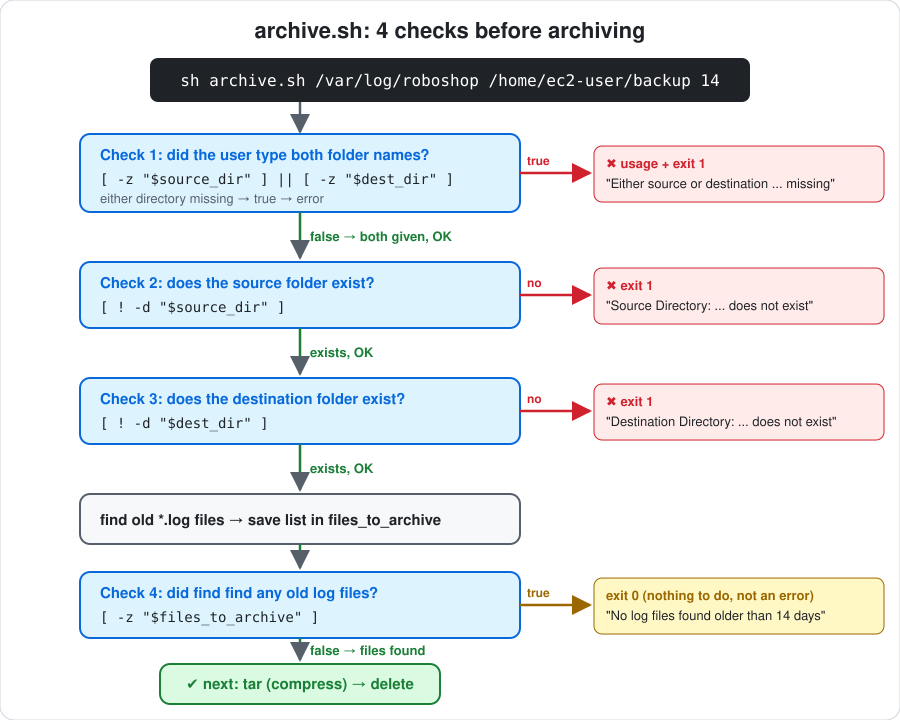

# Day 18 - Shell Script: Log Cleanup, Backup & Crontab

> **In short:** Apps write logs all the time, so log files keep growing and fill the disk. As daily maintenance, a script deletes **`.log` files older than 14 days** from `/var/log/roboshop`. The script checks its inputs first (was a folder given? does it exist?), finds the old files with `find`, says so if there are none, and otherwise deletes them and shows each one. A safer **backup** script first compresses the old logs into a `.tar.gz` in another folder and deletes them **only if** the archive worked. **crontab** runs these scripts automatically at low-traffic times, but cron has a **minimal PATH**, so use full paths.

**More in this folder:** [Interview questions](interview-questions/README.md) · [scripts/](scripts) (`cleanup.sh`, `archive.sh`, `read-file.sh`)

## Table of Contents

1. [The problem: logs fill the disk](#the-problem-logs-fill-the-disk)
2. [Questions to ask before writing the script](#questions-to-ask-before-writing-the-script)
3. [Algorithm: the 5 steps](#algorithm-the-5-steps)
4. [Make test files with old dates (touch -d)](#make-test-files-with-old-dates-touch--d)
5. [find: search for old .log files](#find-search-for-old-log-files)
6. [The script: cleanup.sh](#the-script-cleanupsh)
7. [How the script works, step by step](#how-the-script-works-step-by-step)
8. [2 bugs I found in the class script](#2-bugs-i-found-in-the-class-script)
9. [Run it and check the result](#run-it-and-check-the-result)
10. [Run the script as a command (PATH)](#run-the-script-as-a-command-path)
11. [Schedule it with crontab](#schedule-it-with-crontab)
    - [The 5 time fields](#the-5-time-fields)
    - [Why are both 0 and 7 Sunday?](#why-are-both-0-and-7-sunday)
    - [crontab commands](#crontab-commands)
    - [Add the cleanup job](#add-the-cleanup-job)
    - [Cron's PATH is different from my terminal](#crons-path-is-different-from-my-terminal)
12. [Backup script: compress old logs, then delete](#backup-script-compress-old-logs-then-delete)
    - [Algorithm: the 6 steps](#algorithm-the-6-steps)
    - [&& vs ||](#-vs-)
    - [Timestamp in the archive name](#timestamp-in-the-archive-name)
    - [The script: archive.sh](#the-script-archivesh)
    - [How archive.sh works, step by step](#how-archivesh-works-step-by-step)
13. [Real-time use: archive as a command on every server (AMI)](#real-time-use-archive-as-a-command-on-every-server-ami)
    - [What comes in the AMI?](#what-comes-in-the-ami)
    - [Create the AMI and launch servers from it](#create-the-ami-and-launch-servers-from-it)
    - [Summary](#summary)
14. [What I learned](#what-i-learned)
15. [Interview Questions](#interview-questions)

---

## The problem: logs fill the disk

**Definition:** **Log rotation / cleanup** = regularly removing (or archiving) old log files so they don't use up all the disk space.

```
App (cart, shipping, payment ...) ──writes all day──► /var/log/roboshop/*.log
                                                          │
                                         grows every day  ▼
                                                  disk 100% full → app crashes,
                                                  can't write logs, server issues
```

- Logs are written **continuously**, so their size only grows.
- Old logs are rarely needed, so we keep the recent ones and delete the rest.
- This is **daily maintenance**: the script runs once a day.

| Item | Value |
|---|---|
| Location | `/var/log/roboshop` |
| Files to delete | `*.log` only |
| Age | older than **14 days** |

## Questions to ask before writing the script

**Definition:** **Requirements** = the inputs and rules a script needs before you write any code.

| Question | Answer here | Becomes |
|---|---|---|
| Which **location**? | `/var/log/roboshop` | 1st argument `$1` |
| Which **extension**? | `.log` | `find -name "*.log"` |
| How many **days old**? | 14 | 2nd argument `$2` |

So the user runs:

```bash
sh cleanup.sh /var/log/roboshop 14
#             └── $1 = folder ──┘ └ $2 = days
```

Passing the folder and days as **arguments** (instead of hard-coding them) lets the same script clean any folder.

## Algorithm: the 5 steps

**Definition:** **Algorithm** = the plain-language steps, written before the code.

```
1. Did the user pass a source folder?      no  → print usage, exit 1   ([ -z "$source_dir" ])
2. Does that folder exist?                 no  → print error, exit 1
3. Find *.log files older than 14 days
4. No files found?                         yes → print "no files older than 14 days", exit 0
5. Delete each file and show its name to the user
```

Steps 1 and 2 are **input validation**: check the input first, so the script never runs `find`/`rm` on a wrong path.

## Make test files with old dates (touch -d)

**Definition:** `touch -d <date> file` creates a file (or updates it) with that **modified date**, so you can test the script without waiting 14 days.

```bash
sudo mkdir -p /var/log/roboshop
cd /var/log/roboshop
sudo touch -d 20260101 cart.log        # old  + .log  → DELETE
sudo touch -d 20260101 shipping.log    # old  + .log  → DELETE
sudo touch payment.log                 # new  + .log  → keep (not old)
sudo touch shipping.java               # new  + .java → keep (not .log)
sudo touch -d 20260202 user.js         # old  + .js   → keep (not .log)
ls -l
```

| File | Date | `.log`? | Older than 14 days? | Deleted? |
|---|---|---|---|---|
| cart.log | 2026-01-01 | ✅ | ✅ | ✅ |
| shipping.log | 2026-01-01 | ✅ | ✅ | ✅ |
| payment.log | today | ✅ | ❌ | ❌ |
| shipping.java | today | ❌ | ❌ | ❌ |
| user.js | 2026-02-02 | ❌ | ✅ | ❌ |

A file is deleted **only if both** checks are true. `user.js` is old but not a `.log`, so it stays.

## find: search for old .log files

**Definition:** `find` = searches a folder (and its subfolders) for files that match conditions.

```bash
find /var/log/roboshop -type f -name "*.log" -mtime +14
```

| Part | Meaning |
|---|---|
| `/var/log/roboshop` | where to search |
| `-type f` | files only (not folders) |
| `-name "*.log"` | name ends with `.log` (keep the quotes) |
| `-mtime +14` | **modified** more than 14 days ago |

| `-mtime` | Means |
|---|---|
| `+14` | older than 14 days |
| `-14` | newer than 14 days |
| `14` | exactly 14 days |

> ⚠️ `find . "*.log"` (from my rough notes) is wrong: without `-name`, find treats `"*.log"` as another folder to search. Always write `find . -name "*.log"`.

`find ... -delete` can delete directly, but the script uses a loop so it can **show** each file it deletes.

## The script: cleanup.sh

This is the class script, with **2 small fixes** marked `# FIX` (see [2 bugs I found](#2-bugs-i-found-in-the-class-script)).

```bash
#!/bin/bash

R="\e[31m"
G="\e[32m"
Y="\e[33m"
N="\e[0m"
source_dir=$1
days=${2:-14} # if user is not passing days, we will take 14 days as default

usage(){
    echo -e "${R}USAGE:: $0 [SOURCE_DIR] [days(Optional, default to 14 days)]${N}"
    exit 1
}

# 1. user passed source dir or not
if [ -z "$source_dir" ]; then
    echo "ERROR:: Missing parameters"
    usage
fi

# 2. source dir exists or not
if [ ! -d "$source_dir" ]; then
    echo -e "${R}ERROR:: $source_dir does not exist${N}"
    exit 1                                  # FIX 1: stop here
fi

# 3. find the files
echo "Scanning files older than $days in $source_dir"
files_to_delete=$(find "$source_dir" -name "*.log" -type f -mtime +$days)

# 4. no files found
if [ -z "$files_to_delete" ]; then
    echo "No log files found older than $days"
    exit 0
fi

# 5. delete files and show to user
while IFS= read -r line
do
    echo "File is going to be deleted: $line"
    rm -f "$line"                           # FIX 2: quotes
    echo "File deleted: $line"
done <<< "$files_to_delete"

# < -> for file inputs
# <<< -> variable as input
```

## How the script works, step by step

**Example used below:**

```bash
sh cleanup.sh /var/log/roboshop 14
```
Files in `/var/log/roboshop`: `cart.log` (old), `shipping.log` (old), `payment.log` (new, today).

### Part 0: colors and inputs

```bash
R="\e[31m"   # red
G="\e[32m"   # green
Y="\e[33m"   # yellow
N="\e[0m"    # normal (back to default color)
```
**Color codes**: `${R}` makes text red, `${N}` changes it back. They only make messages nicer.

```bash
source_dir=$1
days=${2:-14}
```

| Code | Gets | In the example |
|---|---|---|
| `$1` | 1st word after the script name | `/var/log/roboshop` |
| `$2` | 2nd word | `14` |
| `${2:-14}` | `$2` if given, otherwise **14** | `14` |

So `sh cleanup.sh /var/log/roboshop` (without days) also works: days becomes 14.

### Part 0b: the usage function

```bash
usage(){
    echo -e "${R}USAGE:: $0 [SOURCE_DIR] [days(Optional, default to 14 days)]${N}"
    exit 1
}
```
- **Function** = a block of code you call by name (`usage`). It doesn't run here, only when something calls it.
- It prints **how to run the script correctly**, then stops with `exit 1` (1 = failure).
- `$0` = the script's own name → `USAGE:: cleanup.sh [SOURCE_DIR] ...`

### Step 1: did the user give a folder?

```bash
if [ -z "$source_dir" ]; then
    echo "ERROR:: Missing parameters"
    usage
fi
```
- `-z` = "is it **empty**?"
- `sh cleanup.sh` with nothing after it → `source_dir` is empty → error + `usage` → stop.
- Example: `source_dir = /var/log/roboshop` isn't empty → continue ✅

### Step 2: does the folder exist?

```bash
if [ ! -d "$source_dir" ]; then
    echo -e "${R}ERROR:: $source_dir does not exist${N}"
    exit 1
fi
```
- `-d` = "is this a folder that exists?" and `!` = **NOT**.
- Reads as: "if the folder does **not** exist → error, stop."
- Example: `/var/log/roboshop` exists → continue ✅
- Without `exit 1` (FIX 1), it would print the error but **keep running**.

### Step 3: find the old .log files

```bash
echo "Scanning files older than $days in $source_dir"
files_to_delete=$(find "$source_dir" -name "*.log" -type f -mtime +$days)
```

| Part | Means |
|---|---|
| `find "$source_dir"` | search inside `/var/log/roboshop` |
| `-name "*.log"` | only names ending in `.log` |
| `-type f` | only files, not folders |
| `-mtime +$days` | last changed **more than 14 days ago** |
| `$( ... )` | run the command and **save its output** in the variable |

Saved in `files_to_delete` (`payment.log` isn't there, because it's new):
```
/var/log/roboshop/cart.log
/var/log/roboshop/shipping.log
```

### Step 4: nothing found?

```bash
if [ -z "$files_to_delete" ]; then
    echo "No log files found older than $days"
    exit 0
fi
```
- If `find` found nothing, the variable is **empty** → message → stop.
- `exit 0` = **success**: nothing to delete is not an error.
- Example: 2 files found → continue ✅

### Step 5: delete each file and show it

```bash
while IFS= read -r line
do
    echo "File is going to be deleted: $line"
    rm -f "$line"
    echo "File deleted: $line"
done <<< "$files_to_delete"
```

| Part | Means |
|---|---|
| `<<< "$files_to_delete"` | feed the list (the variable) into the loop |
| `while read -r line` | take **one line at a time** and put it in `line` |
| `IFS=` and `-r` | read the line exactly as it is (keep spaces and `\`) |
| `rm -f "$line"` | delete that file (`-f` = don't ask "are you sure?") |
| `"$line"` in quotes | FIX 2: a name with spaces stays one file |

The loop runs 2 times:
```
Round 1: line = /var/log/roboshop/cart.log      → delete
Round 2: line = /var/log/roboshop/shipping.log  → delete
List finished → loop ends
```

### `<` vs `<<<` (the last 2 comments)

| Symbol | Gives input from | Example |
|---|---|---|
| `<` | a **file** | `done < list.txt` |
| `<<<` | a **variable** | `done <<< "$files_to_delete"` |

**`<` example: read a file line by line** ([scripts/read-file.sh](scripts/read-file.sh))

```bash
#!/bin/bash

while IFS= read -r line
do
    echo $line
done < 02-conversation.sh
```
- `< 02-conversation.sh` → the loop reads that **file**, one line per round, and prints it.
- Same loop as Step 5; only the input changes: a **file** (`<`) instead of a **variable** (`<<<`).

### Full picture

```
sh cleanup.sh /var/log/roboshop 14
        │
        ▼
Step 1: folder given?        no → ERROR + usage, exit 1
        │ yes
Step 2: folder exists?       no → ERROR, exit 1
        │ yes
Step 3: find *.log older than 14 days
        │
Step 4: anything found?      no → "No log files found", exit 0
        │ yes
Step 5: loop → delete each file, print its name
```

**Output in the example:**
```
Scanning files older than 14 in /var/log/roboshop
File is going to be deleted: /var/log/roboshop/cart.log
File deleted: /var/log/roboshop/cart.log
File is going to be deleted: /var/log/roboshop/shipping.log
File deleted: /var/log/roboshop/shipping.log
```
The two files can come in any order (`find` doesn't sort). At the end, only `payment.log` is left.

## 2 bugs I found in the class script

**Definition:** **Word splitting** = bash splits an **unquoted** variable at spaces into separate words.

| # | Class code | Problem | What happened in my test | Fix |
|---|---|---|---|---|
| 1 | no `exit` after `does not exist` | script keeps going | printed the error, then `find: '/nope': No such file or directory`, `No log files found`, **exit 0** (looks like success) | add `exit 1` |
| 2 | `rm -f $line` (no quotes) | file names with spaces split | for `my app.log`, bash ran `rm -f roboshop/my app.log` → **deleted a different file `my`**, and `my app.log` stayed | `rm -f "$line"` |

> Rule: **always quote variables** (`"$var"`), especially in `rm`.

## Run it and check the result

```bash
sudo sh cleanup.sh                          # step 1 fails
sudo sh cleanup.sh /var/log/nope            # step 2 fails
sudo sh cleanup.sh /var/log/roboshop        # days not given → 14, deletes old files
sudo sh cleanup.sh /var/log/roboshop 14     # run again: nothing left
ls /var/log/roboshop
```

| Run | Output | Exit code |
|---|---|---|
| no arguments | `ERROR:: Missing parameters`<br>`USAGE:: cleanup.sh [SOURCE_DIR] [days(Optional, default to 14 days)]` | 1 |
| folder doesn't exist | `ERROR:: /var/log/nope does not exist` | 1 |
| first real run | `Scanning files older than 14 in /var/log/roboshop`<br>`File is going to be deleted: /var/log/roboshop/shipping.log`<br>`File deleted: /var/log/roboshop/shipping.log`<br>`File is going to be deleted: /var/log/roboshop/cart.log`<br>`File deleted: /var/log/roboshop/cart.log` | 0 |
| second run | `No log files found older than 14` | 0 |
| `ls` after | `payment.log  shipping.java  user.js` | |

> **Why `sudo`?** `/var/log` belongs to root, so deleting files there needs root.
> **`sh` vs `bash`:** on RHEL / Amazon Linux `sh` is bash, so `sh cleanup.sh` works. On Ubuntu `sh` is `dash`: `echo -e` and `<<<` break, so run `bash cleanup.sh` there.

## Run the script as a command (PATH)

**Definition:** **`$PATH`** = the list of folders Linux searches when you type a command. Any file in those folders can be run **by its name** from anywhere, like `ls` or `cp`.

> 💡 **Key point: with shell scripting you can create your own Linux commands.** Commands like `ls`, `cp` and `useradd` are just files sitting in PATH folders. Write a script, put it in a PATH folder, make it executable, and it becomes a command too.

```
cleanup.sh (script)  ──cp to /usr/local/bin/cleanup + chmod +x──►  cleanup (new Linux command)
```

The cleanup script has to run on **every Linux server**. Instead of typing `sh /home/ec2-user/cleanup.sh ...` each time, put it in a PATH folder and run it as a **command**:

```
Before:  sh /home/ec2-user/cleanup.sh /var/log/roboshop 14     (need sh + full path)
After:   cleanup /var/log/roboshop 14                          (from any folder)
```

### PATH folders on the server

```bash
echo $PATH
```

| Folder | Who can use it | Use for |
|---|---|---|
| `/home/ec2-user/.local/bin` | only ec2-user | my own tools |
| `/home/ec2-user/bin` | only ec2-user | my own tools |
| `/usr/local/bin` | **all users** | ✅ **admin scripts like cleanup** |
| `/usr/bin` | all users | packages installed by `dnf` (don't put own scripts here) |
| `/usr/local/sbin` | root (admin) | admin-only tools |
| `/usr/sbin` | root (admin) | system admin commands from packages |

Linux checks the folders **in order**, left to right, and runs the **first** match.

### Steps

```bash
sudo cp cleanup.sh /usr/local/bin/cleanup     # 1. copy into a PATH folder (drop .sh: nicer command name)
sudo chmod +x /usr/local/bin/cleanup          # 2. make it executable
which cleanup                                 # 3. check: /usr/local/bin/cleanup
sudo /usr/local/bin/cleanup /var/log/roboshop 14   # 4. run it (see the sudo note below)
cleanup /var/log/abc                          #    without sudo, from any folder: ERROR:: /var/log/abc does not exist
```

| Step | Why |
|---|---|
| `cp` to `/usr/local/bin` | Linux finds it by name, for every user |
| `chmod +x` | without **execute permission**: `Permission denied` |
| `#!/bin/bash` (1st line of the script) | **shebang**: tells Linux which shell runs the file, since there's no `sh` in front any more |
| `which cleanup` | shows which file runs when you type `cleanup` |

I tested it on my laptop: with the file in a PATH folder, `cleanup <folder> 14` worked from `/`; with cron's PATH (`/usr/bin:/bin`) → `cleanup: command not found`.

> ⚠️ **sudo:** on RHEL / Amazon Linux, `sudo` uses its own short PATH (`secure_path` in `/etc/sudoers` = `/sbin:/bin:/usr/sbin:/usr/bin`), so `sudo cleanup` can say `command not found`. Use `sudo /usr/local/bin/cleanup ...`, or run `sudo -i` first (root's PATH).

> ⚠️ **Cron:** `/usr/local/bin` is **not** in cron's PATH (see [Cron's PATH](#crons-path-is-different-from-my-terminal)). In crontab, use the full path: `0 2 * * * /usr/local/bin/cleanup /var/log/roboshop 14`.

## Schedule it with crontab

**Definition:** **crontab** = used to **schedule scripts** in Linux. The cron service runs each entry automatically at the time you set.

In real projects nobody runs the cleanup by hand every day. A **cron job** runs it automatically, usually at **low-traffic times** (e.g. 2 AM), so it doesn't slow the app down for users.

### The 5 time fields

```
 ┌───────── minute        (0-59)
 │ ┌─────── hour          (0-23)
 │ │ ┌───── day of month  (1-31)
 │ │ │ ┌─── month         (1-12)
 │ │ │ │ ┌─ day of week   (0-7, 0 and 7 = Sunday)
 │ │ │ │ │
 * * * * *   command
```

`*` = every value.

| Expression | Runs |
|---|---|
| `* * * * *` | every minute (good for testing) |
| `*/5 * * * *` | every 5 minutes |
| `0 2 * * *` | every day at 02:00 |
| `0 2 * * 0` | every Sunday at 02:00 |
| `0 0 1 * *` | 1st of every month at 00:00 |

### Why are both 0 and 7 Sunday?

**Definition:** cron accepts **two ways of counting** the days of the week, so Sunday has two numbers.

| Way of counting | Week starts on | Sunday is | Who uses it |
|---|---|---|---|
| Old Unix / C style | Sunday | **0** (0 to 6) | the original cron, C programs, US calendars |
| ISO / Europe style | Monday | **7** (1 to 7) | most of the world, ISO 8601 standard |

```
Sun Mon Tue Wed Thu Fri Sat Sun
 0   1   2   3   4   5   6   7
 └───────── both = Sunday ─────┘
```

Monday to Saturday are the same number either way (1 to 6). Only Sunday differs, so cron accepts **both**: no one gets it wrong, whichever way they count.

| Expression | Runs |
|---|---|
| `0 2 * * 0` | every Sunday at 02:00 |
| `0 2 * * 7` | every Sunday at 02:00 (same) |
| `0 2 * * 1-5` | Monday to Friday at 02:00 |
| `0 2 * * SUN` | every Sunday at 02:00 (day names avoid confusion) |

> One-liner: cron accepts 0 and 7 for Sunday so it works whether your week starts on Sunday (0) or Monday (Sunday = 7).

### crontab commands

| Command | Does |
|---|---|
| `crontab -e` | edit my cron jobs (opens an editor) |
| `crontab -l` | list my cron jobs |
| `crontab -r` | ⚠️ **removes all** my cron jobs |
| `sudo crontab -e` | edit **root's** cron jobs (needed for `/var/log`) |

### Add the cleanup job

```bash
sudo crontab -e
```
```
0 2 * * * /bin/bash /home/ec2-user/cleanup.sh /var/log/roboshop 14 >> /tmp/cleanup.log 2>&1
```

| Part | Meaning |
|---|---|
| `0 2 * * *` | every day at 02:00 |
| `/bin/bash /home/ec2-user/cleanup.sh` | **full paths**: cron doesn't start in my folder and has a small PATH |
| `>> /tmp/cleanup.log 2>&1` | save output and errors; cron has no screen, so without this I can't see what happened |

Check it ran: `cat /tmp/cleanup.log`. On RHEL, cron's own log is `/var/log/cron`.

### Cron's PATH is different from my terminal

**Definition:** **`$PATH`** = the list of folders Linux searches to find a command (`aws`, `tar`, ...).

| Where | PATH |
|---|---|
| My terminal (`echo $PATH`) | `/home/ec2-user/.local/bin:/home/ec2-user/bin:/usr/local/bin:/usr/bin:/usr/local/sbin:/usr/sbin` |
| Cron | `/usr/bin:/bin` ← **minimal** |

So a command in `/usr/local/bin` (for example `aws`) works in the terminal but **not** in cron.

**Class example:**

| Server | Cron PATH has `/usr/local/bin`? | Result |
|---|---|---|
| Development | ✅ yes (someone set it) | script worked |
| Production | ❌ no | script **failed**: command not found |

Same script, different result, because the cron PATH was different. ⭐ Full interview story: [interview question 1](interview-questions/README.md#-very-important-asked-in-class). I tested it on my laptop with cron's PATH:

```bash
env -i PATH=/usr/bin:/bin bash -c 'aws --version'
# bash: line 1: aws: command not found      (exit 127)
env -i PATH=/usr/bin:/bin bash -c '/usr/local/bin/aws --version'
# aws-cli/2.x ...                            (works)
```

**Fixes (use one):**

| Fix | How |
|---|---|
| Full paths in the script | `/usr/local/bin/aws` instead of `aws` (find it with `which aws`) |
| Set PATH at the top of the crontab | `PATH=/usr/local/bin:/usr/bin:/bin` as the first line of `crontab -e` |
| Set the full PATH explicitly at the top of the script | `PATH=/usr/bin:/bin:/usr/local/bin`: every folder written out, so the script doesn't depend on cron's PATH |

> Lesson: "it works in the terminal" doesn't mean it works in cron. Test with cron's PATH, and set PATH the **same on dev and prod**.

## Backup script: compress old logs, then delete

**Definition:** **Archive / backup** = pack old files into one compressed file (`.tar.gz`) and keep it somewhere safe **before** deleting the originals.

Deleting old logs loses them forever. A safer job: **compress** them into a backup folder first, and delete them **only if** the archive was created.

```bash
sh archive.sh <source_dir> <dest_dir> [days]
sh archive.sh /var/log/roboshop /home/ec2-user/backup 14
```

### Algorithm: the 6 steps

```
1. Did the user give source_dir AND dest_dir?    no  → usage, exit 1
2. Do both directories exist?                    no  → error, exit 1
3. Find *.log files older than 14 days           none → "no files", exit 0
4. Compress them into dest_dir (.tar.gz)
5. Archive created OK?                           yes → delete the files in source_dir
6.                                               no  → DON'T delete, error, exit 1
```

Step 6 is the key: if the backup failed and we still deleted, the logs would be **gone with no copy**.

### && vs ||

**Definition:** `&&` (AND) is true only if **both** sides are true; `||` (OR) is true if **at least one** side is true.

| Left | Right | `&&` | `\|\|` |
|---|---|---|---|
| true | true | ✅ true | ✅ true |
| true | false | ❌ false | ✅ true |
| false | true | ❌ false | ✅ true |
| false | false | ❌ false | ❌ false |

**Which one for step 1?** The script needs **both** folders, so show the error if **either one** is missing → use `||`:

```bash
if [ -z "$source_dir" ] || [ -z "$dest_dir" ]; then    # ✅ catches one OR both missing
```

> ⚠️ My rough notes had `[ -z "$source_dir" ] && [ -z "$dest_dir" ]`. That is only true when **both** are missing. I tested it with only a source folder given (no dest): `&&` → **not caught**, the script keeps going; `||` → caught.

### Timestamp in the archive name

**Definition:** `date +FORMAT` prints the current date/time in the format you choose.

```bash
date +%Y-%m-%d-%H-%M-%S        # 2026-10-30-18-56-55
```

| Code | Means |
|---|---|
| `%Y` `%m` `%d` | year, month, day |
| `%H` `%M` `%S` | hour, minute, second |

The name becomes `logs-2026-10-30-18-56-55.tar.gz`. Each run gets a **unique** name, so it never overwrites an older backup.

> ⚠️ Don't use `:` in the name (`logs-2026-10-23-02:40:53.tar.gz` from my rough notes). tar thinks `name:path` is a **remote host**. I tested it: `tar (child): Cannot connect to logs-2026-10-23-02: resolve failed`. Use `-` (as the `date` format above does).

### The script: archive.sh

This is the class script ([scripts/archive.sh](scripts/archive.sh)), with quotes added around `$source_dir` and `$line` (marked `# FIX`), the same quote fix as in `cleanup.sh`.

```bash
#!/bin/bash

R="\e[31m"
G="\e[32m"
Y="\e[33m"
N="\e[0m"
source_dir=$1
dest_dir=$2
days=${3:-14} # if user is not passing days, we will take 14 days as default

usage(){
    echo -e "${R}USAGE:: $0 [SOURCE_DIR] [DEST_DIR] [days(Optional, default to 14 days)]${N}"
    exit 1
}

# 1. user gave source_dir and dest_dir or not
if [ -z "$source_dir" ] || [ -z "$dest_dir" ]; then
    echo "Either source or destination directory are missing"
    usage
fi

# 2. both directories exist or not
if [ ! -d "$source_dir" ]; then
    echo "Source Directory: $source_dir does not exist"
    exit 1
fi

if [ ! -d "$dest_dir" ]; then
    echo "Destination Directory: $dest_dir does not exist"
    exit 1
fi

# 3. find the files
echo "Scanning files older than $days days in $source_dir"
files_to_archive=$(find "$source_dir" -name "*.log" -type f -mtime +$days)    # FIX: quotes

if [ -z "$files_to_archive" ]; then
    echo "No log files found older than $days days"
    exit 0
fi

# 4. compress them and place in dest_dir
timestamp=$(date +%Y-%m-%d-%H-%M-%S)

file_name="$dest_dir/logs-$timestamp.tar.gz"

tar -czf $file_name $files_to_archive

# 5. if error, don't delete the files
# 6. if successfully archived, delete in source_dir
if [ $? -ne 0 ]; then
    echo "Logs archival is failed"
    exit 1
else
    echo "Logs are archived: $file_name"
    while IFS= read -r line
    do
        echo "File is going to be deleted: $line"
        rm -f "$line"                                                         # FIX: quotes
        echo "File deleted: $line"
    done <<< "$files_to_archive"
fi
```

### How archive.sh works, step by step

**Example:** `sh archive.sh /var/log/roboshop /home/ec2-user/backup 14`, with `cart.log` and `shipping.log` (old) and `payment.log` (new) in `/var/log/roboshop`.

**Part 0: inputs**

| Code | Gets | In the example |
|---|---|---|
| `$1` → `source_dir` | where the logs are | `/var/log/roboshop` |
| `$2` → `dest_dir` | where the archive goes | `/home/ec2-user/backup` |
| `${3:-14}` → `days` | 3rd word, or 14 if not given | `14` |

**The 4 checks before archiving:** if any check fails, the script stops.



**Check 1: did the user type both folder names?**

```bash
if [ -z "$source_dir" ] || [ -z "$dest_dir" ]; then
    echo "Either source or destination directory are missing"
    usage
fi
```

**Definition:** `-z` = "is it **missing**?" (the user didn't pass a value).

**If either the source or the destination directory is missing, the condition becomes true and the script exits with an error message.**

| Directory | Missing? | `[ -z "$var" ]` gives |
|---|---|---|
| passed (e.g. `/var/log/roboshop`) | no | **false** |
| not passed | yes | **true** |

`||` = OR: if **at least one** side is true, the whole condition is true → error message + usage → exit.

| You type | source missing? | dest missing? | `\|\|` result | Result |
|---|---|---|---|---|
| `sh archive.sh /var/log/roboshop /backup` | false | false | **false** | ✅ continue |
| `sh archive.sh /var/log/roboshop` | false | **true** | **true** | ❌ error message, exit |
| `sh archive.sh "" /backup` | **true** | false | **true** | ❌ error message, exit |
| `sh archive.sh` | **true** | **true** | **true** | ❌ error message, exit |

The script continues **only** when both directories are passed. The `if` looks for **problems**: **true** = "a directory is missing" → error; **false** = "both passed" → continue.

> `-z` here checks the **folder name the user typed** (`$1`, `$2`), not whether the folder has log files. That's Check 4.

**Check 2: does the source folder exist?**

```bash
if [ ! -d "$source_dir" ]; then
    echo "Source Directory: $source_dir does not exist"
    exit 1
fi
```
- `-d` = "is it a folder that exists?" and `!` = **NOT**.
- Reads as: "if the source folder does **not** exist → error, stop."
- `sh archive.sh /var/log/abc /backup` → `Source Directory: /var/log/abc does not exist`

**Check 3: does the destination folder exist?**

Same as Check 2, for `dest_dir` → `Destination Directory: ... does not exist`.

**Why 2 separate checks?** So the message tells you **which** folder is wrong.

**Find the old .log files**

```bash
echo "Scanning files older than $days days in $source_dir"
files_to_archive=$(find $source_dir -name "*.log" -type f -mtime +$days)
```
`find` prints every match and `$( ... )` saves that list in `files_to_archive` (same `find` as `cleanup.sh`).

| Case | Folder has | `files_to_archive` |
|---|---|---|
| A: old logs exist | `cart.log` (Jan 1), `shipping.log` (Jan 1), `payment.log` (today) | `cart.log` and `shipping.log` paths |
| B: no old logs | only `payment.log` (today) | `""` (empty) |

**Check 4: did find find any old log files?**

```bash
if [ -z "$files_to_archive" ]; then
    echo "No log files found older than $days days"
    exit 0
fi
```

| Case | `-z "$files_to_archive"` | What happens |
|---|---|---|
| A: 2 files found | **false** | skip the `if` → go on to `tar` |
| B: list is empty | **true** | `No log files found older than 14 days` → `exit 0` |

- **Why stop here?** If the list is empty, `tar` would have nothing to pack and fail (`Cowardly refusing to create an empty archive`), which would show a false "archival failed" error.
- **Why `exit 0`, not `exit 1`?** No old logs = nothing to do, which is **not an error**. Cron runs this every night, so quiet nights shouldn't count as failures.

| Exit code | Means | Used when |
|---|---|---|
| `exit 1` | error | missing or wrong input (Checks 1–3) |
| `exit 0` | success | nothing to do (Check 4), or all done |

**Same `-z`, different variable:**

| | Variable checked | Question |
|---|---|---|
| Check 1 | `source_dir`, `dest_dir` | "Did the user **type** the folder names?" |
| Check 4 | `files_to_archive` | "Did `find` find any old log files?" |

**After the checks: compress into one file (tar)**

```bash
timestamp=$(date +%Y-%m-%d-%H-%M-%S)              # 2026-10-30-02-00-00
file_name="$dest_dir/logs-$timestamp.tar.gz"      # /home/ec2-user/backup/logs-2026-10-30-02-00-00.tar.gz
tar -czf $file_name $files_to_archive
```

| Part | Means |
|---|---|
| `tar` | packs many files into one file |
| `-c` | **c**reate a new archive |
| `-z` | compress it with g**z**ip (`.gz`) |
| `-f $file_name` | write it to this **f**ile |
| `$files_to_archive` | the files to put inside (cart.log, shipping.log) |

**Last: check tar, then delete or not**

```bash
if [ $? -ne 0 ]; then
```
- `$?` = exit code of the last command (tar). `0` = success.
- `-ne 0` = **not equal** to 0 → tar **failed** → `Logs archival is failed` → `exit 1`. **Nothing is deleted**, so no logs are lost.
- Else (tar worked) → `Logs are archived: ...` → same delete loop as `cleanup.sh`.

> ⚠️ `$?` must come **right after** `tar`. Any command in between (even an `echo`) changes `$?`.

**Full picture**

```
sh archive.sh /var/log/roboshop /home/ec2-user/backup 14
        │
Step 1: source AND dest given?    no → message + usage, exit 1
        │ yes
Step 2: both folders exist?       no → which one is missing, exit 1
        │ yes
Step 3: find *.log older than 14  none → "No log files found", exit 0
        │ found
Step 4: tar -czf logs-<timestamp>.tar.gz  <files>
        │
Step 5: tar failed ($? ≠ 0)?      yes → "Logs archival is failed", exit 1 (files kept)
        │ no
Step 6: delete each file, print its name
```

**Expected output in the example:**
```
Scanning files older than 14 days in /var/log/roboshop
tar: Removing leading `/' from member names
Logs are archived: /home/ec2-user/backup/logs-2026-10-30-02-00-00.tar.gz
File is going to be deleted: /var/log/roboshop/cart.log
File deleted: /var/log/roboshop/cart.log
File is going to be deleted: /var/log/roboshop/shipping.log
File deleted: /var/log/roboshop/shipping.log
```

- `Removing leading '/'` is just a tar **warning**, not an error: tar stores `var/log/roboshop/cart.log` without the first `/`, so unpacking can't overwrite the real files.
- Check what's inside the archive: `tar -tzf /home/ec2-user/backup/logs-*.tar.gz`
- Unpack it later: `tar -xzf <file>.tar.gz` (`-x` = e**x**tract)

## Real-time use: archive as a command on every server (AMI)

**Definition:** **AMI (Amazon Machine Image)** = a saved copy of a server's disk. Every new EC2 launched from it starts with the same software and files.

**The need:** on our servers, **every day** some files (old logs) must be archived and moved to a destination folder. Doing it by hand on each server isn't possible, so:

1. We **developed a shell script** (`archive.sh`).
2. We made it a **command** (`archive`) by putting it in a PATH folder.
3. We **schedule** that command with **crontab**.
4. We put it in the **AMI**, so every server has the command.

### Step 1: make it a command

```bash
sudo cp archive.sh /usr/local/bin/archive     # in a PATH folder, without .sh
sudo chmod +x /usr/local/bin/archive          # executable
sudo mkdir -p /var/log/logs-archive           # destination must exist (Check 3)
```

Now run it like any Linux command, from any folder:

```bash
sudo /usr/local/bin/archive /var/log/roboshop/ /var/log/logs-archive/
# or, without sudo, as root (sudo -i):
archive /var/log/roboshop/ /var/log/logs-archive/
```
Days aren't given, so `${3:-14}` → **14 days** (default).

### Step 2: schedule it in crontab

```bash
sudo crontab -e
```
```
0 2 * * * /usr/local/bin/archive /var/log/roboshop/ /var/log/logs-archive/ >> /tmp/archive.log 2>&1
```
- Every day at **02:00** (low traffic).
- **Full path** `/usr/local/bin/archive`, because cron's PATH (`/usr/bin:/bin`) doesn't have `/usr/local/bin`.
- `>> /tmp/archive.log 2>&1` saves the output so I can check it later.

### Step 3: put it in the AMI (common for all servers)

```
One server: install archive command + crontab entry
        │
        ▼  create image
   AMI (has /usr/local/bin/archive + cron job)
        │
        ├──► EC2 server 1  ─┐
        ├──► EC2 server 2   ├─ every server already has the "archive" command
        └──► EC2 server 3  ─┘   and archives its logs every night
```

| Without AMI | With AMI |
|---|---|
| copy the script + set cron on **each** server by hand | done **once**, in the AMI |
| easy to forget a server | every new server has it **automatically** |
| servers can end up with different versions | same command everywhere |

### What comes in the AMI?

Creating an AMI copies the server's **whole disk** at that moment. So if I create any server using that AMI ID, it comes with the shell script already in it.

| Saved on the disk at | In the AMI? |
|---|---|
| `/usr/local/bin/archive` (the script, executable) | ✅ yes |
| root's crontab (`/var/spool/cron/root`) | ✅ yes → the cron job comes too |
| `/var/log/logs-archive/` (destination folder) | ✅ yes |
| installed packages, users, config files | ✅ yes |

### Create the AMI and launch servers from it

```
1. Server A: install archive command + crontab + destination folder
        │
2. Create AMI from server A  →  ami-0abc123 (snapshot of the disk)
        │
3. Launch new servers with --image-id ami-0abc123
        │
        ├──► server B: archive command ✅  cron job ✅
        └──► server C: archive command ✅  cron job ✅
```

| Step | Console | CLI |
|---|---|---|
| Create AMI | EC2 → select server A → **Actions → Image and templates → Create image** | `aws ec2 create-image --instance-id i-0123456789abcdef0 --name "base-with-archive-v1"` |
| Launch server | Launch instance → **My AMIs** → pick it | `aws ec2 run-instances --image-id ami-0abc123 ...` (same `--image-id` as in `roboshop.sh`, just my own AMI ID) |

### 3 things to remember

| Point | Why |
|---|---|
| AMI = **snapshot at that moment** | Changing the script later doesn't update old AMIs or running servers → make a **new AMI version** (v2) and launch new servers from it. |
| Enable the cron service | `sudo systemctl enable crond` on server A before creating the AMI, so cron starts on new servers. |
| Clean server A first | Delete old logs, test files and secrets, or every new server gets them too. |

**Golden AMI** = one base image with all the common company scripts (cleanup, archive, monitoring agents). In real projects every server is launched from it.

### Summary

> I used a **shell script** to create one **archival command** (`archive`). We placed that script in the **AMI**, so **any person who is using a server** launched from that AMI can use the `archive` command, and crontab runs it every day automatically.

```
archive.sh ──► archive command ──► AMI ──► every server ──► anyone on the server can run: archive <source> <dest>
                (/usr/local/bin)                            + crontab runs it daily at 02:00
```

## What I learned

- Logs grow every day, so deleting old ones is daily maintenance.
- Before coding, answer 3 questions: **which location, which extension, how many days old**.
- Write the steps (algorithm) first: check input → check folder exists → find → nothing found? → delete and show.
- `touch -d <date>` makes test files with old dates.
- `find <dir> -type f -name "*.log" -mtime +14` finds `.log` files older than 14 days.
- A file is deleted only if it's **both** a `.log` and old enough.
- `${2:-14}` gives a default value when the user skips an argument.
- `<` feeds a file into a loop, `<<<` feeds a variable.
- Always quote variables in `rm`: `rm -f $line` with a space in the name deleted the wrong file.
- **crontab** schedules scripts; real cleanup jobs run from cron at low-traffic times, not by hand.
- Cron's PATH is minimal (`/usr/bin:/bin`): a script that works in the terminal (and on dev) can fail in cron (on prod). Use full paths or set PATH.
- With shell scripting I can **create my own Linux commands**: put a script in a PATH folder (`/usr/local/bin`) + `chmod +x` → run it as a command (`cleanup /var/log/roboshop 14`) on every server.
- Real-time: daily archive script → `archive` command in `/usr/local/bin` → crontab (full path) → baked into the **AMI**, so every server launched from that AMI ID has it (the AMI copies the whole disk at that moment; script changes need a new AMI version).
- Backup = compress first, delete **only if** the archive succeeded; if it fails, keep the files.
- `&&` = both must be true, `||` = one is enough. "Both folders are required" → error if `-z src || -z dest`.
- `date +%Y-%m-%d-%H-%M-%S` makes a unique archive name; no `:` in tar file names.

## Interview Questions

See [interview-questions/README.md](interview-questions/README.md).
