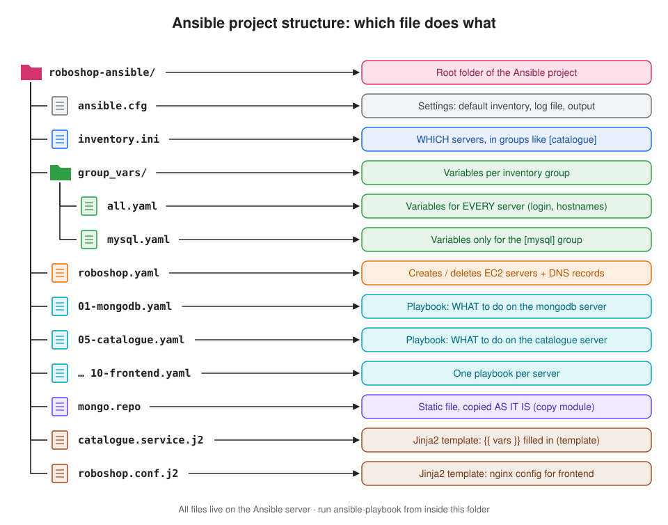

# Day 23 - Ansible AWS Access, unarchive remote_src, App Deployment Steps & Managing Java Versions

[← All notes](../README.md)

> **In short:** before Ansible can create AWS resources, the Ansible server needs **AWS credentials** (`aws configure` or an IAM role) and the **boto3** library. When Ansible configures a server like catalogue, there are two machines: the **Ansible controller** and the **remote machine**, and `remote_src: yes` tells `unarchive` the zip is already on the remote machine. Every app deployment follows 3 steps: **remove old code → download new code → restart**. And when a server has more than one Java installed, **`alternatives`** picks the default `java` command and **`JAVA_HOME`** tells tools like Maven which Java to use.

## About this class

| Part | Topic | What you learn |
|---|---|---|
| **Part 1: Concepts** | AWS credentials (`aws configure` vs IAM role) · controller vs remote machine · `remote_src` · the 3 deployment steps · `alternatives` and `JAVA_HOME` · Jinja2 templates | What each one is and why we need it |
| **Part 2: Lab** | Give the Ansible server AWS access · break and fix `remote_src` · deploy a new catalogue version · switch Java versions by hand and with Ansible · fill a Jinja2 template | Do each one on real servers |

**Before this:** [Day 22 - Ansible vs Shell Script, command vs shell, and Creating EC2 + Route 53 Records](../day-22-ansible-shell-vs-ansible-aws-ec2-route53/README.md)

**Project:** [RoboShop v1 with Ansible: every file explained](../day-22-ansible-shell-vs-ansible-aws-ec2-route53/roboshop-v1/README.md)

## Table of Contents

**Part 1: Concepts**
1. [AWS credentials for Ansible: aws configure vs IAM role](#1-aws-credentials-for-ansible-aws-configure-vs-iam-role)
2. [Ansible controller vs remote machine](#2-ansible-controller-vs-remote-machine)
3. [unarchive and remote_src](#3-unarchive-and-remote_src)
4. [The 3 steps of every deployment](#4-the-3-steps-of-every-deployment)
5. [Many Java versions: alternatives](#5-many-java-versions-alternatives)
6. [JAVA_HOME](#6-java_home)
7. [Jinja2 templates](#7-jinja2-templates)

**Part 2: Lab**
- [Lab setup](#lab-setup)
- [Step 1: Give the Ansible server AWS access](#step-1-give-the-ansible-server-aws-access)
- [Step 2: Install boto3 and botocore](#step-2-install-boto3-and-botocore)
- [Step 3: See the remote_src error, then fix it](#step-3-see-the-remote_src-error-then-fix-it)
- [Step 4: Deploy a new version of catalogue](#step-4-deploy-a-new-version-of-catalogue)
- [Step 5: Switch Java versions by hand](#step-5-switch-java-versions-by-hand)
- [Step 6: Switch Java versions with Ansible](#step-6-switch-java-versions-with-ansible)
- [Step 7: Fill a Jinja2 template](#step-7-fill-a-jinja2-template)

**Wrap-up**
- [What I learned](#what-i-learned)
- [Interview one-liners](#interview-one-liners)

---

# Part 1: Concepts

## 1. AWS credentials for Ansible: aws configure vs IAM role

**Definition:** AWS modules like `amazon.aws.ec2_instance` call AWS through **boto3**, the AWS SDK (software development kit) for Python. Before AWS accepts a request, boto3 has to prove who is calling, so the Ansible server needs **AWS credentials**. There are two ways to give it credentials: run **`aws configure`** and type an access key, or attach an **IAM role** to the EC2 server so AWS gives it temporary keys automatically.

```
 ansible-playbook ──► amazon.aws module ──► boto3 ──► finds credentials ──► AWS API
                                                       │
                                                       ├─ 1. ~/.aws/credentials  (aws configure)
                                                       └─ 2. IAM role on the EC2 server
```

| | `aws configure` | IAM role |
|---|---|---|
| What it is | Saves an **access key + secret key** in `~/.aws/credentials` | A role attached to the EC2 server; AWS gives it **temporary keys** that rotate automatically |
| Keys on disk | ✅ Yes, in plain text | ❌ No |
| If the server is hacked | The keys work from anywhere until we delete them | The temporary keys expire after a few hours |
| Works outside AWS (laptop, on-prem) | ✅ | ❌ Only on AWS servers |
| **Use in real projects** | Only on a laptop | ✅ **Always on EC2** |

**Which one wins?** boto3 checks `~/.aws/credentials` **before** the IAM role. If both exist, the access keys are used and the role is ignored.

**Also needed:** the boto3 and botocore libraries themselves: `pip3.9 install botocore boto3` ([Day 22, section 4](../day-22-ansible-shell-vs-ansible-aws-ec2-route53/README.md#4-how-ansible-talks-to-aws-boto3) explains why `pip3.9`).

> **Interview one-liner:** AWS modules use boto3, which needs credentials: on EC2 we attach an IAM role so there are no keys on disk and the keys rotate automatically; `aws configure` saves long-lived access keys in `~/.aws/credentials` and is only for laptops. If both exist, the keys file wins.

---

## 2. Ansible controller vs remote machine

**Definition:** the **Ansible controller** is the server where Ansible is installed and where we run `ansible-playbook` (our Ansible server). A **remote machine** (also called a **managed node**) is a server Ansible configures over SSH, for example the **catalogue** server. Every file path in a task is read on one of these two machines, so it's important to know which one.

```
   Ansible controller                         remote machine
   (Ansible server)          SSH              (catalogue)
 ┌──────────────────────┐  ───────►  ┌──────────────────────────┐
 │ ansible-playbook     │            │ tasks run here           │
 │ playbooks, .j2, .repo│            │ /tmp/catalogue.zip       │
 │ inventory, group_vars│            │ /app                     │
 └──────────────────────┘            └──────────────────────────┘
```

| Module | Reads the source file from | Writes to |
|---|---|---|
| `copy`, `template` | **Controller** (`mongo.repo`, `catalogue.service.j2`) | Remote |
| `get_url` | The internet (the remote machine downloads it) | Remote |
| `unarchive` | **Controller** by default, or **remote** with `remote_src: yes` | Remote |

---

## 3. unarchive and remote_src

**Definition:** the **`unarchive`** module extracts a `.zip` or `.tar.gz` file into a folder on the remote machine, like `unzip`. By default, it looks for the zip **on the Ansible controller**, copies it to the remote machine, then extracts it. **`remote_src: yes`** means the zip is **already on the remote machine** (for example, `get_url` just downloaded it to `/tmp/catalogue.zip`), so Ansible extracts it there and copies nothing.

| `remote_src` | Where Ansible looks for `src` | Use when |
|---|---|---|
| not set / `no` | On the **controller** → copies it to the remote, then extracts | The zip is in our Ansible project folder |
| **`yes`** | On the **remote machine** → extracts it there | The remote machine downloaded the zip itself (`get_url`) |

```yaml
  - name: download catalogue application
    get_url:
      url: https://raw.githubusercontent.com/daws-92s/roboshop-documentation/refs/heads/main/artifacts/catalogue-v4.zip
      dest: /tmp/catalogue.zip          # saved on the REMOTE machine

  - name: unzip catalogue
    unarchive:
      src: /tmp/catalogue.zip
      dest: /app
      remote_src: yes                   # the zip is on the remote, not on the controller
```

Without `remote_src: yes`, Ansible looks for `/tmp/catalogue.zip` on the controller, doesn't find it and fails with `Could not find or access '/tmp/catalogue.zip' on the Ansible Controller` (we break it on purpose in [Step 3](#step-3-see-the-remote_src-error-then-fix-it)).

> **Interview one-liner:** `unarchive` takes `src` from the Ansible controller by default and copies it over; `remote_src: yes` means the archive already exists on the remote server, so it's extracted there directly.

---

## 4. The 3 steps of every deployment

**Definition:** a **deployment** means putting a **new version** of the application code on a server and running it. Whatever the language (Node.js, Java, Python), it always comes down to the same 3 steps: **remove the old code**, **download the new code**, and **restart the service** so the running process loads the new code.

```
 1. remove old code ──► 2. download new code ──► 3. restart the service
    rm -rf /app            get_url + unarchive       systemctl restart
```

| # | Step | Ansible | Why it's needed |
|---|---|---|---|
| 1 | **Remove the old code** | `file: path=/app state=absent` (+ remove the old zip) | Files deleted in the new version would otherwise stay behind and can break the app |
| 2 | **Download the new code** | `file: state=directory` → `get_url` → `unarchive` (+ `npm install` / `mvn package`) | Gets the new version and its dependencies |
| 3 | **Restart the service** | `service: state=restarted` | The old process still runs the old code from memory until it restarts |

**`started` vs `restarted`:** `state: started` does **nothing** if the service is already running, so the old code keeps running. A deployment always needs **`state: restarted`**.

> **Interview one-liner:** every deployment is remove old code, download new code, restart the service; we use `state: restarted` (not `started`) because a running process keeps the old code in memory until it restarts.

---

## 5. Many Java versions: alternatives

**Definition:** a server can have **more than one Java installed** (for example Java 21 and Java 25), but typing `java` can only run **one** of them. **`alternatives`** is the Linux tool (on RHEL) that decides which installed version the `java` command points to. It does this with symlinks (shortcuts): `/usr/bin/java` → `/etc/alternatives/java` → the real Java.

```
 /usr/bin/java ──► /etc/alternatives/java ──► /usr/lib/jvm/java-25-openjdk-25.0.x…/bin/java
   (what we type)    (alternatives changes       (the real program)
                      this link)
```

| Command | What it does | Use where |
|---|---|---|
| `alternatives --display java` | Shows all installed Java versions and the current one | Checking |
| `alternatives --config java` | Shows a **numbered menu** and asks us to type a number | By hand only (it waits for input) |
| `alternatives --set java <path>` | Sets the default **without a menu** | **Scripts and Ansible** |

⚠️ `<path>` must be the **full real path** that `alternatives --display java` prints (with the version number), for example `/usr/lib/jvm/java-25-openjdk-25.0.1.0.8-1.el9.x86_64/bin/java`.

> **Interview one-liner:** when several Java versions are installed, `alternatives` decides which one the `java` command runs; `--config` is the interactive menu, `--set java <path>` does it without questions, so we use it in scripts and Ansible.

---

## 6. JAVA_HOME

**Definition:** **`JAVA_HOME`** is an environment variable that holds the **Java install folder** (the folder above `bin/`), for example `/usr/lib/jvm/java-25-openjdk`. Build tools like **Maven** read `JAVA_HOME` to decide which Java to build with, and they don't care what `alternatives` set. So for a Java build we set both: `alternatives` for the `java` command, and `JAVA_HOME` for Maven.

| | `alternatives` | `JAVA_HOME` |
|---|---|---|
| What it controls | Which Java the **`java` command** runs | Which Java **Maven** (and other tools) uses |
| Who uses it | `ExecStart=/bin/java -jar …` in the systemd service | `mvn clean package` |
| Lasts | Permanently (until changed again) | Only in the shell where we `export` it |

**Find JAVA_HOME automatically:**

```bash
export JAVA_HOME=$(dirname $(dirname $(readlink -f /usr/bin/java)))
```

| Part | Gives |
|---|---|
| `readlink -f /usr/bin/java` | Follows every symlink to the real file: `/usr/lib/jvm/java-25-openjdk-25.0.x…/bin/java` |
| 1st `dirname` | Removes `/java`: `…/java-25-openjdk-25.0.x…/bin` |
| 2nd `dirname` | Removes `/bin`: `/usr/lib/jvm/java-25-openjdk-25.0.x…` = **JAVA_HOME** ✅ |

Or set it directly with the short path. `/usr/lib/jvm/java-25-openjdk` is a symlink to the same folder, and it stays the same after Java updates:

```bash
export JAVA_HOME=/usr/lib/jvm/java-25-openjdk
```

**In Ansible:** every task runs in a **new shell**, so `export` in one task is gone in the next one. Set it on the task that needs it with the **`environment:`** keyword ([Step 6](#step-6-switch-java-versions-with-ansible)).

> **Interview one-liner:** `JAVA_HOME` is the Java install folder (above `bin/`); Maven builds with the Java in `JAVA_HOME`, not the one `alternatives` picked, so for a build we set `JAVA_HOME`, and in Ansible we pass it with `environment:` because `export` doesn't survive between tasks.

---

## 7. Jinja2 templates

**Definition:** **Jinja2** is a **templating language** (from Python) that Ansible uses to put **variable values into text**. A **template** is a normal config file with placeholders like `{{ mongodb_host }}`, saved with the `.j2` extension. The **`template`** module fills in every placeholder with the variable's value on the Ansible server, then copies the finished file to the remote machine. For example, `{{ mongodb_host }}` becomes `mongodb.abhignadevops.store`.

**Why we use it:** config files need values that change: hostnames, passwords, ports, `dev` vs `prod`. Without templates, we'd keep one copy of the file per server or environment, or edit it with `sed` after copying (the shell-script way). With Jinja2 we write the file **once**, and the values come from `group_vars` / `vars` / `-e`.

| | Shell script | Ansible + Jinja2 |
|---|---|---|
| Put the MongoDB host in a file | `cp catalogue.service /etc/systemd/system/` + `sed -i 's/<MONGODB-SERVER-IP>/10.0.1.5/' …` | `template: src=catalogue.service.j2` with `{{ mongodb_host }}` inside |
| Different value for prod | Another file or another `sed` | Change the variable, same template |
| Re-run | `sed` runs every time | `template` is **idempotent**: `ok` if the file is already correct |

**Jinja2 syntax (only 5 things to know):**

| Syntax | What it does | Example |
|---|---|---|
| `{{ var }}` | Print a variable's value | `{{ mongodb_host }}` |
| `{{ var \| filter }}` | Change the value first | `{{ env \| upper }}` → `PROD` |
| ` …  … ` | Add lines only if a check is true | Different log level for prod |
| ` … ` | Repeat lines for every item | One `listen` line per port |
| `{# … #}` | Comment, not copied to the server | `{# todo #}` |

**Example: `app.conf.j2` → the file on the server** (with `env: dev`, `app_ports: [8080, 8081]`):

```
 app.conf.j2 (on the Ansible server)        /etc/app.conf (on catalogue)
 ───────────────────────────────────        ────────────────────────────
 server={{ inventory_hostname }}       ──►   server=catalogue.abhignadevops.store
 db={{ mongodb_host }}                 ──►   db=mongodb.abhignadevops.store
                       log_level=debug
 log_level=error                             listen 8080
                                   listen 8081
 log_level=debug
 
 
 listen {{ port }}
 
```

**`copy` vs `template`:**

| | `copy` | `template` |
|---|---|---|
| File type | Static file (`mongo.repo`) | Jinja2 file (`.j2`) |
| Changes the content | ❌ Copied as it is | ✅ `{{ }}`, `if`, `for` filled in first |

**Jinja2 is also in our playbooks:** every `{{ item }}`, `{{ ec2_output.results }}` and every `when:` check is Jinja2. `when:` is already Jinja2, so we write it **without** `{{ }}`: `when: env == "prod"`.

> **Interview one-liner:** Jinja2 is the templating language Ansible uses to put variables into text; a `.j2` file has placeholders like `{{ var }}` plus `if` and `for`, and the `template` module fills them in and copies the result, so one config file works for every server and environment, unlike `copy`, which copies the file as it is.

---

# Part 2: Lab

## Lab setup

Every Ansible project has the same structure. Our lab folder is a small version of the RoboShop one:



| What | Details |
|---|---|
| **Ansible server** | RHEL 9 EC2 server with Ansible installed ([Ansible Lab](../ansible-lab-control-node-managed-nodes/README.md)) |
| **catalogue** and **shipping** servers | Created by `roboshop.yaml` ([RoboShop v1, section 5](../day-22-ansible-shell-vs-ansible-aws-ec2-route53/roboshop-v1/README.md#5-roboshopyaml-and-ec2_outputyaml)); catalogue already set up with `05-catalogue.yaml` ([section 13](../day-22-ansible-shell-vs-ansible-aws-ec2-route53/roboshop-v1/README.md#13-05-catalogueyaml)) |
| **Project folder** on the Ansible server | `~/day23-lab` with the 3 files below |

```bash
mkdir -p ~/day23-lab/group_vars && cd ~/day23-lab
```

```bash
vim ansible.cfg
```

```ini
[defaults]
inventory=inventory.ini
host_key_checking=False
```

```bash
vim inventory.ini
```

```ini
[local]
localhost

[catalogue]
catalogue.abhignadevops.store

[shipping]
shipping.abhignadevops.store
```

```bash
vim group_vars/all.yaml
```

```yaml
ansible_user: ec2-user
ansible_password: <ssh-password>
```

```bash
ansible all -m ping
```

**Expected:** `localhost`, `catalogue` and `shipping` all show `"ping": "pong"` ✅.

---

## Step 1: Give the Ansible server AWS access

**Option A (recommended on EC2): IAM role.** In the console: **EC2 → select the Ansible server → Actions → Security → Modify IAM role** → choose a role with `AmazonEC2FullAccess` and `AmazonRoute53FullAccess` → **Update IAM role**.

**Option B (laptop / outside AWS): `aws configure`.** Run it as the same user that runs `ansible-playbook` (`ec2-user`), because the keys are saved in that user's home folder.

```bash
aws configure
```

| Prompt | Type |
|---|---|
| `AWS Access Key ID` | Your access key (IAM → Users → Security credentials) |
| `AWS Secret Access Key` | Your secret key |
| `Default region name` | `us-east-1` |
| `Default output format` | `json` |

**What it does:** saves the keys in `~/.aws/credentials` and the region in `~/.aws/config`.

**Check which one is used:**

```bash
aws sts get-caller-identity
```

| `Arn` shows | Means |
|---|---|
| `arn:aws:sts::…:assumed-role/<role-name>/…` | The **IAM role** is used ✅ |
| `arn:aws:iam::…:user/<user-name>` | The **access keys** from `aws configure` are used |

> ⚠️ If you attached a role but still see `user/…`, an old `~/.aws/credentials` file is winning. Delete it (`rm ~/.aws/credentials`) to use the role.

---

## Step 2: Install boto3 and botocore

```bash
sudo pip3.9 install botocore boto3
```

**What it does:** installs the AWS SDK for Python into Python 3.9, the Python Ansible uses on RHEL 9.

```bash
python3.9 -c "import boto3; print(boto3.__version__)"
```

**Expected:** a version number like `1.35.x` ✅. If you see `ModuleNotFoundError: No module named 'boto3'`, it was installed for a different Python; run the `pip3.9` command again.

---

## Step 3: See the remote_src error, then fix it

Let's write a playbook that downloads a zip on catalogue and extracts it, but **without** `remote_src`.

```bash
vim unzip-test.yaml
```

```yaml
- name: unarchive test
  hosts: catalogue
  become: yes
  tasks:
  - name: download catalogue zip
    get_url:
      url: https://raw.githubusercontent.com/daws-92s/roboshop-documentation/refs/heads/main/artifacts/catalogue-v4.zip
      dest: /tmp/catalogue-test.zip

  - name: create test folder
    file:
      path: /tmp/unzip-test
      state: directory

  - name: unzip
    unarchive:
      src: /tmp/catalogue-test.zip
      dest: /tmp/unzip-test
```

```bash
ansible-playbook unzip-test.yaml
```

**Expected:** ❌ the `unzip` task fails:

```
Could not find or access '/tmp/catalogue-test.zip' on the Ansible Controller.
If you are using a module and expect the file to exist on the remote, see the remote_src option
```

**Why:** `get_url` saved the zip on **catalogue**, but `unarchive` looked for it on the **Ansible server**.

**Fix:** add `remote_src: yes` under the `unarchive` task:

```yaml
  - name: unzip
    unarchive:
      src: /tmp/catalogue-test.zip
      dest: /tmp/unzip-test
      remote_src: yes
```

```bash
ansible-playbook unzip-test.yaml
```

**Expected:** `unzip` shows `changed` ✅. Check it on catalogue:

```bash
ansible catalogue -m command -a "ls /tmp/unzip-test"
```

**Expected:** `package.json`, `server.js`, `db` … ✅

---

## Step 4: Deploy a new version of catalogue

This playbook does only the 3 deployment steps on a server that's already set up.

```bash
vim deploy-catalogue.yaml
```

```yaml
- name: deploy catalogue
  hosts: catalogue
  become: yes
  vars:
    version: v4
  tasks:
  # 1. remove the old code
  - name: remove old app directory
    file:
      path: /app
      state: absent

  - name: remove old zip
    file:
      path: /tmp/catalogue.zip
      state: absent

  # 2. download the new code
  - name: create app directory
    file:
      path: /app
      state: directory

  - name: download new code
    get_url:
      url: "https://raw.githubusercontent.com/daws-92s/roboshop-documentation/refs/heads/main/artifacts/catalogue-{{ version }}.zip"
      dest: /tmp/catalogue.zip

  - name: unzip new code
    unarchive:
      src: /tmp/catalogue.zip
      dest: /app
      remote_src: yes

  - name: install dependencies
    community.general.npm:
      path: /app

  # 3. restart the service
  - name: restart catalogue
    service:
      name: catalogue
      state: restarted
```

| Task | Deployment step |
|---|---|
| `remove old app directory` + `remove old zip` | 1. Remove old code (removing the zip makes `get_url` always download again) |
| `create app directory` → `download new code` → `unzip new code` → `install dependencies` | 2. Download new code |
| `restart catalogue` | 3. Restart (`restarted`, not `started`) |

```bash
ansible-playbook deploy-catalogue.yaml
```

**Expected:** every task shows `changed` ✅. That's correct for a deployment: it deletes and downloads a fresh copy every run.

**Deploy a different version** (only if that zip exists in the artifacts folder) without editing the file:

```bash
ansible-playbook deploy-catalogue.yaml -e "version=v4"
```

**Check the app is running:**

```bash
ansible catalogue -m command -a "systemctl is-active catalogue"
```

**Expected:** `active` ✅. If it shows `failed`, check the logs with `ansible catalogue -b -m command -a "journalctl -u catalogue -n 20"`.

---

## Step 5: Switch Java versions by hand

SSH to the shipping server (`ec2-user` / your SSH password):

```bash
ssh ec2-user@shipping.abhignadevops.store
```

Install two Java versions:

```bash
sudo dnf install java-21-openjdk-devel java-25-openjdk-devel -y
```

**See both versions:**

```bash
alternatives --display java
```

**Expected:** two entries, `/usr/lib/jvm/java-21-openjdk-21.0.x…/bin/java` and `/usr/lib/jvm/java-25-openjdk-25.0.x…/bin/java`, and a line `link currently points to …` showing the current one.

**Pick one from the menu:**

```bash
sudo alternatives --config java
```

```
There are 2 programs which provide 'java'.

  Selection    Command
-----------------------------------------------
*+ 1           java-21-openjdk.x86_64 (/usr/lib/jvm/java-21-openjdk-21.0.x…/bin/java)
   2           java-25-openjdk.x86_64 (/usr/lib/jvm/java-25-openjdk-25.0.x…/bin/java)

Enter to keep the current selection[+], or type selection number:
```

Type `2` and press Enter.

```bash
java -version
```

**Expected:** `openjdk version "25…"` ✅

**Same thing without a menu (the way scripts do it).** First save the full Java 21 path:

```bash
JAVA21=$(readlink -f $(ls /usr/lib/jvm/java-21-openjdk*/bin/java | head -1))
```

```bash
sudo alternatives --set java $JAVA21
```

```bash
java -version
```

**Expected:** `openjdk version "21…"` ✅. Set it back to 25 with the 25 path the same way.

**Set JAVA_HOME from the current java:**

```bash
export JAVA_HOME=$(dirname $(dirname $(readlink -f /usr/bin/java)))
```

```bash
echo $JAVA_HOME
```

**Expected:** `/usr/lib/jvm/java-25-openjdk-25.0.x…` ✅

**See the short path is the same folder:**

```bash
ls -l /usr/lib/jvm/
```

**Expected:** `java-25-openjdk -> …` is a symlink pointing to the versioned folder.

| Problem | Cause | Fix |
|---|---|---|
| `alternatives --set` fails with `… has not been configured as an alternative for java` | The path isn't registered (e.g. the short `/usr/lib/jvm/java-25-openjdk/bin/java`) | Use the full path from `alternatives --display java` |
| `echo $JAVA_HOME` is empty in a new terminal | `export` lasts only in that shell | Export again, or add it to `~/.bashrc` |

---

## Step 6: Switch Java versions with Ansible

Back on the Ansible server, in `~/day23-lab`:

```bash
vim java-version.yaml
```

```yaml
- name: set java 25 as default
  hosts: shipping
  become: yes
  tasks:
  - name: install java 21, java 25 and maven
    dnf:
      name:
      - java-21-openjdk-devel
      - java-25-openjdk-devel
      - maven
      state: present

  - name: find the full java 25 path
    shell: readlink -f $(ls /usr/lib/jvm/java-25-openjdk*/bin/java | head -1)
    register: java25

  - name: make java 25 the default java command
    command: alternatives --set java {{ java25.stdout }}

  - name: java version
    command: java -version
    register: java_version

  - name: print java version
    debug:
      msg: "{{ java_version.stderr_lines }}"

  - name: maven version with JAVA_HOME
    command: mvn --version
    environment:
      JAVA_HOME: "{{ java25.stdout | dirname | dirname }}"
    register: mvn_version

  - name: print maven version
    debug:
      msg: "{{ mvn_version.stdout_lines }}"
```

| Task | What it does |
|---|---|
| `find the full java 25 path` | `shell` (not `command`) because of `$( )` and the `\|` pipe; `register` saves the path |
| `make java 25 the default` | `alternatives --set` = no menu, safe for Ansible |
| `print java version` | `java -version` prints to **stderr**, not stdout, so we print `stderr_lines` |
| `environment: JAVA_HOME: …` | Sets `JAVA_HOME` **only for this task** |
| `{{ java25.stdout \| dirname \| dirname }}` | The `dirname` **filter**, twice: `…/bin/java` → the Java folder (same as the shell `dirname $(dirname …)`) |

```bash
ansible-playbook java-version.yaml
```

**Expected:**
- `print java version` → `openjdk version "25…"` ✅
- `print maven version` → `Java version: 25…, runtime: /usr/lib/jvm/java-25-openjdk-25.0.x…` ✅

| Problem | Cause | Fix |
|---|---|---|
| `mvn --version` still shows Java 21 | This Maven package is tied to its own default Java and doesn't use our `JAVA_HOME` | Install `maven-openjdk25`, which makes Maven use Java 25 ([RoboShop v1, 08-shipping.yaml](../day-22-ansible-shell-vs-ansible-aws-ec2-route53/roboshop-v1/README.md#16-08-shippingyaml)) |
| `alternatives` task fails with `… has not been configured as an alternative for java` | `java25.stdout` is empty or wrong | Print `java25` with `debug` and check the path exists |

---

## Step 7: Fill a Jinja2 template

Back in `~/day23-lab`, let's write a template with a variable, an `if` and a `for`:

```bash
vim app.conf.j2
```

```
# {{ ansible_managed }}
server={{ inventory_hostname }}
db={{ mongodb_host }}
env={{ env | upper }}

log_level=error

log_level=debug


listen {{ port }}

```

| Line | Filled with |
|---|---|
| `{{ ansible_managed }}` | A built-in note saying "Ansible managed", so people know not to edit the file by hand |
| `{{ inventory_hostname }}` | The server's name in the inventory (`catalogue.abhignadevops.store`) |
| `{{ env \| upper }}` | `dev` → `DEV` (the `upper` filter) |

```bash
vim template-test.yaml
```

```yaml
- name: jinja2 template test
  hosts: catalogue
  become: yes
  vars:
    env: dev
    mongodb_host: mongodb.abhignadevops.store
    app_ports:
    - 8080
    - 8081
  tasks:
  - name: create /tmp/app.conf from the template
    template:
      src: app.conf.j2
      dest: /tmp/app.conf
```

```bash
ansible-playbook template-test.yaml
```

**Expected:** `changed` ✅

```bash
ansible catalogue -m command -a "cat /tmp/app.conf"
```

**Expected:**

```
# Ansible managed
server=catalogue.abhignadevops.store
db=mongodb.abhignadevops.store
env=DEV
log_level=debug
listen 8080
listen 8081
```

**Run it again:**

```bash
ansible-playbook template-test.yaml
```

**Expected:** `ok` (not `changed`) ✅. The file is already correct, so `template` changes nothing: it's idempotent.

**Same template, prod values, see the change before it's made:**

```bash
ansible-playbook template-test.yaml -e "env=prod" --diff
```

**Expected:** `--diff` shows `-env=DEV` / `+env=PROD` and `-log_level=debug` / `+log_level=error` ✅. One template, a different file per environment.

| Problem | Cause | Fix |
|---|---|---|
| `AnsibleUndefinedVariable: 'mongodb_host' is undefined` | A variable used in the template isn't defined anywhere | Add it to `vars:`, `group_vars` or `-e` |
| `Could not find or access 'app.conf.j2'` | `template` reads `src` from the **controller**; wrong folder | Run from `~/day23-lab`, where the `.j2` file is |

**Clean up the test files on catalogue:**

```bash
ansible catalogue -b -m file -a "path=/tmp/unzip-test state=absent"
```

```bash
ansible catalogue -b -m file -a "path=/tmp/app.conf state=absent"
```

---

# Wrap-up

## What I learned

**Part 1: Concepts**
- AWS modules need **credentials** + **boto3**. On EC2 use an **IAM role** (no keys on disk); `aws configure` keys in `~/.aws/credentials` win over the role if both exist.
- **Controller** = where we run Ansible; **remote machine** = the server being configured (catalogue). `copy` / `template` read from the controller.
- `unarchive` takes `src` from the **controller** by default; **`remote_src: yes`** = the zip is already on the remote.
- Every deployment: **remove old code → download new code → restart** (`state: restarted`).
- **`alternatives`** picks which Java the `java` command runs (`--config` = menu, `--set` = scripts).
- **`JAVA_HOME`** = Java folder above `bin/`, used by Maven. In Ansible set it with **`environment:`**.
- **Jinja2** fills `{{ vars }}`, `` and `` in `.j2` files; the **`template`** module copies the result. One config file for every server and environment.

**Part 2: Lab**
- Checked which credentials are used with `aws sts get-caller-identity` (`assumed-role` = role, `user` = keys).
- Saw `Could not find or access … on the Ansible Controller` and fixed it with `remote_src: yes`.
- Deployed catalogue with a 3-step playbook; `-e "version=…"` picks the version.
- Switched Java 21 ↔ 25 by hand and with Ansible, and checked Maven's Java with `mvn --version`.
- Filled a Jinja2 template, saw `ok` on re-run, and switched dev → prod with `-e` + `--diff`.

```
 credentials + boto3 ──► create servers ──► remove old code ──► get_url + unarchive (remote_src) ──► restart
                                                                       │
                                               Java app: alternatives (java) + JAVA_HOME (mvn build)
```

## Interview one-liners

| Question | Answer |
|---|---|
| How does Ansible get AWS access? | boto3 uses credentials: an IAM role on EC2 (best), or access keys from `aws configure` |
| IAM role or access keys on an EC2 server? | IAM role: no keys on disk, temporary keys rotate automatically |
| Controller vs managed node? | Controller runs `ansible-playbook`; managed nodes are the servers it configures over SSH |
| What does `remote_src: yes` do? | Tells `unarchive` (or `copy`) the source file is already on the remote server |
| Error `Could not find or access … on the Ansible Controller`? | The file is on the remote; add `remote_src: yes` |
| Steps of a deployment? | Remove old code, download new code, restart the service |
| `started` vs `restarted`? | `started` does nothing if it's already running; `restarted` always restarts, so the new code loads |
| Two Java versions on one server: how to pick one? | `alternatives --config java` (menu) or `alternatives --set java <full-path>` (scripts) |
| What is `JAVA_HOME`? | The Java install folder above `bin/`; Maven builds with this Java |
| Why doesn't `export JAVA_HOME` work across Ansible tasks? | Each task runs in a new shell; use `environment:` on the task |
| What is Jinja2? | The templating language Ansible uses to put variables into text (`{{ }}`, ``, ``) |
| Why use templates? | One config file for every server/environment; values come from variables, no `sed`, and it's idempotent |
| `copy` vs `template`? | `copy` sends the file as it is; `template` fills in the Jinja2 placeholders first |

---

**Source:** [ansible.builtin.unarchive](https://docs.ansible.com/ansible/latest/collections/ansible/builtin/unarchive_module.html) · [ansible.builtin.template](https://docs.ansible.com/ansible/latest/collections/ansible/builtin/template_module.html) · [Templating (Jinja2)](https://docs.ansible.com/ansible/latest/playbook_guide/playbooks_templating.html) · [Setting the remote environment](https://docs.ansible.com/ansible/latest/playbook_guide/playbooks_environment.html) · [boto3 credentials](https://boto3.amazonaws.com/v1/documentation/api/latest/guide/credentials.html) · [aws configure](https://docs.aws.amazon.com/cli/latest/userguide/cli-configure-files.html)
