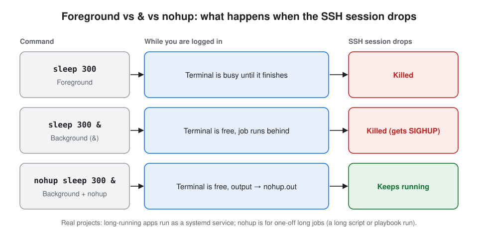
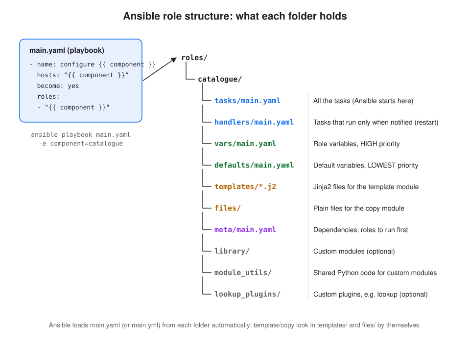
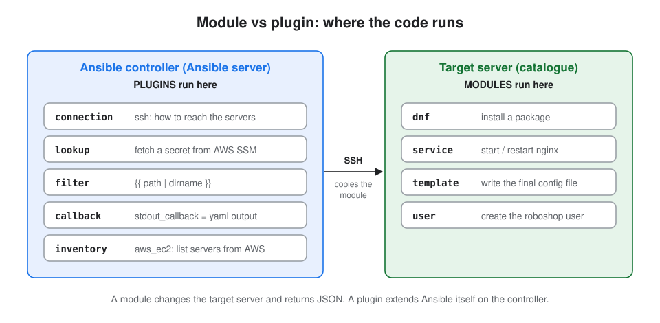

# Day 24 - Background Jobs (nohup), Ansible Tags, Python venv & Ansible Roles

[← All notes](../README.md)

> **In short:** a long command can run in the **background** with `&`, and with **`nohup`** it keeps running even after the SSH session ends. When we use `command`/`shell` to load data, we first **check if the data already exists** (`rc` and row count). **Tags** let us run only some tasks of a playbook. A Python app installs its libraries into its own **virtual environment** (`venv`), and Ansible's `pip` module can do that for us. Finally, our RoboShop playbooks have repeated code, long files and plain-text passwords, so we move to **Ansible roles**: a fixed folder structure that splits one playbook into tasks, variables, templates and handlers. We also see the difference between a **module** (runs on the target) and a **plugin** (runs on the controller).

## About this class

| Part | Topic | What you learn |
|---|---|---|
| **Part 1: Concepts** | `&` and `nohup` · check before loading data (`rc` + count) · tags · Python venv + `pip` module · why roles · role folder structure · `vars` vs `defaults` · module vs plugin | What each one is and why we need it |
| **Part 2: Lab** | Run jobs in the background · keep a job alive with `nohup` · run only some tasks with tags · create a venv by hand and with Ansible · build our first role and run it with `-e component=` | Do each one on a real Ansible server |

**Before this:** [Day 23 - Ansible AWS Access, unarchive remote_src, App Deployment Steps & Managing Java Versions](../day-23-ansible-aws-access-remote-src-deployment-java/README.md)

**Project:** [RoboShop v1 with Ansible: every file explained](../day-22-ansible-shell-vs-ansible-aws-ec2-route53/roboshop-v1/README.md)

## Table of Contents

**Part 1: Concepts**
1. [Background jobs: & and nohup](#1-background-jobs--and-nohup)
2. [Check before loading data: rc and count](#2-check-before-loading-data-rc-and-count)
3. [Tags: run only some tasks](#3-tags-run-only-some-tasks)
4. [Python virtual environment (venv)](#4-python-virtual-environment-venv)
5. [Why roles? The problems with our V1 playbooks](#5-why-roles-the-problems-with-our-v1-playbooks)
6. [Ansible roles: the folder structure](#6-ansible-roles-the-folder-structure)
7. [How a playbook uses a role](#7-how-a-playbook-uses-a-role)
8. [Role variables: vars vs defaults](#8-role-variables-vars-vs-defaults)
9. [Module vs plugin](#9-module-vs-plugin)

**Part 2: Lab**
- [Lab setup](#lab-setup)
- [Step 1: Run a command in the background with &](#step-1-run-a-command-in-the-background-with-)
- [Step 2: See the & job die when the session drops](#step-2-see-the--job-die-when-the-session-drops)
- [Step 3: Keep a job alive with nohup](#step-3-keep-a-job-alive-with-nohup)
- [Step 4: Write a playbook with tags](#step-4-write-a-playbook-with-tags)
- [Step 5: List the tags](#step-5-list-the-tags)
- [Step 6: Run only some tasks with --tags](#step-6-run-only-some-tasks-with---tags)
- [Step 7: Skip tasks with --skip-tags](#step-7-skip-tasks-with---skip-tags)
- [Step 8: Run the full playbook in the background with nohup](#step-8-run-the-full-playbook-in-the-background-with-nohup)
- [Step 9: Create a Python venv by hand](#step-9-create-a-python-venv-by-hand)
- [Step 10: Create the venv with Ansible's pip module](#step-10-create-the-venv-with-ansibles-pip-module)
- [Step 11: Create a role skeleton](#step-11-create-a-role-skeleton)
- [Step 12: Fill the role](#step-12-fill-the-role)
- [Step 13: Run the role with -e component=](#step-13-run-the-role-with--e-component)
- [Step 14: defaults vs vars vs -e](#step-14-defaults-vs-vars-vs--e)
- [Step 15: Clean up](#step-15-clean-up)

**Wrap-up**
- [What I learned](#what-i-learned)
- [Interview questions](#interview-questions)

---

# Part 1: Concepts

## 1. Background jobs: & and nohup

**Definition:** a **foreground** command holds the terminal until it finishes; we can't type anything else. Adding **`&`** at the end runs the command in the **background**: the terminal is free at once, and the shell prints a job number and PID, for example `[1] 4321`. **`nohup`** ("no hang-up") makes the command **ignore the hang-up signal** (`SIGHUP`) that Linux sends when the SSH session ends, so the job **keeps running after we log out**. Its output goes to a file, `nohup.out`, because there's no terminal left to print to.



| Command | Terminal | After the SSH session drops |
|---|---|---|
| `sleep 300` | Busy until it finishes | Killed |
| `sleep 300 &` | Free | Killed (the shell passes `SIGHUP` to its jobs) |
| `nohup sleep 300 &` | Free | **Keeps running**, output in `nohup.out` |

**Where we use it: configure RoboShop servers in parallel.** Run one after another, catalogue, user and cart take minutes each. They don't depend on each other (only on the databases), so we can start all three **at the same time**, each in the background with `nohup`. They keep running even if our SSH session drops.

| Way | What happens |
|---|---|
| `ansible-playbook 05-catalogue.yaml 06-user.yaml 07-cart.yaml` | **One after another** (not parallel), and stops if the session drops |
| `ansible-playbook 05-catalogue.yaml &` (one per playbook) | Parallel, but all die if the session drops |
| `nohup ansible-playbook 05-catalogue.yaml &` (one per playbook) | Parallel **and** survives logout ✅ |

**Separate log per playbook:** without a redirect, every `nohup` job appends to the **same `nohup.out`**, so the output of all three is mixed together. Give each one its own log file instead.

```
mkdir -p /home/ec2-user/roboshop-logs
```

```
nohup ansible-playbook 05-catalogue.yaml &> /home/ec2-user/roboshop-logs/catalogue.log &
```

```
nohup ansible-playbook 06-user.yaml &> /home/ec2-user/roboshop-logs/user.log &
```

```
nohup ansible-playbook 07-cart.yaml &> /home/ec2-user/roboshop-logs/cart.log &
```

| Part | Meaning |
|---|---|
| `nohup` | Don't die when the session ends |
| `&> file` | Send **both** normal output and errors to this file (short for `> file 2>&1`) |
| `&` at the end | Run in the background and give the terminal back |

**Check on them:**

```
pgrep -af ansible-playbook
```

**What it does:** lists the playbooks still running (one line each). When a playbook finishes, it disappears from the list.

```
tail -f /home/ec2-user/roboshop-logs/cart.log
```

**What it does:** shows cart's log live; the `PLAY RECAP` line at the end says whether it passed (`failed=0`).

> ⚠️ Run in parallel **only** playbooks that don't depend on each other. The databases (`01`–`04`) must finish first, because catalogue, user and cart connect to them.

> **Real projects:** apps that must always run (catalogue, cart…) run as a **systemd service**, not with `nohup`; systemd restarts them and starts them at boot. `nohup` is for **one-off long jobs**.

> **Interview one-liner:** `&` runs a command in the background but it dies when the session ends; `nohup <command> &` ignores the hang-up signal, so it keeps running after logout and writes its output to `nohup.out`.

---

## 2. Check before loading data: rc and count

**Definition:** loading data with `command` or `shell` (for example `mysql < master-data.sql`) is **not idempotent**: if we run it twice, it loads the data twice or fails. So before loading, we **check if the data is already there** and load only when it isn't. The check runs a `SELECT COUNT(*)` and looks at two things: the **return code** (`rc`) and the **count**.

```
mysql -h "mysql.$domain_name" -u root -p<mysql-root-password> -N -B -e "SELECT COUNT(*) FROM cities.cities;"
```

| Flag | Meaning |
|---|---|
| `-h` | MySQL server host name |
| `-N` | No column names in the output |
| `-B` | Batch mode: plain output, no table borders |
| `-e` | Run this SQL and exit |

With `-N -B`, the output is **just the number**, for example `4000`, so it's easy to check.

| Result | What it means | Load the data? |
|---|---|---|
| **`rc != 0`** | The command failed: the `cities` database or table doesn't exist yet (first run) | ✅ Yes |
| **`rc = 0` and count = `0`** | The table exists but it's empty | ✅ Yes |
| **`rc = 0` and count > `0`** | Data is already loaded | ❌ No, skip |

In Ansible we `register` the check (with `ignore_errors: true`, because the first run fails on purpose) and load with:

```yaml
when: cities_count.rc != 0 or cities_count.stdout | int == 0
```

`stdout` is text (`"0"`), so the `int` filter turns it into a number before comparing. The full shipping playbook is in [RoboShop v1, section 16](../day-22-ansible-shell-vs-ansible-aws-ec2-route53/roboshop-v1/README.md#16-08-shippingyaml).

> **Interview one-liner:** `command`/`shell` aren't idempotent, so before loading data we run a count query, `register` it, and load only when `rc != 0` (no database yet) or the count is `0` (empty table).

---

## 3. Tags: run only some tasks

**Definition:** a **tag** is a label we put on a task (or a whole play). When we run the playbook with **`--tags <name>`**, Ansible runs **only the tasks with that tag** and skips the rest; **`--skip-tags <name>`** does the opposite. For example, to reload only the MySQL data we run `ansible-playbook 08-shipping.yaml --tags mysql`.

```yaml
- name: load cities data into mysql
  shell: mysql -h "{{ mysql_host }}" -u root -p{{ mysql_root_password }} < /app/db/master-data.sql
  when: cities_count.rc != 0 or cities_count.stdout | int == 0
  tags:
  - mysql
```

| Command | What runs |
|---|---|
| `ansible-playbook 08-shipping.yaml` | All tasks (tags don't change a normal run) |
| `ansible-playbook 08-shipping.yaml --tags mysql` | Only tasks tagged `mysql` |
| `ansible-playbook 08-shipping.yaml --skip-tags mysql` | Everything **except** `mysql` tasks |
| `ansible-playbook 08-shipping.yaml --list-tags` | Prints all tags, runs nothing |

**Special tag `always`:** a task tagged `always` runs even when we pick other tags (useful for a check every run needs). Only `--skip-tags always` skips it.

**Why we use it:** re-run one slow or broken part (reload data, re-copy one config) without repeating the tasks that already worked.

> **Interview one-liner:** we run specific tasks with tags: label the tasks with `tags:`, then `--tags <name>` runs only those and `--skip-tags <name>` skips them.

---

## 4. Python virtual environment (venv)

**Definition:** a **virtual environment** (`venv`) is a **private folder for one Python app**, with its own copy of `python` and `pip` and its own `site-packages` folder for libraries. Libraries we install into it, for example `/app/.venv`, are used **only by that app** and don't touch the system Python. RoboShop's **payment** service (Python) installs its libraries this way.

**Why we need it:**

| Without venv (`sudo pip install …`) | With venv |
|---|---|
| Libraries go into the **system Python**, which OS tools use too (`dnf` on RHEL is written in Python) | Libraries stay in `/app/.venv`; the system Python is untouched |
| Two apps needing different versions of a library clash | Each app has its own venv with its own versions |
| Hard to delete cleanly | Delete the folder and it's gone |

**By hand (what the shell script did):**

```
python3.14 -m venv /app/.venv
/app/.venv/bin/pip install -r requirements.txt
```

| Command | What it does |
|---|---|
| `python3.14 -m venv /app/.venv` | Creates the venv folder using Python 3.14 |
| `/app/.venv/bin/pip install -r requirements.txt` | Installs every library listed in `requirements.txt` **into the venv** (we call the venv's own `pip` by full path) |

We don't need `source …/activate`: calling `/app/.venv/bin/pip` or `/app/.venv/bin/python` directly uses the venv. That's also how the systemd service starts the app (`ExecStart=/app/.venv/bin/gunicorn …`).

**With Ansible: the `pip` module**

```yaml
- name: install dependencies in virtual environment
  ansible.builtin.pip:
    requirements: /app/requirements.txt
    virtualenv: /app/.venv
    virtualenv_command: python3.14 -m venv
```

| Option | Meaning |
|---|---|
| `requirements` | The `requirements.txt` file on the target server |
| `virtualenv` | Install into this venv; **create it if it doesn't exist** |
| `virtualenv_command` | The command used to create the venv (`python3.14 -m venv` = use Python 3.14) |

The `pip` module is **idempotent**: on a second run it sees the venv and libraries are already there and reports `ok`. The full payment playbook is in [RoboShop v1, section 17](../day-22-ansible-shell-vs-ansible-aws-ec2-route53/roboshop-v1/README.md#17-09-paymentyaml).

> **Interview one-liner:** a venv is a private Python environment for one app, so its libraries don't clash with the system Python or other apps; in Ansible we use the `pip` module with `virtualenv` and `virtualenv_command`.

---

## 5. Why roles? The problems with our V1 playbooks

**Definition:** our **RoboShop V1** is 10 playbooks (`01-mongodb.yaml` … `10-frontend.yaml`), each one a long list of tasks. As the project grows, this way of writing has three problems, and **roles** (V2) fix the code organisation part.

| Problem in V1 | Example | Fix |
|---|---|---|
| **Repeated code** | Create `roboshop` user, `/app`, download, unzip, systemd reload: the same tasks in catalogue, user, cart, shipping, payment | Put the shared tasks in **one role** and reuse it |
| **Long, hard-to-read playbooks** | Tasks, variables and templates all mixed in one file and the project root | A role splits them into **folders**: `tasks/`, `vars/`, `templates/` … |
| **Passwords in plain text** | `mysql_root_password` in `group_vars/all.yaml`, pushed to Git | Fetch secrets at run time with a **lookup plugin** (e.g. from AWS SSM Parameter Store) or encrypt them with `ansible-vault` |

**Same idea as our shell scripts:** in RoboShop shell V2, the repeated code went into **`common.sh`** as functions, and each script called them with `source common.sh`. Roles are the Ansible version of that.

| Shell script V2 | Ansible roles |
|---|---|
| `common.sh` with functions | A `common` role with shared tasks |
| `source common.sh` + call `app_setup` | `include_role` / `roles:` |
| One `.sh` file per component | One role folder per component |

---

## 6. Ansible roles: the folder structure

**Definition:** a **role** is a **fixed folder structure** that holds everything for one component (for example catalogue): its tasks, variables, templates, files and handlers. Because the folder names are fixed, Ansible knows where to find each part and **loads `main.yaml` from each folder automatically**, so a playbook only needs to say the role's name. Roles live in a `roles/` folder next to the playbook.



```
roles/
└── catalogue/
    ├── tasks/main.yaml        ← all the tasks
    ├── handlers/main.yaml     ← tasks that run only when notified
    ├── vars/main.yaml         ← role variables (high priority)
    ├── defaults/main.yaml     ← default variables (lowest priority)
    ├── templates/             ← *.j2 files
    ├── files/                 ← plain files to copy
    ├── meta/main.yaml         ← dependencies on other roles
    ├── library/               ← custom modules (optional)
    ├── module_utils/          ← shared code for custom modules (optional)
    └── lookup_plugins/        ← custom plugins (optional)
```

| Folder | What goes in it | Example |
|---|---|---|
| `tasks/` | The tasks, in `main.yaml`. **The only folder a role really needs** | install nodejs, create user, download code |
| `handlers/` | Tasks that run **only when another task notifies them**, once, at the end of the play | `restart catalogue` after the service file changes |
| `vars/` | Role variables. **High priority**: hard to override (only `-e` and a few others beat them) | `component: catalogue` |
| `defaults/` | Default values. **Lowest priority of all**: anything else overrides them | `app_version: v4` |
| `templates/` | Jinja2 files. In a role, `template: src: catalogue.service.j2` looks here automatically | `catalogue.service.j2` |
| `files/` | Files copied as they are. `copy: src: mongo.repo` looks here automatically | `mongo.repo` |
| `meta/` | Role **dependencies**: roles that must run first | `dependencies: - role: common` |
| `library/`, `module_utils/`, `lookup_plugins/` | Our own modules, their shared Python code, and our own plugins. Rarely needed | A custom lookup that reads a secret |

**`main.yaml` is the entry file:** Ansible looks for `main.yaml`, `main.yml` or `main` in each folder. Other files in `tasks/` run only when `main.yaml` includes them.

**Create the skeleton with one command:** `ansible-galaxy role init <name>` makes all these folders with empty `main.yml` files (we do it in [Step 11](#step-11-create-a-role-skeleton)).

> **Interview one-liner:** a role is a standard folder structure (`tasks`, `handlers`, `vars`, `defaults`, `templates`, `files`, `meta`) for one component; Ansible loads `main.yaml` from each folder automatically, so playbooks stay short and the code is reusable.

### RoboShop V2: what goes where

**Every file in the V2 project, in 3 groups:**

| Group | Where | What it holds |
|---|---|---|
| **① Project files** | Repo root + `group_vars/` | Settings, server list, the one playbook, variables for all servers |
| **② Common role** (shared code) | `roles/common/tasks/` | Steps that **2 or more apps repeat**, written with `{{ component }}` instead of an app name |
| **③ Own role** (own code) | `roles/<component>/` | Steps, templates and files that **only this one app** needs |

```
roboshop-ansible-v2/
├── ansible.cfg, inventory.ini, main.yaml, roboshop.yaml   ① project files
├── group_vars/all/main.yaml + vault.yaml                  ① variables for every server
└── roles/
    ├── common/tasks/app-setup.yaml, nodejs.yaml, java.yaml,
    │               python.yaml, systemd-setup.yaml, restart.yaml   ② shared code
    └── catalogue/, user/, cart/, shipping/, payment/,
        mongodb/, redis/, mysql/, rabbitmq/, frontend/              ③ own code
```

**① Project files (outside `roles/`)**

| File | What it contains | Example |
|---|---|---|
| `ansible.cfg` | Ansible settings | `inventory=inventory.ini`, `vault_password_file=~/.ansible_random` |
| `inventory.ini` | The server list, one **group** per component | `[catalogue]` → `catalogue.<domain>` |
| `main.yaml` | The **only playbook** we run. It picks the servers and the role | `hosts: "{{ component }}"`, `roles: - "{{ component }}"` |
| `roboshop.yaml` | Creates/deletes the EC2 servers + Route 53 records | same as V1 |
| `group_vars/all/main.yaml` | Variables for **every** server. This is **not** a role file: Ansible loads every file in `group_vars/all/` | `mongodb_host: mongodb.<domain>`, `ansible_password: "{{ vault_ansible_password }}"` |
| `group_vars/all/vault.yaml` | Encrypted passwords ([Day 25](../day-25-ansible-vault-roboshop-v2/README.md)) | `vault_mysql_root_password: …` (AES256) |

**② Common role: `roles/common/tasks/` (shared code)**

| File | What it does | Used by |
|---|---|---|
| `app-setup.yaml` | Create the `roboshop` user, clean and create `/app`, download `{{ component }}-v4.zip`, unzip | catalogue, user, cart, shipping, payment |
| `nodejs.yaml` | Enable Node.js 24, install it, `npm install` | catalogue, user, cart |
| `java.yaml` | Install Maven + Java 25, `mvn clean package`, move the jar | shipping |
| `python.yaml` | Install Python 3.14, create a venv, `pip install` | payment |
| `systemd-setup.yaml` | Copy `{{ component }}.service.j2` to `/etc/systemd/system/` | catalogue, user, cart, shipping, payment |
| `restart.yaml` | `daemon-reload` + restart and enable `{{ component }}` | catalogue, user, cart, shipping, payment |

The common role has **only `tasks/`**. Its files never run by themselves; another role calls them:

```yaml
- name: nodejs setup
  include_role:
    name: common
    tasks_from: nodejs        # runs roles/common/tasks/nodejs.yaml
```

**③ Own role: what each folder in `roles/<component>/` contains**

| Folder / file | What it contains | Loaded how | RoboShop V2 example |
|---|---|---|---|
| `tasks/main.yaml` | The **steps** for this app: calls to common + its own tasks. **The only file a role must have** | Automatically when the role runs | catalogue: `include_role` common ×4 + mongo repo + mongosh + load products |
| `handlers/main.yaml` | Tasks that run **only when notified** by a task that **changed** something, once, at the end of the play | A task has `notify: <handler name>` | frontend: `restart nginx` after `roboshop.conf` changes |
| `templates/` | `.j2` files with `{{ variables }}`, filled in before copying | `template: src: x.j2` looks here | `catalogue.service.j2`, `roboshop.conf.j2` |
| `files/` | Plain files copied **as they are** (no variables) | `copy: src: x` looks here | `mongo.repo`, `rabbitmq.repo` |
| `defaults/main.yaml` | Default variables, **lowest priority**: anything else overrides them | Automatically | (class demo) `course: devops` |
| `vars/main.yaml` | Role variables, **high priority**: only `-e` and a few others beat them | Automatically | (class demo) `course: ansible`, which beats `defaults` |
| `meta/main.yaml` | **Dependencies**: roles that must run **before** this one | Automatically, before `tasks/` | (class demo) `dependencies: - role: example` |

**Which roles use which parts:**

| Role | Calls common? | Own tasks | `templates/` | `files/` | `handlers/` |
|---|---|---|---|---|---|
| catalogue | ✅ app-setup, nodejs, systemd-setup, restart | mongo client + load products | `catalogue.service.j2` | `mongo.repo` | |
| user, cart | ✅ app-setup, nodejs, systemd-setup, restart | none | `<name>.service.j2` | | |
| shipping | ✅ app-setup, java, systemd-setup, restart | count cities, load cities, create app DB user | `shipping.service.j2` | | |
| payment | ✅ app-setup, python, systemd-setup, restart | none | `payment.service.j2` | | |
| mongodb, rabbitmq | ❌ | everything (install, config, start) | | `mongo.repo` / `rabbitmq.repo` | |
| redis, mysql | ❌ | everything | | | |
| frontend | ❌ | install nginx, clean html, download + unzip, copy config | `roboshop.conf.j2` | | ✅ `restart nginx` |

**Why `<name>.service.j2` stays in each app's own role:** every app's service file is different (different environment variables). The common `systemd-setup.yaml` only says "copy `{{ component }}.service.j2`", and Ansible finds the file in the role that called it.

**How to decide where a step goes:**

| Question | Put it in |
|---|---|
| Do 2 or more apps repeat this step? | `roles/common/tasks/<name>.yaml`, written with `{{ component }}` |
| Only one app needs it? | `roles/<component>/tasks/main.yaml` |
| A config file with variables? | `roles/<component>/templates/<name>.j2` |
| A file copied as it is? | `roles/<component>/files/` |
| Restart only when a config changed? | `roles/<component>/handlers/main.yaml` + `notify:` |
| A value every server needs? | `group_vars/all/main.yaml` |
| A password? | `group_vars/all/vault.yaml` (encrypted) |

---

## 7. How a playbook uses a role

**Definition:** a playbook uses a role with the **`roles:`** keyword. Ansible finds the folder `roles/<name>/`, runs `tasks/main.yaml`, loads its variables and handlers, and uses its `templates/` and `files/`. With a variable in the role name, **one playbook** can configure **every** component.

```yaml
- name: configure {{ component }}
  hosts: "{{ component }}"
  become: yes
  roles:
  - "{{ component }}"
```

```
ansible-playbook main.yaml -e component=mongodb
```

| Run | `hosts` | Role used |
|---|---|---|
| `-e component=mongodb` | the `[mongodb]` group in the inventory | `roles/mongodb/` |
| `-e component=catalogue` | the `[catalogue]` group | `roles/catalogue/` |

So V1's 10 playbooks become **1 short `main.yaml` + 10 role folders**. The inventory group name and the role folder name must match the value we pass.

> **Interview one-liner:** a playbook calls a role with `roles:`; with `hosts: "{{ component }}"` and `roles: - "{{ component }}"`, one `main.yaml` configures any component through `-e component=<name>`.

---

## 8. Role variables: vars vs defaults

**Definition:** a role can keep variables in two folders. **`defaults/main.yaml`** holds **default values with the lowest priority**: they're used only if the variable isn't set anywhere else, so they're easy to override. **`vars/main.yaml`** holds **role variables with high priority**: inventory, `group_vars` and play `vars` can't override them, only a few things like `-e` can.

```
-e (extra vars)  >  role vars/  >  play vars  >  group_vars / inventory  >  role defaults/
   (wins)                                                                    (lowest)
```

| Put it in | When | Example |
|---|---|---|
| `defaults/` | A value users **should be able to change** | `app_version: v4`, a port |
| `vars/` | A value that **should not change** for this role | `component: catalogue`, the service name |

**Example: the same variable in both folders (RoboShop V2 catalogue role)**

`roles/catalogue/defaults/main.yaml`:

```yaml
course: devops
duration: 100hrs
trainer: <name>
```

`roles/catalogue/vars/main.yaml`:

```yaml
course: ansible
duration: 10hrs
```

`roles/catalogue/tasks/main.yaml` prints them:

```yaml
- name: print variables
  debug:
    msg: "COURSE: {{ course }}, DURATION: {{ duration }}, TRAINER: {{ trainer }}"
```

Running `ansible-playbook main.yaml -e component=catalogue` prints:

```
COURSE: ansible, DURATION: 10hrs, TRAINER: <name>
```

| Variable | In `defaults/` | In `vars/` | Used | Why |
|---|---|---|---|---|
| `course` | devops | ansible | **ansible** | Set in both → `vars/` wins |
| `duration` | 100hrs | 10hrs | **10hrs** | Set in both → `vars/` wins |
| `trainer` | `<name>` | (not set) | **`<name>`** | Only `defaults/` has it → it's used |

**Why `vars/` wins:** the two folders have different jobs.

| | `defaults/` | `vars/` |
|---|---|---|
| Meaning | "Use this **if nobody gives a value**" | "This role **needs this value**" |
| Meant to be changed? | ✅ Yes, by whoever uses the role | ❌ No, it's internal to the role |
| Like a form field that is | **Pre-filled**: you can type over it from anywhere | **Locked**: `group_vars` can't change it by accident |

> **Rule of thumb:** if users should be able to change a value, put it in `defaults/`; if they shouldn't, put it in `vars/`. Only `-e` beats `vars/`.

> **Interview one-liner:** role `defaults` have the lowest priority of all and are meant to be overridden; role `vars` have high priority and are for values that shouldn't change; `-e` beats both.

---

## 9. Module vs plugin

> **In short:**
> - **Task** = one step in a playbook. Each task calls **one module**.
> - **Module** = runs on the **target server** and changes it (`dnf`, `copy`, `service`).
> - **Plugin** = runs on the **Ansible controller** and helps Ansible itself, for example fetching secrets from AWS, filtering data, or connecting over SSH.

**Definition:** a **module** is the code that does a task's work **on the target server**: Ansible copies it over SSH, runs it there with the target's Python, and gets back a JSON result (`ok` / `changed` / `failed`). A **plugin** is code that runs **on the Ansible controller** and extends Ansible itself: how it connects, how it shows output, how it changes data, or how it **fetches values from outside**, such as a secret from AWS.



| | Module | Plugin |
|---|---|---|
| **Runs on** | Target server (catalogue) | Ansible controller |
| **Job** | Change the server: install, copy, start | Extend Ansible: connect, filter, look up, show output |
| **Examples** | `dnf`, `service`, `user`, `pip` | `ssh` connection, `\| dirname` filter, `stdout_callback = yaml`, `aws_ssm` lookup |

**We already used plugins without knowing it:**

| What we wrote | Plugin type |
|---|---|
| `{{ java25.stdout \| dirname }}` ([Day 23](../day-23-ansible-aws-access-remote-src-deployment-java/README.md#6-java_home)) | **filter** plugin |
| `callback_result_format = yaml` in `ansible.cfg` | **callback** plugin (output format) |
| SSH login to every server | **connection** plugin |

**Why it matters for passwords:** a **lookup** plugin can read a secret from **AWS SSM Parameter Store** on the controller at run time, so the password never sits in a Git file:

```yaml
mysql_root_password: "{{ lookup('amazon.aws.aws_ssm', '/roboshop/dev/mysql_root_password') }}"
```

> **Interview one-liner:** a module runs on the target server and changes it (install, copy, start); a plugin runs on the controller and extends Ansible, for example lookup plugins fetch secrets, filter plugins change data, connection plugins handle SSH.

---

# Part 2: Lab

## Lab setup

| What | Details |
|---|---|
| **Ansible server** | RHEL 9 EC2 server with Ansible installed. In my case, I'm reusing the Ansible server from the RoboShop labs. If you're doing this for the first time, create one with the [Ansible Lab](../ansible-lab-control-node-managed-nodes/README.md) guide |
| **Target** | The Ansible server itself (`localhost`), so this lab needs no other servers |
| **Project folder** | `~/day24-lab` |

```bash
mkdir -p ~/day24-lab && cd ~/day24-lab
```

```bash
vim ansible.cfg
```

```ini
[defaults]
inventory=inventory.ini
host_key_checking=False
```

```bash
vim inventory.ini
```

```ini
[local]
localhost ansible_connection=local

[nginx]
localhost
```

| Line | Meaning |
|---|---|
| `ansible_connection=local` | Run tasks directly on this server, without SSH |
| `[nginx]` group | Used by the role in Step 13 (the group name matches the role name) |

```bash
ansible all -m ping
```

**Expected:** `localhost | SUCCESS` with `"ping": "pong"` ✅.

---

## Step 1: Run a command in the background with &

```bash
sleep 300 &
```

**What it does:** starts `sleep 300` (wait 5 minutes) in the background.

**Expected:** a job number and PID, like `[1] 4321`, and the prompt comes back at once ✅.

```bash
jobs
```

**What it does:** lists this shell's background jobs.

**Expected:** `[1]+  Running    sleep 300 &` ✅.

---

## Step 2: See the & job die when the session drops

**Close the terminal window** (don't type `exit`). This is the same as your Wi-Fi dropping. Then log in to the Ansible server again.

```bash
pgrep -a sleep
```

**What it does:** shows running processes named `sleep` with their PID.

**Expected:** **no output**: the `sleep 300` job was killed when the session ended ✅.

> **Why not `exit`?** Bash kills background jobs on `exit` only if its `huponexit` option is on (it's off by default), so after `exit` the job may survive. A **dropped connection** always sends the hang-up signal, and that's the real risk.

---

## Step 3: Keep a job alive with nohup

```bash
nohup sleep 600 &
```

**What it does:** starts `sleep 600` in the background and makes it ignore the hang-up signal.

**Expected:** `[1] 4388` and `nohup: ignoring input and appending output to 'nohup.out'` ✅.

**Close the terminal window** again and log back in.

```bash
pgrep -a sleep
```

**Expected:** `4388 sleep 600`: it survived the logout ✅.

```bash
pkill sleep
```

**What it does:** stops it, since we don't need it any more.

---

## Step 4: Write a playbook with tags

```bash
cd ~/day24-lab
```

```bash
vim tags-demo.yaml
```

```yaml
- name: tags demo
  hosts: local
  tasks:
  - name: install tree
    become: yes               # only this task needs sudo
    package:
      name: tree
      state: present
    tags:
    - install

  - name: create config folder
    file:
      path: /tmp/day24/config
      state: directory
    tags:
    - config

  - name: write config file
    copy:
      content: "env=dev\n"
      dest: /tmp/day24/config/app.conf
    tags:
    - config

  - name: slow data load (30 seconds)
    command: sleep 30
    tags:
    - data

  - name: summary
    debug:
      msg: "tags demo finished"
    tags:
    - always
```

| Tag | Tasks |
|---|---|
| `install` | install tree |
| `config` | create config folder, write config file |
| `data` | slow data load (stands in for a long data import) |
| `always` | summary: runs in every run |

> `become: yes` is only on the install task, so `/tmp/day24` is owned by `ec2-user` and we can use it without `sudo` in Step 9.

---

## Step 5: List the tags

```bash
ansible-playbook tags-demo.yaml --list-tags
```

**What it does:** shows every tag in the playbook without running anything.

**Expected:**

```
TASK TAGS: [always, config, data, install]
```

---

## Step 6: Run only some tasks with --tags

```bash
ansible-playbook tags-demo.yaml --tags config
```

**What it does:** runs only the tasks tagged `config` (plus `always`).

**Expected:** only `create config folder`, `write config file` and `summary` run. `install tree` and the 30-second data load don't appear ✅.

```bash
cat /tmp/day24/config/app.conf
```

**Expected:** `env=dev` ✅.

---

## Step 7: Skip tasks with --skip-tags

```bash
ansible-playbook tags-demo.yaml --skip-tags data
```

**What it does:** runs everything **except** the slow data task.

**Expected:** `install tree`, both config tasks and `summary` run; the data load is skipped, so the run finishes in seconds ✅.

---

## Step 8: Run the full playbook in the background with nohup

```bash
nohup ansible-playbook tags-demo.yaml > tags-demo.log 2>&1 &
```

**What it does:** runs the whole playbook (including the 30-second task) in the background, safe from a dropped session, with all output in `tags-demo.log`.

**Expected:** `[1] 4502`, and the prompt comes back ✅.

```bash
tail -f tags-demo.log
```

**What it does:** shows the log live as new lines are added.

**Expected:** the tasks appear one by one and end with the `PLAY RECAP` (`failed=0`) ✅. Press `Ctrl+C` to stop watching; this stops only `tail`, not the playbook.

---

## Step 9: Create a Python venv by hand

```bash
mkdir -p /tmp/day24/app && cd /tmp/day24/app
```

```bash
echo "bottle" > requirements.txt
```

**What it does:** creates a `requirements.txt` with one library, `bottle` (a small Python web framework).

```bash
python3 -m venv /tmp/day24/app/.venv
```

**What it does:** creates the venv with the system Python 3. (RoboShop payment uses `python3.14` the same way.)

```bash
ls /tmp/day24/app/.venv/bin
```

**Expected:** its own `python`, `python3`, `pip`, `pip3` and `activate` ✅.

```bash
/tmp/day24/app/.venv/bin/pip install -r requirements.txt
```

**Expected:** `Successfully installed bottle-…` ✅.

```bash
/tmp/day24/app/.venv/bin/python -c "import bottle; print(bottle.__version__)"
```

**Expected:** a version number like `0.13.x` ✅.

```bash
python3 -c "import bottle"
```

**Expected:** `ModuleNotFoundError: No module named 'bottle'` ✅. The system Python doesn't have it: the library lives **only** in the venv.

---

## Step 10: Create the venv with Ansible's pip module

```bash
cd ~/day24-lab
```

```bash
vim venv.yaml
```

```yaml
- name: python venv with ansible
  hosts: local
  tasks:
  - name: install dependencies in virtual environment
    ansible.builtin.pip:
      requirements: /tmp/day24/app/requirements.txt
      virtualenv: /tmp/day24/app/ansible-venv
      virtualenv_command: python3 -m venv
```

```bash
ansible-playbook venv.yaml
```

**Expected:** `changed: [localhost]`: the venv was created and `bottle` was installed ✅.

```bash
ansible-playbook venv.yaml
```

**Expected:** `ok: [localhost]`: everything is already there, so nothing changes (idempotent) ✅.

| Error | Cause | Fix |
|---|---|---|
| `Failed to find required executable "python3.14"` | That Python version isn't installed on the target | Install it first (RoboShop payment installs `python3.14` before this task) or use one that is installed |

---

## Step 11: Create a role skeleton

```bash
cd ~/day24-lab
```

```bash
ansible-galaxy role init --init-path roles nginx
```

**What it does:** creates the role `nginx` with the standard folders inside `roles/`.

**Expected:** `- Role nginx was created successfully` ✅.

```bash
tree roles
```

**Expected:**

```
roles
└── nginx
    ├── README.md
    ├── defaults
    │   └── main.yml
    ├── files
    ├── handlers
    │   └── main.yml
    ├── meta
    │   └── main.yml
    ├── tasks
    │   └── main.yml
    ├── templates
    ├── tests
    │   ├── inventory
    │   └── test.yml
    └── vars
        └── main.yml
```

`ansible-galaxy` names the files `main.yml`; `main.yaml` works the same. We ignore `tests/` and `README.md`.

**Our role:** install nginx and add a page at `/day24` that shows which environment it is. RHEL's nginx loads every `/etc/nginx/default.d/*.conf` inside its default server on port 80, so we drop our config there.

---

## Step 12: Fill the role

```bash
vim roles/nginx/defaults/main.yml
```

```yaml
app_name: roboshop
env: dev
```

```bash
vim roles/nginx/templates/day24.conf.j2
```

```nginx
location /day24 {
    default_type text/plain;
    return 200 "app={{ app_name }} env={{ env }} host={{ ansible_facts['hostname'] }}\n";
}
```

```bash
vim roles/nginx/tasks/main.yml
```

```yaml
- name: install nginx
  dnf:
    name: nginx
    state: present

- name: copy day24 config
  template:
    src: day24.conf.j2        # Ansible looks in roles/nginx/templates/
    dest: /etc/nginx/default.d/day24.conf
  notify: reload nginx

- name: start and enable nginx
  service:
    name: nginx
    state: started
    enabled: yes
```

```bash
vim roles/nginx/handlers/main.yml
```

```yaml
- name: reload nginx
  service:
    name: nginx
    state: reloaded
```

| File | What it does |
|---|---|
| `defaults/main.yml` | Default values for `app_name` and `env` (easy to override) |
| `templates/day24.conf.j2` | nginx config for `/day24`; Jinja2 fills in the variables and the server's hostname |
| `tasks/main.yml` | Install nginx → write the config → start nginx |
| `notify: reload nginx` | If the config file **changed**, run the handler named `reload nginx` at the end of the play |
| `handlers/main.yml` | Reloads nginx so it reads the new config. If the file didn't change, the handler doesn't run |

Now the playbook. It's short because the role holds the work:

```bash
vim main.yaml
```

```yaml
- name: configure {{ component }}
  hosts: "{{ component }}"
  become: yes
  roles:
  - "{{ component }}"
```

---

## Step 13: Run the role with -e component=

```bash
ansible-playbook main.yaml -e component=nginx
```

**What it does:** `hosts` becomes the `[nginx]` group and the role becomes `roles/nginx/`.

**Expected:** the 3 tasks run, then `RUNNING HANDLER [nginx : reload nginx]`, and `failed=0` ✅.

```bash
curl localhost/day24
```

**Expected:** `app=roboshop env=dev host=ip-172-31-…` ✅. The values came from `defaults/`.

```bash
ansible-playbook main.yaml -e component=nginx
```

**Expected:** every task is `ok`, `changed=0`, and **no handler runs**, because the config didn't change ✅.

| Error | Cause | Fix |
|---|---|---|
| `the role 'xyz' was not found` | No `roles/xyz/` folder (typo in `-e component=`) | Use the role folder's exact name |
| `Could not match supplied host pattern` | No inventory group with that name | Add the group (e.g. `[nginx]`) to `inventory.ini` |
| `curl: (7) Failed to connect … port 80` | nginx isn't running | `sudo systemctl status nginx`, and check the config with `sudo nginx -t` |

---

## Step 14: defaults vs vars vs -e

Let's set `env` in more places and see which one wins.

```bash
vim roles/nginx/vars/main.yml
```

```yaml
env: qa
```

```bash
ansible-playbook main.yaml -e component=nginx
```

```bash
curl localhost/day24
```

**Expected:** `env=qa`: role `vars/` beats `defaults/` ✅. The handler ran, because the config changed.

```bash
ansible-playbook main.yaml -e component=nginx -e env=prod
```

```bash
curl localhost/day24
```

**Expected:** `env=prod`: `-e` beats role `vars/` ✅.

| Run | `env` set in | Page shows |
|---|---|---|
| Step 13 | `defaults/` only | `env=dev` |
| `vars/main.yml` added | `defaults/` + `vars/` | `env=qa` |
| `-e env=prod` | `defaults/` + `vars/` + `-e` | `env=prod` |

---

## Step 15: Clean up

```bash
sudo rm -f /etc/nginx/default.d/day24.conf
```

```bash
sudo systemctl disable --now nginx
```

**What it does:** stops nginx and keeps it from starting at boot. (Skip this if your Ansible server used nginx before this lab.)

```bash
rm -rf /tmp/day24
```

```bash
pgrep -a sleep
```

**Expected:** no output (no leftover background jobs). If you see one, stop it with `pkill sleep`.

Keep `~/day24-lab`: next we turn the RoboShop playbooks into roles the same way.

---

# Wrap-up

## What I learned

**Part 1: Concepts**
- **`&`** runs a command in the background but it dies when the session drops; **`nohup … &`** survives logout, with output in `nohup.out` (or our own log with `&> file`). We use it to run catalogue, user and cart **in parallel**, each with its own log.
- `command`/`shell` aren't idempotent, so we **check first**: load data only if `rc != 0` (no database) or count is `0` (empty table). `-N -B` print only the number.
- **Tags** label tasks; `--tags` runs only those, `--skip-tags` skips them, `--list-tags` shows them, `always` runs every time.
- A **venv** keeps one app's Python libraries apart from the system Python; Ansible's **`pip`** module creates it (`virtualenv`, `virtualenv_command`) and installs `requirements.txt`.
- V1 problems: **repeated code, long playbooks, plain-text passwords**. **Roles** fix the structure (like `common.sh` in shell V2); lookup plugins / `ansible-vault` fix the passwords.
- A **role** = fixed folders (`tasks`, `handlers`, `vars`, `defaults`, `templates`, `files`, `meta`); Ansible loads **`main.yaml`** from each automatically.
- One `main.yaml` + `-e component=<name>` runs any role. Priority: **`-e` > role `vars/` > … > role `defaults/`**.
- **Module** = runs on the target and changes it; **plugin** = runs on the controller (connection, filter, callback, lookup).

**Part 2: Lab**
- Saw a `&` job die after a dropped session and a `nohup` job survive it.
- Ran only some tasks with `--tags` / `--skip-tags`, and a full playbook in the background with `nohup` + `tail -f`.
- Made a venv by hand and with the `pip` module; proved the library exists only inside the venv.
- Built an `nginx` role with `ansible-galaxy role init`, ran it with `-e component=nginx`, saw the handler run only on a change, and tested `defaults` < `vars` < `-e`.

```
 V1: 10 long playbooks ──► V2: main.yaml + roles/<component>/
                                    │
             tasks/ · handlers/ · vars/ · defaults/ · templates/ · files/ · meta/
                                    │
              ansible-playbook main.yaml -e component=catalogue  (--tags to run a part)
```

## Interview questions

### ⭐ Very Important

| Question | Answer |
|---|---|
| How can we run specific tasks in an ansible-playbook? | With **tags**: add `tags:` to the tasks, then run `ansible-playbook <file> --tags <name>`. `--skip-tags` skips them and `--list-tags` shows all tags |

### Other Questions

| Question | Answer |
|---|---|
| `&` vs `nohup`? | `&` runs in the background but dies when the session ends; `nohup … &` ignores the hang-up signal and keeps running, output in `nohup.out` |
| How do you keep a long playbook running if SSH disconnects? | `nohup ansible-playbook x.yaml &> x.log &`, then `tail -f x.log` |
| How do you configure several servers in parallel with separate logs? | Start each playbook with `nohup ansible-playbook <file> &> <component>.log &`; without the redirect they all mix into one `nohup.out` |
| How do you make a data load idempotent with `command`/`shell`? | Run a count query first, `register` it, and load only when `rc != 0` or the count is `0` |
| What does the `always` tag do? | The task runs even when other tags are selected; only `--skip-tags always` skips it |
| What is a Python virtual environment? | A private folder with its own `python`, `pip` and libraries for one app, so it doesn't clash with the system Python |
| How do you install Python dependencies with Ansible? | The `pip` module with `requirements`, `virtualenv` and `virtualenv_command` |
| What is an Ansible role? | A standard folder structure for one component (tasks, handlers, vars, defaults, templates, files, meta) that Ansible loads automatically |
| Why do we use roles? | Reuse code, keep playbooks short and organised, and share them (Ansible Galaxy) |
| Which file does Ansible load in each role folder? | `main.yaml` (or `main.yml`) |
| Role `vars` vs `defaults`? | `defaults` have the lowest priority and are meant to be overridden; `vars` have high priority. `-e` beats both |
| What is a handler? | A task that runs only when another task notifies it, once at the end of the play, e.g. restart a service after its config changed |
| What goes in `meta/main.yaml`? | Role dependencies: roles that must run before this one |
| How do you create a role skeleton? | `ansible-galaxy role init <name>` |
| Module vs plugin? | A module runs on the target and changes it; a plugin runs on the controller and extends Ansible (connection, filter, callback, lookup) |
| How do you avoid plain-text passwords in playbooks? | Fetch them at run time with a lookup plugin (e.g. AWS SSM Parameter Store) or encrypt them with `ansible-vault` |

---

**Source:** [Roles](https://docs.ansible.com/ansible/latest/playbook_guide/playbooks_reuse_roles.html) · [Tags](https://docs.ansible.com/ansible/latest/playbook_guide/playbooks_tags.html) · [Variable precedence](https://docs.ansible.com/ansible/latest/playbook_guide/playbooks_variables.html#understanding-variable-precedence) · [ansible.builtin.pip](https://docs.ansible.com/ansible/latest/collections/ansible/builtin/pip_module.html) · [Handlers](https://docs.ansible.com/ansible/latest/playbook_guide/playbooks_handlers.html) · [Plugins](https://docs.ansible.com/ansible/latest/plugins/plugins.html) · [Python venv](https://docs.python.org/3/library/venv.html) · [nohup(1)](https://man7.org/linux/man-pages/man1/nohup.1.html)
