# RoboShop Debugging Guide: Which Error → What to Check

[← Back to all notes](../README.md) · [Day 16 notes](../day-16-roboshop-shell-scripts/README.md) · [Problems I hit](../day-16-roboshop-shell-scripts/troubleshooting.md)

**Contents:** [1. Request path](#1-the-request-path-who-calls-whom) · [2. Read the error](#2-read-the-error-first-what-it-means--where-to-look) · [3. 6-step checklist](#3-the-6-step-checklist-same-order-every-time) · [4. Configs & restarts](#4-config-files-where-they-are-and-what-to-restart) · [5. 502 example](#5-worked-example-messageservice-not-reachable-502-bad-gateway-from-nginx) · [6. Logs](#6-logs-where-to-find-the-exact-reason) · [7. Health checks](#7-health-check-per-server-copy-paste) · [8. Real errors from class](#8-real-errors-from-class-screenshot--fix) · [Interview](#interview-one-liners)

> **In short:** Don't guess. **Follow the request path** and test **one hop at a time**. The **first hop that fails** is where the problem is. The **error message** tells you **which kind of problem**: the server or service is down, the network (SG) is blocked, or the config is wrong.

---

## 1. The request path (who calls whom)

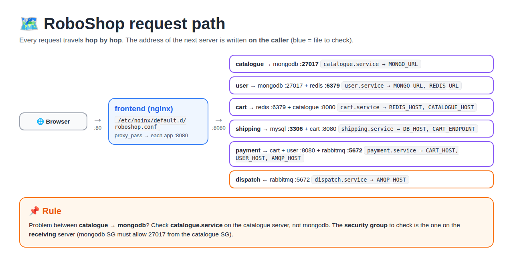

```
Browser
  │ :80
  ▼
frontend (nginx) ── /etc/nginx/default.d/roboshop.conf
  │ :8080 (proxy_pass)
  ├──► catalogue ──► mongodb :27017
  ├──► user ───────► mongodb :27017 + redis :6379
  ├──► cart ───────► redis :6379 + catalogue :8080
  ├──► shipping ───► mysql :3306 + cart :8080
  └──► payment ────► cart :8080 + user :8080 + rabbitmq :5672
                                                   │
                                     dispatch ◄────┘ :5672
```

| Caller | Talks to | Port | Set in (on the caller) |
|--------|----------|------|------------------------|
| browser | frontend | 80 | (public IP / DNS) |
| frontend | catalogue, user, cart, shipping, payment | 8080 | `/etc/nginx/default.d/roboshop.conf` |
| catalogue | mongodb | 27017 | `/etc/systemd/system/catalogue.service` → `MONGO_URL` |
| user | mongodb, redis | 27017, 6379 | `user.service` → `MONGO_URL`, `REDIS_URL` |
| cart | redis, catalogue | 6379, 8080 | `cart.service` → `REDIS_HOST`, `CATALOGUE_HOST` |
| shipping | mysql, cart | 3306, 8080 | `shipping.service` → `DB_HOST`, `CART_ENDPOINT` |
| payment | cart, user, rabbitmq | 8080, 5672 | `payment.service` → `CART_HOST`, `USER_HOST`, `AMQP_HOST` |
| dispatch | rabbitmq | 5672 | `dispatch.service` → `AMQP_HOST` |

> **Rule:** the address of a server is always written **on the caller**, not on the server itself. For a catalogue → mongodb problem, look in **catalogue.service**, not on mongodb.

---

## 2. Read the error first: what it means → where to look


| Error you see | Meaning (simple) | Usually caused by | Check first |
|---------------|------------------|-------------------|-------------|
| `502 Bad Gateway` (from nginx) | nginx is up, but **can't reach** the backend | Backend server/service down, wrong IP in conf, SG blocks 8080, SELinux | Backend `systemctl status`, then `curl` from frontend to backend |
| `504 Gateway Timeout` | Backend was reached but **too slow** to answer | Backend stuck, or its own DB is slow/down | Backend logs: `journalctl -u <svc>` |
| `503` with `"mongo":false` / `"redis":false` / `"rabbitmq":false` | The **app is up**, but **its database** is not reachable | DB down, wrong DB address in `.service`, SG on the DB | DB server, then the `.service` file on the app |
| `404` with HTML | nginx didn't match the `location` path | Typo in `roboshop.conf` | `grep location roboshop.conf` |
| `curl: (7) Connection refused` | The machine is reached, but **nothing listens on that port** | Service stopped/crashed, or listens only on `127.0.0.1` | `systemctl status`, `ss -lntp` |
| `curl: (28) timed out` / just hangs | Packets **dropped on the way** | **Security group** doesn't allow the port, or the server is stopped | SG inbound rules, EC2 state |
| `Could not resolve host` / `host not found in upstream` | The **DNS name** doesn't exist | Route 53 record missing or typo | `dig +short <name>` |
| `Permission denied` in `/var/log/nginx/error.log` | **SELinux** blocks nginx's outgoing connection | SELinux enforcing | `getenforce` |
| `ERROR 1045 Access denied` (MySQL) | Wrong user/password/host | Password not set for that user@host | `mysql.user` table |
| `systemctl status` → `failed` / `activating (auto-restart)` | The app **crashes on start** | Wrong path in `ExecStart`, missing code/npm modules, bad `Environment=` | `journalctl -u <svc> -n 50` |
| `No route to host` | The **IP doesn't answer at all** (no machine there, or a host firewall rejects) | Server stopped/terminated, DNS record points to an **old IP** | `dig +short <name>` vs the instance's current private IP |
| `NXDOMAIN` | **No such DNS name** (from some or all nameservers) | Record missing, or registrar still lists **old nameservers** | `dig NS <domain> +short` |
| `ERROR 2003 ... (111)` (MySQL) | MySQL client got **connection refused** | Wrong host (often the app's **own** IP), or mysqld down | `mysql -h <name>` on the **right** server |
| `Unit xxx.service not found` | Wrong **service name** | `mongodb` instead of `mongod` | `systemctl list-units --type=service \| grep -i <word>` |
| `dnf` → `Curl error (28) ... epel ... timed out` | Server can't download from a repo **on the internet** | EPEL mirror slow/blocked, or no outbound internet | `curl -I https://google.com`; `--disablerepo=epel` |

> **Most useful pair:** **refused** = the server is fine but the **service** is down. **timeout** = the **network/SG** is blocking (or the server is stopped).

---

## 3. The 6-step checklist (same order every time)

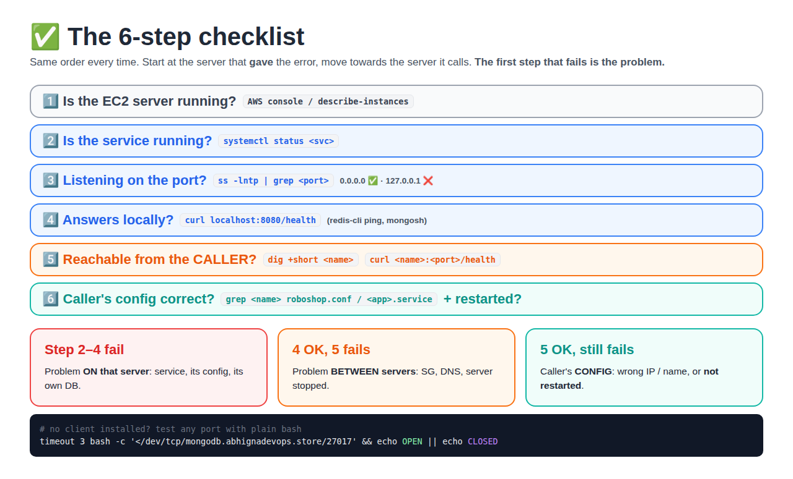

Start at the server that **gave** the error and work towards the server it calls.

| Step | Question | Command | Where |
|------|----------|---------|-------|
| 1 | Is the **EC2 server** running? | AWS console, or `aws ec2 describe-instances` | Laptop |
| 2 | Is the **service** running? | `systemctl status <svc>` | That server |
| 3 | Is it **listening** on the right port and address? | `ss -lntp \| grep <port>` (`0.0.0.0` = OK, `127.0.0.1` = only local) | That server |
| 4 | Does it answer **locally**? | `curl localhost:8080/health` (or `redis-cli ping`, `mongosh`) | That server |
| 5 | Can the **caller** reach it? (DNS + SG) | `dig +short <name>` then `curl <name>:<port>/health` | **Caller** server |
| 6 | Does the caller's **config** point to the right place? | `grep` the conf / `.service` file | **Caller** server |

**How to read the result:**

```
step 4 fails            → problem is ON that server (service, config, its own DB)
step 4 OK, step 5 fails → problem is BETWEEN servers (SG, DNS, server stopped)
step 5 OK, app fails    → problem is the caller's CONFIG (wrong IP/name, not restarted)
```

Then **read the logs** for the exact reason (section 6).

### Test a port when there is no curl or client

```bash
timeout 3 bash -c '</dev/tcp/mongodb.abhignadevops.store/27017' && echo OPEN || echo CLOSED
```

It works for any port (27017, 6379, 3306, 5672) and needs no extra tool.

Each command used here (`systemctl status`, `ss -lntp`, `telnet`, `nc`, `curl -v`, `dig`) explained in depth, with every output line: [Connection check commands](../connection-check-commands/README.md)

---

## 4. Config files: where they are and what to restart

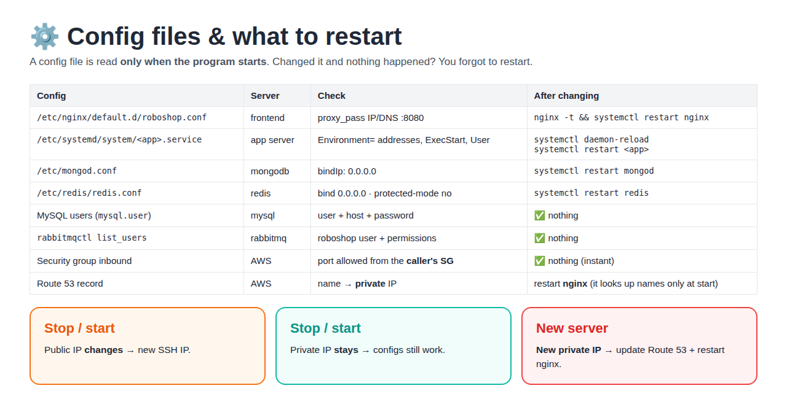

| Config | Server | What to check | After changing it |
|--------|--------|---------------|-------------------|
| `/etc/nginx/default.d/roboshop.conf` | frontend | `proxy_pass` IP/DNS + port 8080 for each `/api/...` | `nginx -t && systemctl restart nginx` |
| `/etc/systemd/system/<app>.service` | each app server | `Environment=` addresses (DB / other services), `ExecStart`, `User` | `systemctl daemon-reload && systemctl restart <app>` |
| `/etc/mongod.conf` | mongodb | `bindIp: 0.0.0.0` | `systemctl restart mongod` |
| `/etc/redis/redis.conf` | redis | `bind 0.0.0.0`, `protected-mode no` | `systemctl restart redis` |
| MySQL users (`mysql.user`) | mysql | user + host + password | nothing (takes effect at once) |
| `rabbitmqctl list_users` | rabbitmq | `roboshop` user + permissions | nothing |
| **Security group** inbound rules | AWS | port from the **caller's SG** | nothing (instant) |
| **Route 53** record | AWS | name → **private** IP | nothing, but **restart nginx** (it looks up names only at start) |

> **Remember:** a config file is read **only when the program starts**. Changed a file and nothing changed? You forgot to restart. A `.service` file also needs `daemon-reload` first.

### What changes after stop / start of an EC2 server?

| | Changes? | Impact |
|---|----------|--------|
| Public IP | **Yes** | SSH with the new IP; frontend public DNS must be updated |
| Private IP | No | Configs using private IP / DNS still work |
| New server (terminated + created) | **New private IP** | Update Route 53 (`roboshop.sh` does it) + restart nginx |

---

## 5. Worked example: `{"message":"service not reachable (502 Bad Gateway from nginx)"}`

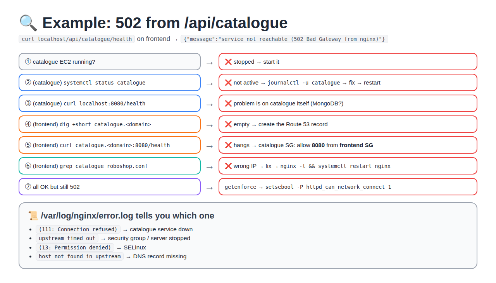

```
curl localhost/api/catalogue/health   (on frontend)  → 502
```

| Step | Run | If it fails → cause → fix |
|------|-----|---------------------------|
| 1 | Is the catalogue EC2 running? | Stopped → start it |
| 2 | (catalogue) `systemctl status catalogue` | Not active → `journalctl -u catalogue` → fix → `systemctl restart catalogue` |
| 4 | (catalogue) `curl localhost:8080/health` | Fails → problem on catalogue itself |
| 5 | (frontend) `dig +short catalogue.abhignadevops.store` | Empty → create the Route 53 record |
| 5 | (frontend) `curl catalogue.abhignadevops.store:8080/health` | Hangs → **catalogue SG** missing inbound 8080 from the **frontend SG** |
| 6 | (frontend) `grep catalogue /etc/nginx/default.d/roboshop.conf` | Wrong IP / still `<CATALOGUE-IP>` → fix → `nginx -t && systemctl restart nginx` |
| - | Steps 5 + 6 OK but still 502 | `getenforce` = Enforcing → `setsebool -P httpd_can_network_connect 1` |

Logs: `tail /var/log/nginx/error.log` shows `connect() failed (111: Connection refused)` = service down, `upstream timed out` = SG, `(13: Permission denied)` = SELinux.

---

## 6. Logs: where to find the exact reason

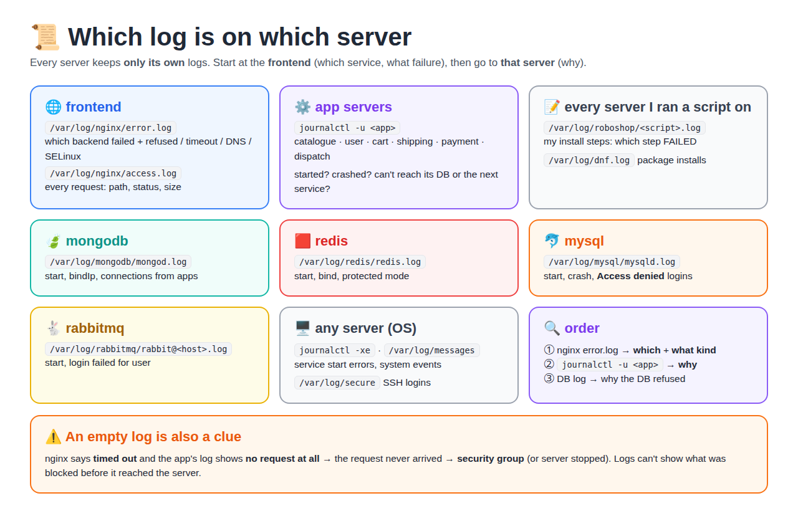

### 6.1 Logs first, checklist second

You **don't** have to test every hop one by one. The logs usually point straight to the problem:

```
① frontend:      /var/log/nginx/error.log   → WHICH service failed + WHAT kind of failure
② that server:   journalctl -u <app>         → WHY (crashed, bad config, can't reach its DB)
③ its DB server: the DB's own log            → why the DB refused (only if ② says DB)
④ checklist (section 3) → only to confirm the fix
```

| Fact | Why it matters |
|------|----------------|
| **Each server keeps only its own logs** | nginx's log never shows why cart crashed; for that, SSH to the cart server |
| **A log shows only what reached that server** | If the SG blocked the request, the app's log is **empty** for it |
| **error.log = why, access.log = what** | access.log only has the status (`502`) and size; error.log has the reason |
| Nothing collects all logs in our lab | In companies a tool collects every server's logs into one place (section 6.8) |

### 6.2 Map: server → log → what you find there

| Server | Log | Command | What you can find |
|--------|-----|---------|-------------------|
| **frontend** | nginx error log | `tail -50 /var/log/nginx/error.log` | Which backend failed and how: refused, timed out, host not found, permission denied (SELinux), bad config at start |
| **frontend** | nginx access log | `tail -50 /var/log/nginx/access.log` | Every request: client IP, method, path, **status**, **size**, page it came from |
| **catalogue / user / cart / payment** (Node.js) | systemd journal | `journalctl -u <app> -n 50` | `started on port 8080`, `MongoDB connected` / `Redis connected`, connection failures, crashes, each request |
| **shipping** (Java) | systemd journal | `journalctl -u shipping -n 100` | Spring Boot start, MySQL connection errors (Java errors are long: read the **first** `Caused by:` line) |
| **dispatch** | systemd journal | `journalctl -u dispatch -n 50` | Connected to RabbitMQ or not, orders it took from the queue |
| **mongodb** | MongoDB log | `tail -50 /var/log/mongodb/mongod.log` | Start errors (bad `mongod.conf`), listening address, **connections from app IPs** |
| **redis** | Redis log | `tail -50 /var/log/redis/redis.log` | Start, `Ready to accept connections`, config errors |
| **mysql** | MySQL error log | `tail -50 /var/log/mysql/mysqld.log` | Start / crash, `ready for connections`, **Access denied** for a user |
| **rabbitmq** | RabbitMQ log | `tail -50 /var/log/rabbitmq/rabbit@$(hostname -s).log` | Start, **login failed** for a user, connections from payment/dispatch |
| **every server** I ran a script on | my script log | `less /var/log/roboshop/<script>.sh.log` | Full output of every step: **which step FAILED** and the real error text |
| **every server** | dnf log | `tail /var/log/dnf.log` | Which packages were installed, repo errors |
| **every server** | OS log | `journalctl -xe` · `tail /var/log/messages` | Why a service failed to start, system events |
| **every server** | security log | `tail /var/log/secure` | SSH logins, `sudo` use |

> Node.js apps don't write a log file. They print to the screen (stdout), and **systemd saves it in the journal**. That's why you read them with `journalctl -u <app>`, not from a file.

### 6.3 frontend: nginx error.log (start here)

```bash
tail -20 /var/log/nginx/error.log
grep upstream /var/log/nginx/error.log | tail       # only backend problems
```

Example line, and how to read it:

```
2026/10/07 08:33:52 [error] 1234#1234: *57 connect() failed (111: Connection refused)
  while connecting to upstream, client: 58.84.62.61, server: _,
  request: "POST /api/cart/add/gk/HPTD/1 HTTP/1.1",
  upstream: "http://172.31.30.55:8080/add/gk/HPTD/1", host: "opsify.online"
```

| Part | Tells you |
|------|-----------|
| `request: "POST /api/cart/..."` | Which **service** (cart) |
| `upstream: "http://172.31.30.55:8080/..."` | Which **IP** nginx actually used (compare with the cart server's private IP) |
| `(111: Connection refused)` | What **kind** of failure |

| Text in error.log | Meaning | Go to next |
|-------------------|---------|------------|
| `(111: Connection refused)` | Server reached, nothing listens on 8080 | That app server: `journalctl -u <app>` |
| `(110: Connection timed out)` / `upstream timed out` | No answer: SG blocks, or server stopped | AWS: SG inbound / EC2 state |
| `(113: No route to host)` | No machine at that IP | DNS record vs current private IP |
| `host not found in upstream "cart.xxx"` | DNS name doesn't resolve (nginx won't even start) | Route 53 / typo in `roboshop.conf` |
| `(13: Permission denied) while connecting to upstream` | SELinux blocks nginx | `setsebool -P httpd_can_network_connect 1` |
| `[emerg] ... in /etc/nginx/default.d/roboshop.conf:12` | Bad config, nginx didn't start | Fix that line → `nginx -t` |

### 6.4 frontend: nginx access.log

```bash
tail -20 /var/log/nginx/access.log
grep '" 50[234] ' /var/log/nginx/access.log | tail     # only 502/503/504 lines
tail -f /var/log/nginx/access.log                       # watch live while you click on the site
```

```
58.84.62.61 - - [07/Oct/2026:08:33:52 +0000] "POST /api/cart/add/gk/HPTD/1 HTTP/1.1" 502 64 "http://opsify.online/product/HPTD" ...
     │                       │                         │                              │   │
  client IP                time                   method + path                   status size
```

- **Status**: 200 OK · 4xx = request problem · 502/504 = nginx ↔ backend problem · 503 = the app says "my DB is down".
- **Size**: `64` = nginx's own 502 JSON → nginx couldn't reach the app. A different size = the **app** answered with its own error (see [8.9](#89-could-not-add-to-cart-502-on-post-apicartadd--a-typo-in-cartservice)).
- No line at all when you click? The browser never reached nginx → frontend SG port 80, public IP, or DNS of the website.

### 6.5 app servers: `journalctl -u <app>`

```bash
journalctl -u cart -n 50                  # last 50 lines
journalctl -u cart -f                     # follow live (Ctrl+C to stop)
journalctl -u cart --since "10 min ago"   # only recent
journalctl -u cart -p err                 # only errors
journalctl -u cart -b                     # since the last boot
systemctl status cart                     # state + last 10 lines
```

What the RoboShop apps print (from the app code) and what it means:

| You see | Meaning | Fix |
|---------|---------|-----|
| `catalogue started on port 8080` / `cart started on port 8080` | App started OK | - |
| `MongoDB connected` / `Redis connected` | DB connection OK | - |
| `MongoDB connection failed, retrying in 2s` | Can't reach MongoDB | `MONGO_URL` in `.service`, mongod running, `bindIp`, mongodb SG 27017 |
| `Redis error` / `Redis initial connect failed` | Can't reach Redis | `REDIS_HOST`, redis running, `bind` + `protected-mode`, redis SG 6379 |
| `catalogue lookup failed` + `ENOTFOUND catalog.xxx` | Cart can't **resolve** the catalogue name | Typo in `CATALOGUE_HOST` → `daemon-reload` + restart |
| `ECONNREFUSED <ip>:<port>` | That IP answers but nothing listens there | Wrong IP (own IP?) or that service is down |
| `ETIMEDOUT <ip>:<port>` | No answer | SG on the target server |
| `Main process exited, code=exited, status=1/FAILURE` | App crashed at start | Read the lines **just above** it |
| `Cannot find module` | Code or `node_modules` missing | Unzip into `/app`, `npm install` |
| `status=203/EXEC` | `ExecStart` path wrong (`/bin/node` not there) | `which node`, fix `ExecStart` |
| `status=217/USER` | `User=roboshop` doesn't exist | `useradd ... roboshop` |
| `Start request repeated too quickly` | Crashed again and again, systemd gave up | Fix the real error above, then `systemctl reset-failed <app>` + restart |

### 6.6 database servers

**mongodb:** `tail -50 /var/log/mongodb/mongod.log` (JSON lines; search for words)

```bash
grep -i "listening on" /var/log/mongodb/mongod.log | tail -2   # 127.0.0.1 = only local, 0.0.0.0 = OK
grep -i "connection accepted" /var/log/mongodb/mongod.log | tail   # which app IPs connected
grep -i error /var/log/mongodb/mongod.log | tail
```

- No "connection accepted" from the catalogue IP, while catalogue says "connection failed" → the request never arrived → **SG** or **bindIp**.

**redis:** `tail -50 /var/log/redis/redis.log`

- `Ready to accept connections` = started OK.
- Apps get `DENIED Redis is running in protected mode` (shown in the **app's** log) → `protected-mode no` + restart redis.

**mysql:** `tail -50 /var/log/mysql/mysqld.log`

- `ready for connections ... port: 3306` = started OK.
- `Access denied for user 'shipping'@'172.31.x.x'` → wrong password, or the user doesn't exist **for that host**.
- `ERROR 2003 (111)` is shown on the **client** side, not here: MySQL never saw that connection.

**rabbitmq:** `tail -50 /var/log/rabbitmq/rabbit@$(hostname -s).log`

- `Server startup complete` = started OK.
- `user 'roboshop' - invalid credentials` / `login refused` → wrong `AMQP_USER`/`AMQP_PASS`, or the user wasn't created.
- `accepting AMQP connection ... (172.31.x.x:...)` → payment/dispatch connected from that IP.

### 6.7 Follow one request across servers (live)

Open **two terminals**, then click "Add to cart" on the website:

```
terminal 1 (frontend):  tail -f /var/log/nginx/access.log /var/log/nginx/error.log
terminal 2 (cart):      journalctl -u cart -f
```

| frontend shows | cart shows | Problem is |
|----------------|------------|------------|
| 200 | the request | ✅ works |
| 502 + `refused` | nothing | cart **service down** |
| 502/504 + `timed out` | nothing | **cart SG** (8080 from frontend SG) or server stopped |
| 502 (app's own size) | `catalogue lookup failed` | cart → **catalogue** (go one hop deeper) |
| 503 | `Redis error` | cart → **redis** |
| nothing at all | nothing | browser → frontend (SG 80, public IP, website DNS) |

**Rule:** the hop where the log lines **stop** is where the problem is.

### 6.8 In real companies: central logging

| Our lab | Companies |
|---------|-----------|
| SSH into each server, `tail` / `journalctl` | An agent on every server ships logs to **one place** |
| Logs lost when a server is terminated | Logs kept for days/months |
| Search one server at a time | Search **all servers at once** (by service, time, request id) |

Tools: **ELK** (Elasticsearch + Logstash/Fluentd + Kibana), **Grafana Loki** + Promtail, **AWS CloudWatch Logs**.

**Does Loki / CloudWatch / ELK replace this guide?** No. They replace the **SSH + tail on each server** part. You still need the **method**:

| With central logging you still... | Because |
|-----------------------------------|---------|
| Follow the **request path** (frontend → app → DB) | Loki shows all logs together; you still must know which hop to read first |
| Read the error text (refused / timeout / ENOTFOUND / Access denied) | Loki **finds** the line; **you** must understand it |
| Notice **missing** lines | A request blocked by an **SG** never reaches the app, so there is **no log** to search |
| Check the **agent** | Logs reach Loki only if Promtail/the agent runs on that server and is configured for that file |
| Run commands to **fix and confirm** | Fixing a typo, an SG rule or a restart still happens on the server or in AWS |

Full picture in real teams: **metrics** (Prometheus/Grafana: *something is wrong*, e.g. 5xx rate up) → **logs** (Loki: *what* and *where*) → **commands/fix** (this guide: *why* + fix).

> The RoboShop nginx config sets `X-Request-Id` on every request. With central logging you search that one id and see the same request in nginx, cart and catalogue logs together.

## 7. Health check per server (copy-paste)

| Server | Command | Good answer |
|--------|---------|-------------|
| mongodb | `mongosh --eval 'db.runCommand({ping:1})'` | `{ ok: 1 }` |
| redis | `redis-cli ping` | `PONG` |
| mysql | `mysql -uroot -pRoboShop@1 -e 'SELECT VERSION();'` | the version |
| rabbitmq | `rabbitmqctl list_users` | `roboshop` in the list |
| catalogue | `curl localhost:8080/health` | `{"app":"OK","mongo":true}` |
| user | `curl localhost:8080/health` | `{"app":"OK","mongo":true,"redis":true}` |
| cart | `curl localhost:8080/health` | `{"app":"OK","redis":true}` |
| shipping | `curl localhost:8080/actuator/health` | `{"status":"UP"}` |
| payment | `curl localhost:8080/health` | `{"app":"OK","rabbitmq":true}` |
| frontend | `curl localhost/api/catalogue/health` | same as catalogue (goes through nginx) |

---

## 8. Real errors from class (screenshot → fix)

Errors classmates got while building RoboShop. For each one: **read the error → which step of the checklist → fix.**

| # | Error | Root cause in one line |
|---|-------|------------------------|
| 1 | 502 from nginx | nginx can't reach the backend |
| 2 | `No route to host` | DNS points to an IP where no server answers |
| 3 | `dnf` EPEL timeout | Can't reach the EPEL mirror on the internet |
| 4 | `curl localhost:8080` refused on frontend | Tested the **wrong server** |
| 5 | MySQL `ERROR 2003 (111)` | Connected to its **own** IP, not the MySQL server |
| 6 | `/health` → `"db":"down"`, `ECONNREFUSED <own-ip>:3306` | `DB_HOST` in the `.service` file points to **itself** |
| 7 | mongod on `127.0.0.1` + `Unit mongodb.service not found` | `bindIp` not changed + wrong service name |
| 8 | `NXDOMAIN` | Domain still has old **parking nameservers** at the registrar |
| 9 | "Could not add to cart" 502 + `CATALOGUE_HOST=catalog...` | nginx can't reach **cart**, and cart has a **typo** in the catalogue name |

### 8.1 `502 Bad Gateway` from nginx

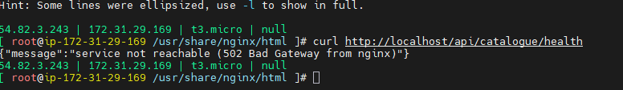

- **Means:** nginx (frontend) is fine; the **backend behind it** is not reachable.
- **Steps:** follow [section 5](#5-worked-example-messageservice-not-reachable-502-bad-gateway-from-nginx) → backend running? → `curl <backend>:8080/health` from frontend → SG → `roboshop.conf` → restart nginx.

### 8.2 `telnet: connect to address 172.31.x.x: No route to host`

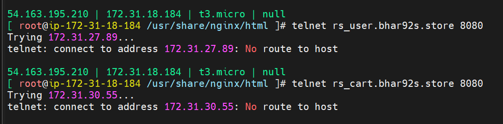

- **Means:** the frontend found an IP in DNS, but **no machine answers** at that IP (different from timeout = SG, and refused = service down).
- **Usual cause:** the user/cart servers were **stopped or terminated and created again** → new private IP, but the DNS record (`rs_user...`, `rs_cart...`) still has the **old IP**. Or a host firewall on the target rejects.
- **Steps:**
  1. `dig +short rs_user.<domain>` on frontend → note the IP.
  2. AWS console → the user instance → is it **running**? is its **private IP the same**?
  3. Different → update the Route 53 record (run `roboshop.sh` again) → `systemctl restart nginx` on frontend.
  4. Same IP and running → on the target: `systemctl status firewalld` (stop it in practice labs).
- **Tip:** use letters, numbers and `-` in DNS names (`user.<domain>`). `_` is allowed in Route 53 but is not a valid hostname character, so some tools refuse it.

### 8.3 `dnf install` → EPEL `Curl error (28): Timeout ... mirrors.fedoraproject.org port 443`

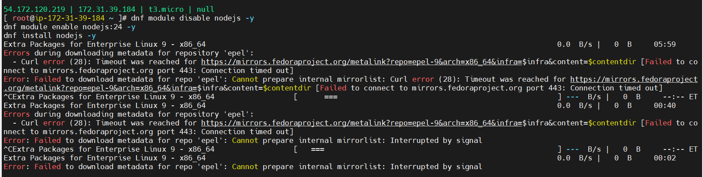

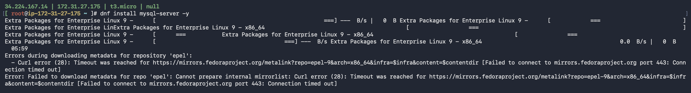

- **Means:** before installing, `dnf` downloads the list of packages from **every enabled repo**. The **EPEL** repo's mirror didn't answer, so `dnf` stopped. It's an **outbound internet** problem, not a RoboShop config problem.
- **Steps:**
  1. Is outbound internet working at all? `curl -I https://google.com`
     - **Fails** → SG **outbound** rule (should allow all), instance has **no public IP**, or private subnet without NAT.
     - **Works** → only the EPEL mirror is slow/blocked right now.
  2. nodejs and mysql-server come from the **RHEL AppStream** repo, not EPEL. So skip EPEL for this install:
     ```bash
     dnf install mysql-server -y --disablerepo=epel
     dnf module enable nodejs:24 -y --disablerepo=epel
     ```
  3. Or retry later / clean the cache: `dnf clean all && dnf makecache`.
- **Don't** wait 6 minutes for every repo: press `Ctrl+C` once you see the first `Curl error (28)`.

### 8.4 `telnet cart... 8080` connected, but `curl localhost:8080/health` refused

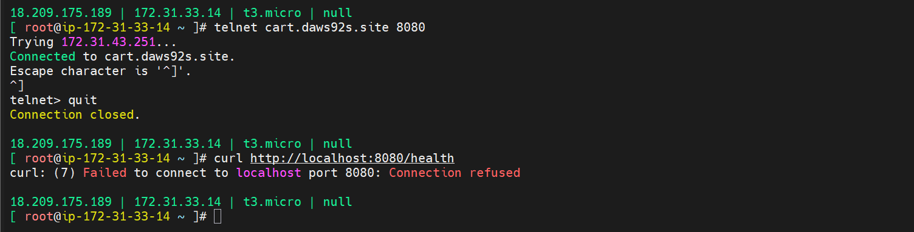

- **Look at the tab name:** this is the **frontend** server. Nothing listens on 8080 **on the frontend**: nginx listens on **80**.
- `telnet cart.<domain> 8080` = **Connected** → cart is up and the SG is fine. ✅
- **Right tests on frontend:**
  ```bash
  curl http://cart.<domain>:8080/health     # frontend → cart directly
  curl http://localhost/api/cart/health     # through nginx (port 80)
  ```
- **Lesson:** `localhost` = **this** server. Run `curl localhost:8080/...` only **on the app server** itself.

### 8.5 MySQL `ERROR 2003 (HY000): Can't connect to MySQL server on '172.31.23.3:3306' (111)`

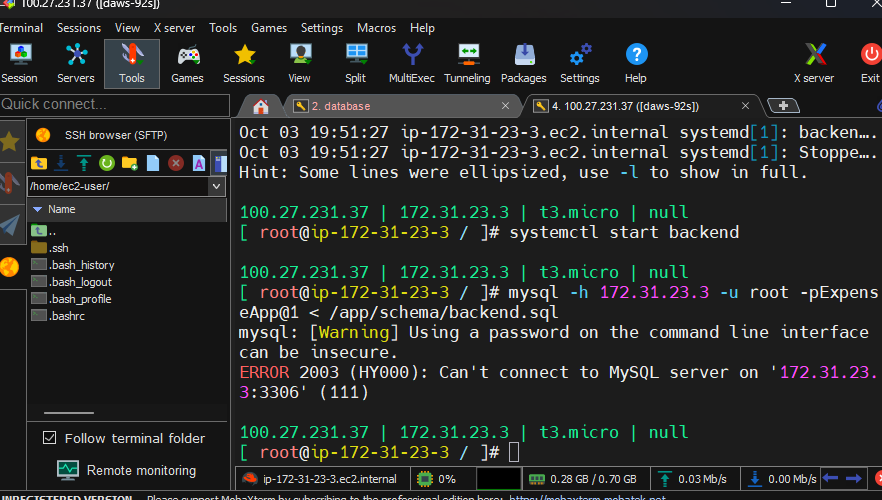

- **Look at the prompt:** `ip-172-31-23-3`, and it connects to `172.31.23.3` = **its own IP**. This is the **backend** server, MySQL isn't installed here → `(111)` = **connection refused**.
- **Fix:** use the **MySQL server's** address: `mysql -h mysql.<domain> -uroot -p... < /app/schema/backend.sql`
- If the address is right and it's still `(111)`: on the MySQL server, `systemctl status mysqld` and `ss -lntp | grep 3306`. `(110)` instead of `(111)` = timeout = **SG** (allow 3306 from the app SG).

### 8.6 `/health` → `{"status":"degraded","db":"down","error":"connect ECONNREFUSED 172.31.45.148:3306"}`

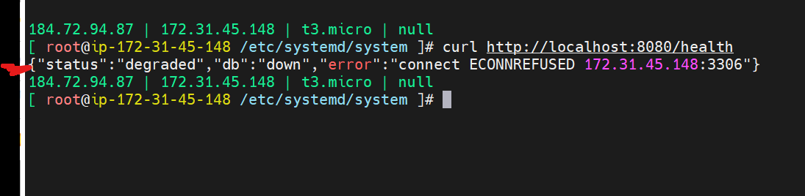

- **Means:** the **app is up** (it answered), but **its DB connection** was refused.
- **Look:** the prompt is `ip-172-31-45-148` and the error is `172.31.45.148:3306` → the app is connecting to **itself**. `DB_HOST` in the `.service` file has the **app's own IP**.
- **Fix:**
  ```bash
  grep DB_HOST /etc/systemd/system/<app>.service      # should be mysql.<domain>
  vim /etc/systemd/system/<app>.service
  systemctl daemon-reload && systemctl restart <app>
  curl http://localhost:8080/health
  ```

### 8.7 mongod listens on `127.0.0.1:27017` + `Unit mongodb.service not found`

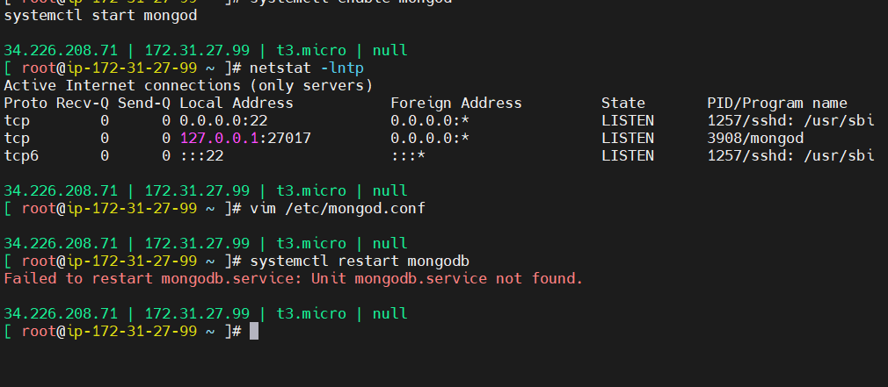

Two mistakes in one screenshot:

| Seen | Problem | Fix |
|------|---------|-----|
| `127.0.0.1:27017` in `netstat -lntp` | MongoDB accepts **only local** connections → catalogue/user get refused | `/etc/mongod.conf`: `bindIp: 0.0.0.0` |
| `Unit mongodb.service not found` | The service is called **`mongod`**, not `mongodb` | `systemctl restart mongod` |

Then check again: `ss -lntp | grep 27017` → must show `0.0.0.0:27017`.

> The restart **failed**, so the old setting (`127.0.0.1`) is still running even though the file was edited.

### 8.8 `nslookup mysql.<domain>` → `NXDOMAIN`, "but Route 53 is fine"

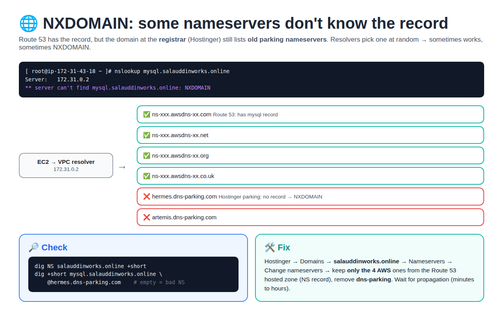

- **Cause:** the domain at **Hostinger** had **6 nameservers**: the 4 AWS ones **plus** 2 old Hostinger parking ones (`hermes.dns-parking.com`, `artemis.dns-parking.com`). The parking ones don't have the records and answer NXDOMAIN. Resolvers pick a nameserver at random → it **sometimes** fails.
- **Check:**
  ```bash
  dig NS <domain> +short                              # must list ONLY the 4 awsdns ones
  dig +short mysql.<domain> @<each-nameserver>        # every one must return the IP
  ```
- **Fix:** Hostinger → Domains → `<domain>` → Nameservers → **Change nameservers** → keep only the **4 NS values from the Route 53 hosted zone**, remove the dns-parking ones. Wait for propagation, then test again.

### 8.9 "Could not add to cart": 502 on `POST /api/cart/add/...` + a typo in `cart.service`

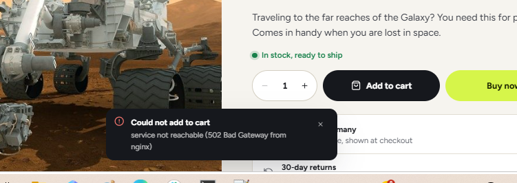

Frontend access log:
```
"POST /api/cart/add/gk/HPTD/1 HTTP/1.1" 502 64 "http://opsify.online/product/HPTD" ...
```

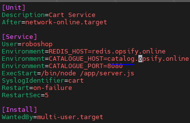

**Two separate problems here. Read the log carefully:**

| Clue | What it tells you |
|------|-------------------|
| `502 64` in the access log | The response body is **64 bytes** = exactly nginx's own `{"message":"service not reachable (502 Bad Gateway from nginx)"}` → **nginx couldn't reach cart** |
| The UI says "...from nginx" | Same: the message came from **nginx**, not from cart |
| If cart had answered with its own 502 | Body would be cart's `{"message":"catalogue not available"}` (cart code: catalogue down/unreachable → 502) |

**Problem 1 (this 502): frontend → cart is broken.** Checklist on the path `nginx → cart:8080`:
```bash
# on cart server
systemctl status cart
curl http://localhost:8080/health                 # {"app":"OK","redis":true}
# on frontend
curl http://cart.opsify.online:8080/health         # hangs = cart SG missing 8080 from frontend SG
grep cart /etc/nginx/default.d/roboshop.conf       # right name/IP? restarted nginx?
tail /var/log/nginx/error.log                      # refused / timed out / host not found
```

**Problem 2 (next error after fixing 1): `CATALOGUE_HOST=catalog.opsify.online`**
- The record is **`catalogue`**, not `catalog`. Cart calls catalogue on **every add** to check the product and stock, so it would fail with `catalogue not available`.
- Check: `dig +short catalog.opsify.online` → empty (NXDOMAIN).
- Fix:
  ```bash
  sed -i 's/catalog\./catalogue./' /etc/systemd/system/cart.service
  systemctl daemon-reload && systemctl restart cart
  curl -i -X POST http://localhost:8080/add/test/RMC/1    # 200 = cart → catalogue works
  ```
- **Lesson:** after editing a `.service` file, `dig` every hostname in it. A typo in a name never shows up as a "typo" error, only as "not reachable".

---

## Interview one-liners

- **502** = the proxy is up, the backend is down or unreachable. **504** = the backend is reached but too slow. **503** = the service itself says "not ready" (often its DB is down).
- **Connection refused** = nothing listens on the port (service down). **Timeout** = a firewall/SG drops the packets.
- Debug **hop by hop** along the request path; the first hop that fails is the problem.
- Config is read **at start**: after changing it, restart (and `daemon-reload` for systemd units).
- Use **DNS names** in configs, not IPs, so a new server only needs a DNS update.
- **No route to host** = no machine answers at that IP (often a stale DNS record after a server was recreated).
- **Read the response size** in the nginx access log: it tells you whether the error body came from nginx or from the app.
- **NXDOMAIN** = the DNS name doesn't exist on the nameserver that was asked; check the registrar's NS list matches the Route 53 hosted zone.
- Each server keeps **its own logs**: nginx's error.log tells you **which** service failed and **how**; that service's `journalctl -u <app>` tells you **why**.
- If the app's log shows **no request at all**, it never arrived: suspect the **security group**.
- **Logs** give the exact reason: `journalctl -u <svc>` for systemd apps, `/var/log/nginx/error.log` for nginx.
