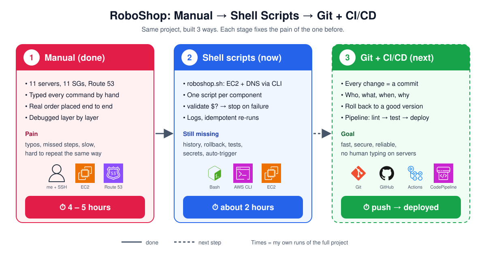

# RoboShop Journey: Manual → Shell Scripts → Git + CI/CD

I built the same project, **RoboShop** (11-server microservices e-commerce app on AWS), in stages.
Each stage showed me the problems of the one before it. This note is the full story: what I built, every error I hit, how I traced it layer by layer, and why each next tool exists.



## Table of Contents

1. [The 3 stages at a glance](#1-the-3-stages-at-a-glance)
2. [Stage 1: Manual build, end to end](#2-stage-1-manual-build-end-to-end)
3. [How I debug: layer by layer](#3-how-i-debug-layer-by-layer)
4. [Manual errors I hit (story + fix)](#4-manual-errors-i-hit-story--fix)
5. [Other errors I studied](#5-other-errors-i-studied)
6. [The real pain of manual work](#6-the-real-pain-of-manual-work)
7. [Stage 2: Automating with shell scripts](#7-stage-2-automating-with-shell-scripts)
8. [Scripting errors I hit (story + fix)](#8-scripting-errors-i-hit-story--fix)
9. [What scripting fixed](#9-what-scripting-fixed)
10. [What scripting still can't solve](#10-what-scripting-still-cant-solve)
11. [Stage 3: Git + CI/CD (next)](#11-stage-3-git--cicd-next)
12. [Lessons](#12-lessons)
13. [Interview Questions](#13-interview-questions)

---

## 1. The 3 stages at a glance

| | Stage 1: Manual | Stage 2: Shell scripts | Stage 3: Git + CI/CD |
|---|---|---|---|
| Status | ✅ Done | 🔄 In progress (01–05 done) | ⏭ Next |
| How | SSH + type every command | `roboshop.sh` + one script per component | Push code → pipeline deploys |
| Time for the project | **4–5 hours** | **about 2 hours** | push → deployed |
| Mistakes | typos, missed steps | fixed once in the script, never again | caught by tests before deploy |
| History / rollback | ❌ none | ❌ files on my laptop | ✅ every change in git |

---

## 2. Stage 1: Manual build, end to end

**What I built**

```
Internet ─► frontend (Nginx) ─► catalogue · user · cart · shipping · payment
                                     │        │      │       │          │
                                 MongoDB   Redis  Redis   MySQL    RabbitMQ ─► dispatch
```

1. Created **11 security groups**, one per server, and opened only the ports each tier needs.
2. Launched **11 EC2 servers** (RHEL 9, t3.micro).
3. Set up the **databases** first: MongoDB, Redis, MySQL, RabbitMQ.
4. Set up the **apps**: catalogue, user, cart (Node.js), shipping (Java), payment (Python), dispatch (Go).
5. Set up the **frontend**: Nginx reverse proxy to every backend.
6. Created **Route 53** records: backends use private IPs under `<name>.abhignadevops.store`, and the root domain points to the frontend.
7. **Tested end to end**: placed 3 real orders (register → cart → shipping → payment → RabbitMQ → dispatch).
8. **Resilience test**: stopped dispatch, placed an order, and watched it wait in the RabbitMQ queue. After restarting dispatch, the order was processed in 0.5 s and nothing was lost.

Full steps: [RoboShop docs](../roboshop-docs/README.md) · [My lab run with screenshots](../roboshop-docs/hands-on/README.md)

---

## 3. How I debug: layer by layer

Every connection problem is in **one** of these layers. I check them in order and stop at the first one that fails.

| # | Layer | Question | Command |
|---|-------|----------|---------|
| 1 | **Right server?** | Am I even on the correct box? | look at the prompt hostname |
| 2 | **DNS** | Does the name resolve to the right IP? | `dig +short mongodb.<domain>` |
| 3 | **Network (SG)** | Is the port open from this server? | `telnet <host> <port>` |
| 4 | **Service running** | Is the process up? | `systemctl status <svc>` |
| 5 | **Listening address** | `127.0.0.1` or `0.0.0.0`? | `ss -tlnp` |
| 6 | **Service config** | bind, protected-mode, env vars | the config / `.service` file |
| 7 | **Logs** | What is the exact reason? | `journalctl -u <svc>`, `/var/log/...` |

**The error text tells me which layer:**

| Error | Layer |
|-------|-------|
| `timeout` | SG / network |
| `connection refused` | service down or listening on `127.0.0.1` |
| `connection opens, then closed` | service config refuses me (e.g. Redis protected-mode) |
| `NXDOMAIN` / `host not found` | DNS |
| `Access denied` | user / password |
| `502 Bad Gateway` | nginx can't reach the backend → check that hop |

More detail: [Debugging guide](../roboshop-debugging-guide/README.md)

---

## 4. Manual errors I hit (story + fix)

### 4.1 User service showed `"redis":false` (the big one)

| | |
|---|---|
| **Symptom** | `curl localhost:8080/health` on user → `{"app":"OK","mongo":true,"redis":false}` |
| **Log** | `journalctl -u user -f` → `Socket closed unexpectedly`, every 2 seconds |

**Layer by layer:**

1. **DNS**: `redis.<domain>` resolved to the right private IP. ✅
2. **SG**: port 6379 was open from user. ✅
3. **Listening**: Redis on `0.0.0.0:6379` (I had changed `bind`). ✅
4. **Error type**: the connection **opened, then got closed**. So it wasn't the network. Redis itself was refusing me.
5. **Config**: `protected-mode yes` was still set. With no password, Redis rejects every client from another server. ❌ **Found it.**

**Fix:**
```bash
sed -i 's/^protected-mode yes/protected-mode no/' /etc/redis/redis.conf
systemctl restart redis                     # restart, NOT start
redis-cli config get protected-mode         # confirm the live value = "no"
systemctl restart user                      # on user → "Redis connected"
```

**Second mistake inside this one:** I first ran `systemctl start redis`. Nothing changed, because `start` does nothing on a running service. A config change needs a **restart**.

**Lesson:** for Redis, change **both** `bind` and `protected-mode`. Full write-up: [Troubleshooting #1](../roboshop-docs/troubleshooting.md#1-user-shows-redisfalse)

### 4.2 Smaller manual mistakes

| # | What happened | Why | Fix / lesson |
|---|---------------|-----|--------------|
| 1 | Launched a server with the wrong OS (RHEL 10 official AMI) | The console defaulted to a different AMI | Re-selected the practice AMI. **Check the AMI on every launch.** |
| 2 | Health check gave `404 route not found` | I was on the **catalogue** server, not **user** | Read the prompt hostname before testing |
| 3 | Payment once showed `rabbitmq:false` (503) | Checked right after start, before it connected | Wait a few seconds, check again: 8/8 OK |
| 4 | Lots of small typos while copy-pasting | Typing the same steps on 11 servers | This is exactly why Stage 2 exists |

---

## 5. Other errors I studied

Real error screenshots I worked through using the same layer-by-layer method:

| # | Error | Layer | Root cause |
|---|-------|-------|------------|
| 1 | `502 Bad Gateway` from nginx | network / service | nginx can't reach the backend |
| 2 | `No route to host` | DNS | Record points to an IP with no server |
| 3 | `dnf` → EPEL `Curl error (28)` timeout | internet | Can't reach the EPEL mirror → `--disablerepo=epel` |
| 4 | `curl localhost:8080` refused on frontend | right server? | Tested the **wrong server** |
| 5 | MySQL `ERROR 2003 (111)` | config | Connected to its **own** IP, not MySQL |
| 6 | `/health` → `"db":"down"`, `ECONNREFUSED <own-ip>:3306` | config | `DB_HOST` in `.service` points to **itself** |
| 7 | mongod on `127.0.0.1` + `Unit mongodb.service not found` | listening + name | `bindIp` not changed; service is `mongod` |
| 8 | `NXDOMAIN` but Route 53 looks fine | DNS | Registrar still has **old nameservers** |
| 9 | "Could not add to cart" 502 | network + config | cart unreachable **and** typo `catalog.` vs `catalogue.` in `cart.service` |

Screenshots + fixes: [Debugging guide §8](../roboshop-debugging-guide/README.md#8-real-errors-from-class-screenshot--fix)

**Pattern:** most of these are **typos or a missed step**, not hard problems. Manual work creates them.

---

## 6. The real pain of manual work

| Pain | What it looked like |
|------|---------------------|
| **Slow** | 4–5 hours for one full build |
| **Typos** | `catalog` vs `catalogue`, wrong IP in `DB_HOST` |
| **Missed steps** | changed `bind`, forgot `protected-mode` |
| **Not repeatable** | Rebuilding = doing everything again from memory |
| **No record** | No log of which command I ran on which server |
| **Doesn't scale** | 11 servers was already tiring; 100 would be impossible |

> After this I understood **why automation exists**: not to look smart, but because humans make the same mistakes again and again.

---

## 7. Stage 2: Automating with shell scripts

Same project, now as code. Repo: [shellscript-roboshop-v1](https://github.com/Abhignadumpala/shellscript-roboshop-v1) · Notes: [Day 15](../day-15-shell-loops-error-handling-aws-cli/README.md), [Day 16](../day-16-roboshop-shell-scripts/README.md)

| Script | What it does | My run time |
|--------|--------------|-------------|
| `roboshop.sh <names>` | Creates EC2 servers + Route 53 records with AWS CLI | – |
| `01-mongodb.sh` | MongoDB install + `bindIp 0.0.0.0` | – |
| `02-redis.sh` | Redis 7 + `bind` **and** `protected-mode no` before first start | **21 s** |
| `03-mysql.sh` | MySQL 8.4 + root password + login check | **40 s** |
| `04-rabbitmq.sh` | Repos + RabbitMQ + app user (idempotent) | **36 s** |
| `05-catalogue.sh` | Node.js, app user, code, service file, load products | **63 s** |
| user, cart, shipping, payment, dispatch, frontend | next | – |

**What every script has:**

1. **Root check**: exit if not run with sudo.
2. **`validate $? "step"`**: prints SUCCESS / FAILED and **stops at the first failure**.
3. **Logs** in `/var/log/roboshop/<script>.log` with timestamps and `[INFO]` / `[ERROR]`.
4. **Idempotent**: checks before creating (`id roboshop`, `list_users | grep -qw`, `countDocuments()` before loading products), so a re-run prints SKIPPING instead of failing.
5. **No hard-coded values**: `DOMAIN_NAME` placeholder + `sed`, and `script_dir` to find its own files.
6. **Restart at the end**: `systemctl restart <service>` + `validate $?`, so every change from this run is loaded. This is the same `start` vs `restart` lesson as the Redis bug in Stage 1.

> The Redis protected-mode bug from Stage 1 **can't happen again**: the fix is a line in `02-redis.sh`.

---

## 8. Scripting errors I hit (story + fix)

### 8.1 MySQL said SUCCESS, but root login failed

| | |
|---|---|
| **Symptom** | `03-mysql.sh` → all SUCCESS. Then `mysql -uroot -p<password>` → `ERROR 1045 Access denied for 'root'@'localhost'` |

1. The exit code was 0, so `validate` was happy. **Exit code ≠ correct result.**
2. Queried `mysql.user`: `root@'%'` had a password, but `root@localhost` had `authentication_string = ''`.
3. Cause: `mysql_secure_installation --set-root-pass` only set it on `root@'%'`.
4. **Security hole**: anyone on the server had passwordless MySQL root.
5. Fix: `ALTER USER 'root'@'localhost' IDENTIFIED BY '<password>';` + added a **login-check step** to the script.

**Lesson:** validate the **result**, not only the exit code.

### 8.2 `cp catalogue.service` → No such file

| | |
|---|---|
| **Symptom** | `cp: cannot stat 'catalogue.service': No such file or directory` |

1. The script runs `cd /app` before the `cp`.
2. `catalogue.service` is a relative name, so it means "in the current folder", which is now `/app`. The file isn't there.
3. Fix: save the script's own folder **at the top, before any `cd`**:
   ```bash
   script_dir=$(dirname "$(realpath "$0")")
   cp "$script_dir/catalogue.service" /etc/systemd/system/
   ```
4. **My confusion while testing it:** I ran `realpath 05-catalogue.sh` from `interview-questions/` and got a path to a file that doesn't exist. `realpath` just joins the **current folder** + the name; it doesn't search. That's why it has to run at the top, while still in the right folder.

| | `$PWD` | `$(dirname "$(realpath "$0")")` |
|---|---|---|
| Gives | folder **I am in** | folder **the script lives in** |
| Run from another folder | ❌ wrong | ✅ right |

### 8.3 All other scripting errors

| # | Error | Cause | Fix |
|---|-------|-------|-----|
| 1 | AMI ID not found | Practice AMI was rebuilt, old ID gone | Look it up **by name** with `describe-images` |
| 2 | SG ID not found | Copied an ID from another account | Use **my own** SG names |
| 3 | `sh roboshop.sh` printed nothing | No args → `$@` empty → loop ran 0 times | `bash roboshop.sh mongodb` |
| 4 | `-e` printed in output | `sh` on Ubuntu = **dash**, not bash | Run with `bash` |
| 5 | Variable empty | `INSTANCE_ID` set, `$instance_id` used | Bash is case-sensitive |
| 6 | `completed in  seconds` | `$seconds` instead of built-in `$SECONDS` | `$SECONDS` |
| 7 | `r53_record: command not found` | Spaces around `=` | `name="value"`, no spaces |
| 8 | Route 53 got literal `$IP` | Variables don't expand in `'single quotes'` | `"'$IP'"` |
| 9 | `--iam-instance-profile` error | Profile didn't exist | Removed it (servers don't call AWS APIs) |
| 10 | `--instance-ids required` | Swapped run → terminate but kept create args | Separate lookup-by-tag script |
| 11 | 2nd run of rabbitmq script fails | User already exists → non-zero exit | Check first → SKIPPING |
| 12 | `sed: unterminated 's' command` | Missing the 3rd `/` | `s/old/new/` |
| 13 | `cp` still failed | File saved as `" catalogue.service"` (leading space) | `mv` to the right name |
| 14 | Download URL broken | Long lines cut off when pasting | `bash -n script.sh`; `curl -sI <url>` → 200 |
| 15 | Script looked frozen | Output goes to the log; dnf refreshing metadata | `tail -f` the log in a 2nd terminal |
| 16 | CLI stuck on `:` | AWS CLI pager | `q`, or `cli_pager =` in config |
| 17 | 2nd run would load products twice | `master-data.js` ran every time | `countDocuments()` → load only if `0` |
| 18 | Re-run ignored a changed service file | `systemctl start` does nothing on a running service | End every app script with `systemctl restart` + `validate` |

Full table: [Day 16 troubleshooting](../day-16-roboshop-shell-scripts/troubleshooting.md)

**Difference from Stage 1:** each of these I fixed **once**, in the file. In manual work I'd hit the same typo again on the next build.

---

## 9. What scripting fixed

| Manual problem | How the script solves it |
|----------------|--------------------------|
| 4–5 hours | about 2 hours, each component in **21–63 s** |
| Typos | Commands written once, tested, reused |
| Missed steps | Every step is in the file, in order |
| Silent failures | `validate $?` stops at the first failure |
| "What did I run?" | Timestamped log for every step |
| Forgot to restart after a change | `systemctl restart` + `validate` at the end of every app script |
| Re-run breaks things | Idempotent checks → SKIPPING |
| Hard-coded IPs | DNS names + one `domain_name` variable |

---

## 10. What scripting still can't solve

| Problem | Why scripts aren't enough | What fixes it |
|---------|---------------------------|---------------|
| **No history** | Who changed the script, when, and why? Unknown | **Git**: every change is a commit with author + time + message |
| **No rollback** | A bad edit breaks the script; the old version is gone | **Git**: `git revert` / checkout a good version |
| **No team work** | Copies on laptops drift apart | **Git + pull requests**: one source of truth, reviewed changes |
| **Still manual trigger** | I SSH in and run `sudo bash 05-catalogue.sh` | **CI/CD**: push → pipeline runs it |
| **No tests** | Bugs found only after running on a server | **CI**: `shellcheck`, `bash -n`, health checks in the pipeline |
| **Secrets in files** | Passwords sit in the script | **Secrets manager** / pipeline secrets |
| **No audit trail** | Who deployed what to production, when? | **Pipeline logs** + git history |
| **Not truly idempotent everywhere** | I write every `if` check myself | **Ansible / Terraform**: idempotent by design |
| **Server-by-server** | One script per server, run one at a time | Config management / containers |

---

## 11. Stage 3: Git + CI/CD (next)

```
I change a script ─► git commit ─► git push ─► pipeline
                                               ├─ lint   (shellcheck, bash -n)
                                               ├─ test   (health checks)
                                               └─ deploy (runs on the servers)
                                                     │
                     something broke? ◄──────────────┘
                     git revert → pipeline redeploys the last good version
```

| I get | How |
|-------|-----|
| **Fast** | No SSH, no typing: push and it deploys |
| **Secure** | Secrets in the pipeline, not in files; reviewed changes |
| **Reliable** | Tests run before deploy; same steps every time |
| **Traceable** | Who / what / when / why for every change |
| **Recoverable** | Roll back to any previous version |

---

## 12. Lessons

- **Do it manually once.** The errors taught me the layers: DNS, SG, listening address, config, logs. Scripts would have hidden that.
- **The error text points to the layer.** `timeout` = network, `refused` = service, `closed` = config, `NXDOMAIN` = DNS.
- **Exit code 0 doesn't mean it worked.** Check the real result (login, `/health`).
- **Automate what hurt.** Every manual mistake became a line in a script.
- **Each tool fixes the previous tool's pain:** manual → scripts (speed, no typos) → git (history, rollback) → CI/CD (auto, tested, secure).

---

## 13. Interview Questions

**1. Tell me about a project you built.**

I built RoboShop, an 11-server microservices app on AWS: Nginx, Node.js, Java, Python, Go, MongoDB, Redis, MySQL and RabbitMQ, with Route 53 DNS. I first did it fully manually in 4–5 hours and placed real orders end to end. Then I automated it with shell scripts and AWS CLI, one idempotent script per component with logging and failure checks, which brought it to about 2 hours. Next I'm moving it to Git and CI/CD.

**2. Why did you build it manually first?**

To understand every layer. The manual errors (Redis protected-mode, wrong `DB_HOST`, DNS issues) taught me how the pieces connect. Then I knew exactly what the scripts must do.

**3. Describe a hard issue you debugged.**

User `/health` showed `redis:false`. DNS, SG and listening address were all fine. The log said "socket closed", which means the connection opened and then got rejected, so it was Redis config: `protected-mode yes`. I set it to `no`, restarted (not started) Redis, and put the fix into the script.

**4. Your script said SUCCESS but something was wrong. How?**

The MySQL script exited 0, but `root@localhost` had no password. Exit code only says the command ran, not that the result is right. I added a login-check step.

**5. What does `validate $?` do?**

`$?` is the exit code of the last command. `validate` prints SUCCESS / FAILED and exits on failure, so the script stops at the first broken step.

**6. What is idempotency?**

Running the script again gives the same result without errors. I check before creating (`id roboshop`), so a 2nd run says SKIPPING.

**7. Why `script_dir=$(dirname "$(realpath "$0")")`?**

It saves the script's own folder as a full path at the start. A later `cd /app` can't break `cp $script_dir/catalogue.service`.

**8. Scripts work. Why do you need Git and CI/CD?**

Scripts give speed and consistency, but no history, rollback, review, tests, secret handling or automatic triggers. Git gives history + rollback; CI/CD runs tests and deploys on every push.

**9. Manual vs scripts vs CI/CD in one line each?**

Manual = learn, but slow and error-prone. Scripts = fast and repeatable, but still triggered by hand with no history. CI/CD = automatic, tested, traceable and reversible.
