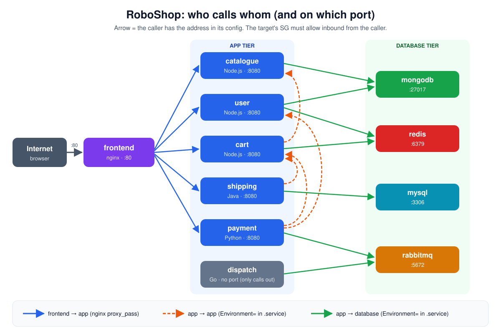

# RoboShop Traffic Flow: Incoming & Outgoing Addresses, Files and SG Rules

All the addresses and firewall rules of RoboShop in one place.
For every server: **who it calls** (outgoing) and **who is allowed to call it** (incoming), side by side.

[← RoboShop docs](../roboshop-docs/README.md) · [Debugging guide](../roboshop-debugging-guide/README.md) · [RoboShop journey](../roboshop-journey/README.md)



## Table of Contents

1. [The 2 rules](#1-the-2-rules)
2. [Outgoing traffic: where I add the address](#2-outgoing-traffic-where-i-add-the-address)
3. [Incoming traffic: where I allow it](#3-incoming-traffic-where-i-allow-it)
4. [One request, every layer](#4-one-request-every-layer)
5. [All connections in one table](#5-all-connections-in-one-table)
6. [Side by side: each server](#6-side-by-side-each-server)
7. [Check one connection](#7-check-one-connection)
8. [Interview Questions](#8-interview-questions)

---

## 1. The 2 rules

| Direction | Question | Where it's set | On which server |
|-----------|----------|----------------|-----------------|
| **Outgoing** | "Where do **I** send requests?" | The app's **config file** (address of the target) | the **caller** |
| **Incoming** | "Who is **allowed** to reach me?" | The **SG inbound rule** + the service's **listen address** | the **target** |

Example: **user → redis**

```
user server                                     redis server
user.service:                                   SG roboshop-redis inbound:
  REDIS_URL="redis://redis.DOMAIN_NAME:6379"  ─►   6379 from roboshop-user
  (outgoing: I know where redis is)             redis.conf:
                                                   bind 0.0.0.0, protected-mode no
                                                   (incoming: I accept user)
```

> Both sides must be right. A correct address with no SG rule → **timeout**. An SG rule with the wrong address → the call goes to the wrong server or **NXDOMAIN**.

---

## 2. Outgoing traffic: where I add the address

### 2.1 Which file, on which server

| Server | File (path on the server) | What I add | Apply the change |
|--------|---------------------------|------------|------------------|
| **frontend** | `/etc/nginx/default.d/roboshop.conf` | `proxy_pass http://<app>.DOMAIN_NAME:8080/;` for each app | `nginx -t` → `systemctl restart nginx` |
| **catalogue** | `/etc/systemd/system/catalogue.service` | `MONGO_URL` | `daemon-reload` → `restart catalogue` |
| **user** | `/etc/systemd/system/user.service` | `REDIS_URL`, `MONGO_URL` | `daemon-reload` → `restart user` |
| **cart** | `/etc/systemd/system/cart.service` | `REDIS_HOST`, `CATALOGUE_HOST`, `CATALOGUE_PORT` | `daemon-reload` → `restart cart` |
| **shipping** | `/etc/systemd/system/shipping.service` | `CART_ENDPOINT`, `DB_HOST` (+ DB user/password) | `daemon-reload` → `restart shipping` |
| **payment** | `/etc/systemd/system/payment.service` | `CART_HOST`, `USER_HOST`, `AMQP_HOST` (+ login) | `daemon-reload` → `restart payment` |
| **dispatch** | `/etc/systemd/system/dispatch.service` | `AMQP_HOST` (+ login) | `daemon-reload` → `restart dispatch` |
| databases | – | Nothing: databases don't call anyone | – |

### 2.2 How the address gets there (with scripts)

```
repo:   user.service  →  REDIS_URL="redis://redis.DOMAIN_NAME:6379"
          │  cp $script_dir/user.service /etc/systemd/system/
          ▼
server: /etc/systemd/system/user.service
          │  sed -i "s/DOMAIN_NAME/$domain_name/g"
          ▼
        REDIS_URL="redis://redis.abhignadevops.store:6379"
          │  Route 53: redis.abhignadevops.store → redis private IP
          ▼
        the app connects to redis
```

1. The repo file has a **placeholder** (`DOMAIN_NAME`), not an IP.
2. The script **copies** it to `/etc/systemd/system/`, then `sed` puts in the real domain.
3. **Route 53** turns `redis.<domain>` into redis's **private IP**.
4. `daemon-reload` + `restart` → the app reads the new values.

> Use **DNS names, not IPs**. If a server is recreated, its IP changes. I only update the Route 53 record, not every config file.

### 2.3 What about the SG **outbound** rules?

| Path in AWS console | Default value | Do I change it? |
|---------------------|---------------|-----------------|
| EC2 → Security Groups → `roboshop-<name>` → **Outbound rules** | All traffic → `0.0.0.0/0` | **No.** Every server may call out to anywhere |

- So for outgoing traffic, the only place I add details is the **config file**.
- SGs are **stateful**: when a request goes out, the reply comes back in automatically. No extra rule is needed for the reply.

---

## 3. Incoming traffic: where I allow it

Incoming needs **2 things** on the **target** server:

1. **SG inbound rule** (AWS): on **every** server
2. **Config file** (on the server): only on **mongodb** and **redis**

### 3.1 Which rule and file, on which server

| Server | SG inbound rule (AWS) | Config file (path on the server) | What I change | Apply the change |
|--------|-----------------------|----------------------------------|---------------|------------------|
| **frontend** | `roboshop-frontend`: 80 from `0.0.0.0/0` | – | nothing | – |
| **catalogue** | `roboshop-catalogue`: 8080 from `roboshop-frontend`, `roboshop-cart` | – | nothing | – |
| **user** | `roboshop-user`: 8080 from `roboshop-frontend`, `roboshop-payment` | – | nothing | – |
| **cart** | `roboshop-cart`: 8080 from `roboshop-frontend`, `roboshop-shipping`, `roboshop-payment` | – | nothing | – |
| **shipping** | `roboshop-shipping`: 8080 from `roboshop-frontend` | – | nothing | – |
| **payment** | `roboshop-payment`: 8080 from `roboshop-frontend` | – | nothing | – |
| **dispatch** | none (nobody calls it) | – | nothing | – |
| **mongodb** | `roboshop-mongodb`: 27017 from `roboshop-catalogue`, `roboshop-user` | `/etc/mongod.conf` | `bindIp: 127.0.0.1` → `0.0.0.0` | `systemctl restart mongod` |
| **redis** | `roboshop-redis`: 6379 from `roboshop-user`, `roboshop-cart` | `/etc/redis/redis.conf` | `bind 0.0.0.0` **and** `protected-mode no` | `systemctl restart redis` |
| **mysql** | `roboshop-mysql`: 3306 from `roboshop-shipping` | – | nothing | – |
| **rabbitmq** | `roboshop-rabbitmq`: 5672 from `roboshop-payment`, `roboshop-dispatch` | – | nothing | – |

Plus on every SG: `22` from **My IP** (SSH). On rabbitmq: `15672` from **My IP** (management UI).

> Why only mongodb and redis need a file change: by default they listen on `127.0.0.1` (only the server itself). The others already listen for other servers. Check with `ss -tlnp`.

### 3.2 How I add the SG rule

**Console path:**

1. **EC2** → **Network & Security** → **Security Groups**
2. Select the **target's** SG, e.g. `roboshop-redis`
3. **Inbound rules** → **Edit inbound rules** → **Add rule**
4. Type **Custom TCP**, Port **6379**
5. Source **Custom** → the **caller's SG**, e.g. `roboshop-user`
6. **Save rules**

**AWS CLI:**

```bash
aws ec2 authorize-security-group-ingress \
  --group-id <roboshop-redis-sg-id> \
  --protocol tcp --port 6379 \
  --source-group <roboshop-user-sg-id>
```

> **Source = the caller's SG, not its IP.** If the server is recreated with a new IP, the rule still works.

---

## 4. One request, every layer

**user → mongodb**, with each layer and where it's configured:

| # | Layer | Where | Path / place | If wrong → error |
|---|-------|-------|--------------|------------------|
| 1 | Address | user server | `/etc/systemd/system/user.service` → `MONGO_URL` | connects to the wrong place |
| 2 | DNS | Route 53 | Hosted zone → record `mongodb.<domain>` → private IP | `ENOTFOUND` / `NXDOMAIN` |
| 3 | SG outbound | AWS | `roboshop-user` → Outbound | (all allowed by default) |
| 4 | SG inbound | AWS | `roboshop-mongodb` → Inbound → 27017 from `roboshop-user` | **timeout** |
| 5 | Listen address | mongodb server | `/etc/mongod.conf` → `bindIp: 0.0.0.0` | **connection refused** |
| 6 | Service up | mongodb server | `systemctl status mongod` | **connection refused** |

---

## 5. All connections in one table

| # | From (caller) | To (target) | Port | Outgoing: set in caller's file | Incoming: SG rule on target | Incoming: config file on target |
|---|---------------|-------------|------|--------------------------------|-----------------------------|---------------------------------|
| 1 | Internet | frontend | 80 | – | `roboshop-frontend`: 80 from `0.0.0.0/0` | – |
| 2 | frontend | catalogue | 8080 | `roboshop.conf` → `/api/catalogue/` | `roboshop-catalogue`: 8080 from `roboshop-frontend` | – |
| 3 | frontend | user | 8080 | `roboshop.conf` → `/api/user/` | `roboshop-user`: 8080 from `roboshop-frontend` | – |
| 4 | frontend | cart | 8080 | `roboshop.conf` → `/api/cart/` | `roboshop-cart`: 8080 from `roboshop-frontend` | – |
| 5 | frontend | shipping | 8080 | `roboshop.conf` → `/api/shipping/` | `roboshop-shipping`: 8080 from `roboshop-frontend` | – |
| 6 | frontend | payment | 8080 | `roboshop.conf` → `/api/payment/` | `roboshop-payment`: 8080 from `roboshop-frontend` | – |
| 7 | catalogue | mongodb | 27017 | `catalogue.service` → `MONGO_URL` | `roboshop-mongodb`: 27017 from `roboshop-catalogue` | `/etc/mongod.conf` → `bindIp: 0.0.0.0` |
| 8 | user | mongodb | 27017 | `user.service` → `MONGO_URL` | `roboshop-mongodb`: 27017 from `roboshop-user` | `/etc/mongod.conf` → `bindIp: 0.0.0.0` |
| 9 | user | redis | 6379 | `user.service` → `REDIS_URL` | `roboshop-redis`: 6379 from `roboshop-user` | `/etc/redis/redis.conf` → `bind 0.0.0.0` + `protected-mode no` |
| 10 | cart | redis | 6379 | `cart.service` → `REDIS_HOST` | `roboshop-redis`: 6379 from `roboshop-cart` | `/etc/redis/redis.conf` → `bind 0.0.0.0` + `protected-mode no` |
| 11 | cart | catalogue | 8080 | `cart.service` → `CATALOGUE_HOST` | `roboshop-catalogue`: 8080 from `roboshop-cart` | – |
| 12 | shipping | cart | 8080 | `shipping.service` → `CART_ENDPOINT` | `roboshop-cart`: 8080 from `roboshop-shipping` | – |
| 13 | shipping | mysql | 3306 | `shipping.service` → `DB_HOST` | `roboshop-mysql`: 3306 from `roboshop-shipping` | – |
| 14 | payment | cart | 8080 | `payment.service` → `CART_HOST` | `roboshop-cart`: 8080 from `roboshop-payment` | – |
| 15 | payment | user | 8080 | `payment.service` → `USER_HOST` | `roboshop-user`: 8080 from `roboshop-payment` | – |
| 16 | payment | rabbitmq | 5672 | `payment.service` → `AMQP_HOST` | `roboshop-rabbitmq`: 5672 from `roboshop-payment` | – |
| 17 | dispatch | rabbitmq | 5672 | `dispatch.service` → `AMQP_HOST` | `roboshop-rabbitmq`: 5672 from `roboshop-dispatch` | – |

Plus on **every** SG: `22` from **My IP** (SSH). On `roboshop-rabbitmq`: `15672` from **My IP** (management UI, optional).

> 📝 **Rule to remember**
>
> - **Outgoing traffic** → I add the target's address in the **caller's config file** (`.service` file or nginx `roboshop.conf`).
> - **Incoming traffic** → I add an **SG inbound rule on every server** that receives traffic.
> - **Config file change for incoming** → **only on mongodb and redis** (they listen on `127.0.0.1` by default). All other servers need only the SG rule.

---

## 6. Side by side: each server

Left = **outgoing** (the addresses this server calls). Right = **incoming** (who may call this server).

### frontend (nginx)

<table>
<tr><th>Outgoing: <code>/etc/nginx/default.d/roboshop.conf</code></th><th>Incoming: SG <code>roboshop-frontend</code></th></tr>
<tr><td>

```nginx
location /api/catalogue/ { proxy_pass http://catalogue.DOMAIN_NAME:8080/; }
location /api/user/      { proxy_pass http://user.DOMAIN_NAME:8080/; }
location /api/cart/      { proxy_pass http://cart.DOMAIN_NAME:8080/; }
location /api/shipping/  { proxy_pass http://shipping.DOMAIN_NAME:8080/; }
location /api/payment/   { proxy_pass http://payment.DOMAIN_NAME:8080/; }
```

</td><td>

```
80   from 0.0.0.0/0   (internet)
22   from My IP
```

</td></tr>
</table>

### catalogue

<table>
<tr><th>Outgoing: <code>/etc/systemd/system/catalogue.service</code></th><th>Incoming: SG <code>roboshop-catalogue</code></th></tr>
<tr><td>

```ini
Environment=MONGO_URL="mongodb://mongodb.DOMAIN_NAME:27017/catalogue"
```

</td><td>

```
8080 from roboshop-frontend
8080 from roboshop-cart
22   from My IP
```

</td></tr>
</table>

### user

<table>
<tr><th>Outgoing: <code>/etc/systemd/system/user.service</code></th><th>Incoming: SG <code>roboshop-user</code></th></tr>
<tr><td>

```ini
Environment=REDIS_URL="redis://redis.DOMAIN_NAME:6379"
Environment=MONGO_URL="mongodb://mongodb.DOMAIN_NAME:27017/users"
```

</td><td>

```
8080 from roboshop-frontend
8080 from roboshop-payment
22   from My IP
```

</td></tr>
</table>

### cart

<table>
<tr><th>Outgoing: <code>/etc/systemd/system/cart.service</code></th><th>Incoming: SG <code>roboshop-cart</code></th></tr>
<tr><td>

```ini
Environment=REDIS_HOST=redis.DOMAIN_NAME
Environment=CATALOGUE_HOST=catalogue.DOMAIN_NAME
Environment=CATALOGUE_PORT=8080
```

</td><td>

```
8080 from roboshop-frontend
8080 from roboshop-shipping
8080 from roboshop-payment
22   from My IP
```

</td></tr>
</table>

### shipping

<table>
<tr><th>Outgoing: <code>/etc/systemd/system/shipping.service</code></th><th>Incoming: SG <code>roboshop-shipping</code></th></tr>
<tr><td>

```ini
Environment=CART_ENDPOINT=cart.DOMAIN_NAME:8080
Environment=DB_HOST=mysql.DOMAIN_NAME
Environment=DB_USER=shipping
Environment=DB_PASSWORD=<password>
```

</td><td>

```
8080 from roboshop-frontend
22   from My IP
```

</td></tr>
</table>

### payment

<table>
<tr><th>Outgoing: <code>/etc/systemd/system/payment.service</code></th><th>Incoming: SG <code>roboshop-payment</code></th></tr>
<tr><td>

```ini
Environment=CART_HOST=cart.DOMAIN_NAME
Environment=CART_PORT=8080
Environment=USER_HOST=user.DOMAIN_NAME
Environment=USER_PORT=8080
Environment=AMQP_HOST=rabbitmq.DOMAIN_NAME
Environment=AMQP_USER=roboshop
Environment=AMQP_PASS=<password>
```

</td><td>

```
8080 from roboshop-frontend
22   from My IP
```

</td></tr>
</table>

### dispatch

<table>
<tr><th>Outgoing: <code>/etc/systemd/system/dispatch.service</code></th><th>Incoming: SG <code>roboshop-dispatch</code></th></tr>
<tr><td>

```ini
Environment=AMQP_HOST=rabbitmq.DOMAIN_NAME
Environment=AMQP_USER=roboshop
Environment=AMQP_PASS=<password>
```

</td><td>

```
22   from My IP
(nobody calls dispatch:
 it pulls orders from RabbitMQ)
```

</td></tr>
</table>

### mongodb

<table>
<tr><th>Listen: <code>/etc/mongod.conf</code></th><th>Incoming: SG <code>roboshop-mongodb</code></th></tr>
<tr><td>

```yaml
net:
  port: 27017
  bindIp: 0.0.0.0     # was 127.0.0.1
```

</td><td>

```
27017 from roboshop-catalogue
27017 from roboshop-user
22    from My IP
```

</td></tr>
</table>

### redis

<table>
<tr><th>Listen: <code>/etc/redis/redis.conf</code></th><th>Incoming: SG <code>roboshop-redis</code></th></tr>
<tr><td>

```
bind 0.0.0.0          # was 127.0.0.1
protected-mode no     # was yes
```

</td><td>

```
6379 from roboshop-user
6379 from roboshop-cart
22   from My IP
```

</td></tr>
</table>

### mysql

<table>
<tr><th>Listen: nothing to change</th><th>Incoming: SG <code>roboshop-mysql</code></th></tr>
<tr><td>

```
listens on all interfaces by default (*:3306)
```

</td><td>

```
3306 from roboshop-shipping
22   from My IP
```

</td></tr>
</table>

### rabbitmq

<table>
<tr><th>Listen: nothing to change</th><th>Incoming: SG <code>roboshop-rabbitmq</code></th></tr>
<tr><td>

```
listens on all interfaces by default (*:5672)
```

</td><td>

```
5672  from roboshop-payment
5672  from roboshop-dispatch
15672 from My IP   (management UI)
22    from My IP
```

</td></tr>
</table>

---

## 7. Check one connection

Run from the **caller**, one layer at a time:

```bash
# on user, testing user → mongodb
grep MONGO_URL /etc/systemd/system/user.service   # 1. right address?
dig +short mongodb.<domain>                       # 2. DNS → private IP?
telnet mongodb.<domain> 27017                     # 3. SG + listen: "Connected" = OK
journalctl -u user -n 50                          # 4. what the app says
```

| `telnet` result | Problem | Fix where |
|-----------------|---------|-----------|
| `Connected` | network is fine | look at the app config / logs |
| hangs, then **timeout** | SG inbound missing | target SG → Inbound rules |
| **Connection refused** | service down or on `127.0.0.1` | target config file + `systemctl status` |
| **Name or service not known** | DNS record missing / typo | Route 53 or the caller's config file |

---

## 8. Interview Questions

**1. Where do you configure outgoing and incoming traffic for a microservice?**

Outgoing = the caller's config (`Environment=` in the `.service` file, or `proxy_pass` in nginx). Incoming = the target's SG inbound rule plus the service's listen address (`bindIp`, `bind`).

**2. Why do you not add SG outbound rules?**

By default an SG allows all outbound traffic, and SGs are stateful, so replies come back automatically. I only control who comes **in**.

**3. Why use another SG as the source instead of an IP?**

IPs change when servers are recreated or scaled. "Allow from `roboshop-user`" works for any server with that SG attached.

**4. Why DNS names in config files instead of IPs?**

When a server is recreated, only the Route 53 record changes. The config files and scripts stay the same.

**5. The SG rule is there but you get `connection refused`. Why?**

The packet reached the server, so the SG is fine. The service is down or listening only on `127.0.0.1`. Check `ss -tlnp` and the config file (`bindIp`, `bind`).

**6. You get a timeout instead. Why?**

The packet never reached the service: usually a missing SG inbound rule on the target.

**7. Which RoboShop server has no inbound app port, and why?**

Dispatch. It doesn't serve requests; it **pulls** orders from RabbitMQ. Only outbound to RabbitMQ is needed.
